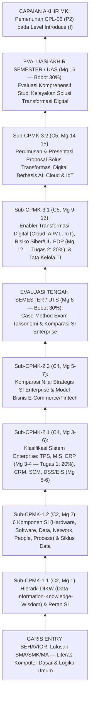

# 055_1 — RENCANA PEMBELAJARAN SEMESTER (RPS)
## STI-101 — PENGANTAR SISTEM DAN TEKNOLOGI INFORMASI (*Introduction to Systems and Information Technology*)

**Program Studi:** S1 Sistem dan Teknologi Informasi (SISTEKIN)  
**Fakultas:** Fakultas Sains dan Teknologi Informasi (FSTI) — Universitas Widyagama Malang  
**Kurikulum:** Kurikulum OBE SISTEKIN 2026 (Semester 1 — Tahap Fondasi)  
**Nomor Dokumen SPMI:** `071030.B4.5.2.RPS-STI101`  
**Tanggal Penyusunan:** 07 November 2026  
**Rujukan Utama:** Template Master RPS Generator FSTI UWG (`Template_RPS_GEN_2026_20092026-SWO.docx` / Dok 052 & 053) · Dok 003 (14 CPL & BoK) · Dok 004 (Matriks Keterlacakan & IRM) · Dok 005 (Struktur 8 Semester) · Dok 007 §3 (Silabus 3-Tabel) · Dok 008 & 018 (Asesmen 4 Titik & Rubrik Klaster) · Dok 043 (Matriks CPL–CPMK–BoK & Boundary Guardrails).  
**Perangkat Pendamping Seri `055`:**  
- `055_2_SAP_STI-101_PENGANTAR_SISTEM_DAN_TEKNOLOGI_INFORMASI_07112026.md` (Satuan Acara Perkuliahan 16 Pertemuan)  
- `055_3_OUTLINE_MODUL_STI-101_PENGANTAR_SISTEM_DAN_TEKNOLOGI_INFORMASI_07112026.md` (Outline Buku Modul Pembelajaran)  
- `055_4_RENCANA_EVALUASI_ASESMEN_STI-101_PENGANTAR_SISTEM_DAN_TEKNOLOGI_INFORMASI_07112026.md` (Rencana Evaluasi & Asesmen OBE)  
- `055_5_RUBRIK_PENILAIAN_STI-101_PENGANTAR_SISTEM_DAN_TEKNOLOGI_INFORMASI_07112026.md` (Rubrik Penilaian OBE)

> [!IMPORTANT]
> **Catatan Anti-Kolisi Kode Kurikulum (AGENTS.md Butir 7):**  
> Dokumen ini berlaku khusus untuk **`STI-101` pada Kurikulum OBE SISTEKIN 2026** berbobot **2 SKS (Teori)**. Pada Kurikulum 2025, kode `STI-101` memiliki bobot berbeda (3 SKS). Pastikan entri kelas dan administrasi nilai di SIAKAD menggunakan kurikulum tahun **2026**.

---

## HALAMAN 1 — SAMPUL & IDENTITAS MATA KULIAH

### A. Blok Sampul Dokumen (Cover — Landscape)
* **Judul Dokumen:** RENCANA PEMBELAJARAN SEMESTER (RPS)
* **Mata Kuliah:** Pengantar Sistem dan Teknologi Informasi (*Introduction to Systems and Information Technology*)
* **Kode Mata Kuliah:** `STI-101` (Kurikulum OBE SISTEKIN 2026)
* **Penyusun:** Tim KBK Sistem Informasi & Tata Kelola (`[PERLU KONFIRMASI: Nama Dosen Koordinator STI-101]` / NUPTK: `[PERLU KONFIRMASI: NUPTK Dosen]`)
* **Institusi:** UNIVERSITAS WIDYAGAMA MALANG — FAKULTAS SAINS DAN TEKNOLOGI INFORMASI
* **Periode Penetapan:** NOVEMBER 2026

### B. Tabel Identitas Mata Kuliah & Otorisasi SPMI

| Atribut Identitas Template (`{{tag}}`) | Spesifikasi Resmi Kurikulum OBE SISTEKIN 2026 |
|---|---|
| **Institusi & UPPS** | Universitas Widyagama Malang — Fakultas Sains dan Teknologi Informasi (FSTI) |
| **Program Studi (`{{prodi}}`)** | S1 Sistem dan Teknologi Informasi (SISTEKIN) |
| **Nomor Dokumen SPMI (`071030.{{kodeprodi}}`)** | `071030.B4.5.2.RPS-STI101` |
| **Mata Kuliah (`{{namamk}}`)** | Pengantar Sistem dan Teknologi Informasi (*Introduction to Systems and Information Technology*) |
| **Kode MK (`{{kodemk}}`)** | `STI-101` |
| **Rumpun MK (`{{rumpunmk}}`)** | Sistem Informasi & Tata Kelola (Mata Kuliah Inti Program Studi / *Core STI*) |
| **Bobot SKS (`T={{skst}} P={{sksp}}`)** | **T = 2 SKS, P = 0 SKS** (Total **2 SKS**, Tipe: **Teori**) |
| **Alokasi Waktu Belajar per Pekan** | Tatap Muka (TM) = $2 \times 50' = 100\text{ menit}$ · Penugasan Terstruktur (PT) = $2 \times 60' = 120\text{ menit}$ · Belajar Mandiri (BM) = $2 \times 60' = 120\text{ menit}$ (Total $340\text{ menit/pekan}$ atau $90,67\text{ jam/semester}$) |
| **Semester (`{{sms}}`)** | **Semester 1** (Ganjil — Tahap Fondasi) |
| **Tanggal Penyusunan (`{{tglsusun}}`)** | 07 November 2026 |
| **Matakuliah Prasyarat (`{{mkprasyarat}}`)** | `-` (Tidak Ada — Mata Kuliah Fondasi Semester Pertama) |
| **Status & Nilai Minimal Kelulusan** | Wajib Program Studi · Nilai Minimal Lulus: **C** (Ambang Ketercapaian OBE: $\ge 65,0$ / Kategori B) |
| **Pengembang RPS (`{{pengembangrps}}`)** | Tim KBK Sistem Informasi & Tata Kelola |
| **Koordinator RMK (`{{koordinatormk}}`)** | `[PERLU KONFIRMASI: Nama Koordinator RMK Sistem Informasi & Tata Kelola]` |
| **Ketua Program Studi (`{{ketuaprodi}}`)** | `[PERLU KONFIRMASI: Nama Ketua Prodi SISTEKIN]` *(Ref. Dok 054: Ahmad Fairuzabadi, S.Kom., M.Kom.)* |
| **Dosen Pengampu (`{{dosenpengampu}}`)** | 1. `[PERLU KONFIRMASI: Nama Dosen Pengampu 1]` (Koordinator MK) 2. `[PERLU KONFIRMASI: Nama Dosen Pengampu 2]` (Kelas Paralel) |

---

## HALAMAN 2 — CAPAIAN PEMBELAJARAN, KORELASI, DESKRIPSI, BAHAN KAJIAN & PUSTAKA

### 1. Capaian Pembelajaran Lulusan (CPL-PRODI) yang Dibebankan pada MK (`[nocpl]` & `[cpl]`)

Merujuk **Dokumen 003** (rumusan verbatim), **Dokumen 004 Bagian 0 & Tabel 3.1** (kode baku `CPL-XX`, level penguasaan **IRM = `I` / *Introduce***), serta **Dokumen 043**:

| Kode Baku CPL | Alias Kategori | Rumusan Resmi CPL (Verbatim Dokumen 003) | Target Bloom CPL | Posisi IRM di MK Ini | Profil Lulusan & PEO Didukung |
|:---:|:---:|---|:---:|:---:|---|
| **`CPL-06`** | **`P2`** | Menguasai konsep teoretis sistem informasi, analisis & perancangan sistem, arsitektur enterprise, metodologi pengembangan perangkat lunak, serta proses bisnis organisasi untuk transformasi digital. | **C4** (*Analyze*) | **`I`** (*Introduce*) | Seluruh Profil Lulusan (`PL-1`, `PL-2`, `PL-3`, `PL-4`) · `PEO-1` & `PEO-2` |

### 2. Capaian Pembelajaran Mata Kuliah (CPMK) — Format ABCD & Level Bloom (`[nocpmk]` & `[cpmk]`)

Rumusan **verbatim** dari **Dokumen 043** dan **Dokumen 007 Tabel 3.B** (3 CPMK berjenjang C2 → C4 → C5):

| Kode CPMK | Rumusan Capaian Pembelajaran Mata Kuliah (Format ABCD) | Level Bloom | CPL Didukung |
|:---:|---|:---:|:---:|
| **`CPMK-1`** | Mahasiswa (*A*) mampu **menguraikan** komponen pembentuk sistem informasi, siklus data-ke-informasi, dan perannya dalam organisasi (*B*) melalui studi kasus bisnis (*C*) secara komprehensif (*D*). | **C2** (*Understand*) | `CPL-06` (`P2`) |
| **`CPMK-2`** | Mahasiswa (*A*) mampu **membandingkan** jenis-jenis sistem informasi enterprise (TPS, MIS, DSS, ERP, CRM, SCM) (*B*) pada ekosistem industri modern (*C*) dengan analisis komparasi yang valid (*D*). | **C4** (*Analyze*) | `CPL-06` (`P2`) |
| **`CPMK-3`** | Mahasiswa (*A*) mampu **merumuskan** usulan solusi transformasi digital berbasis AI, Cloud, dan IoT (*B*) terhadap permasalahan proses bisnis konvensional (*C*) secara etis dan layak bisnis (*D*). | **C5** (*Evaluate*) | `CPL-06` (`P2`) |

### 3. Kemampuan Akhir Tiap Tahapan Belajar (Sub-CPMK) (`[nosubcpmk]` & `[subcpmk]`)

Rumusan **verbatim** dari **Dokumen 043** (6 Sub-CPMK operasional selaras *In-Scope Boundary Guardrails*):

| Kode Sub-CPMK | Rumusan Kemampuan Akhir Tahapan Belajar (Kompetensi Spesifik) | Induk CPMK | Level Bloom | Rentang Pekan |
|:---:|---|:---:|:---:|:---:|
| **`Sub-CPMK-1.1`** | Membandingkan konsep data, informasi, dan pengetahuan (DIKW) serta perannya dalam organisasi. | `CPMK-1` | **C2** | Pekan 1 |
| **`Sub-CPMK-1.2`** | Mengidentifikasi komponen pembentuk sistem informasi dan siklus data-ke-informasi pada studi kasus bisnis. | `CPMK-1` | **C2** | Pekan 2–3 |
| **`Sub-CPMK-2.1`** | Mengklasifikasikan sistem enterprise (TPS, MIS, DSS, ERP, CRM, SCM) berdasarkan fungsi dan penggunanya. | `CPMK-2` | **C4** | Pekan 3–6 |
| **`Sub-CPMK-2.2`** | Membandingkan peran dan nilai tiap tipe sistem informasi dalam ekosistem industri modern. | `CPMK-2` | **C4** | Pekan 5–7 |
| **`Sub-CPMK-3.1`** | Menganalisis permasalahan proses bisnis konvensional yang layak ditransformasi digital. | `CPMK-3` | **C5** | Pekan 9–13 |
| **`Sub-CPMK-3.2`** | Merumuskan usulan solusi transformasi digital berbasis AI, Cloud, dan IoT secara etis dan layak bisnis. | `CPMK-3` | **C5** | Pekan 14–16 |

### 4. Peta Analisis Pembelajaran (*Instructional Analysis* — Standar KPT 2024)

### 5. Matriks Korelasi CPL terhadap CPMK & Bobot Penilaian (`[tabelkolerasi]`)

Mengacu **Dokumen 008 §2** (Skema Baku 4x Evaluasi MK Teori: `20% + 30% + 20% + 30% = 100%`) dan **Dokumen 018** (Klaster K-4 — Sintesis & Sistem Informasi):

| Kode CPMK | `CPL-06` (`P2`) (%) | Bobot Penilaian (%) | Jumlah Minggu | Instrumen & Titik Asesmen Sumatif | Metode Dominan (IKU 7) |
|:---:|:---:|:---:|:---:|---|---|
| **`CPMK-1`** | 20% | **20%** | 3 Minggu (Mg 1–3) | **Tugas 1** (Pekan 4 — 20%): Analisis Kasus Komponen SI & Siklus DIKW | *Case Method* (20%) |
| **`CPMK-2`** | 30% | **30%** | 5 Minggu (Mg 4–8) | **UTS** (Pekan 8 — 30%): Ujian Tertulis Analitik Taksonomi SI Enterprise | Ujian Kasus Terjadwal |
| **`CPMK-3`** | 50% | **50%** | 8 Minggu (Mg 9–16) | **Tugas 2** (Pekan 12 — 20%): Paper Analisis Kasus Risiko Siber & Proses Bisnis **UAS** (Pekan 16 — 30%): Naskah & Pertahanan Studi Kelayakan Transformasi Digital | *Case Method* (20%) + *Team-Based Project Proposal* (30%) |
| **TOTAL** | **100%** | **100%** | **16 Minggu** | **4 Titik Evaluasi Baku = 100%** | **Bobot Partisipatif/Kasus/Proyek (IKU 7) = 70% ($\ge 50\%$)** |

### 6. Deskripsi Singkat Mata Kuliah (`{{deskripsimk}}`)

Mata kuliah **Pengantar Sistem dan Teknologi Informasi (`STI-101`)** merupakan mata kuliah wajib inti program studi (*Core STI*) berbobot 2 SKS Teori pada Semester 1 yang meletakkan fondasi konseptual dan pandangan makro (*helicopter view*) disiplin Sistem dan Teknologi Informasi bagi mahasiswa baru. Perkuliahan ini membekali mahasiswa dengan pemahaman utuh mengenai hierarki data–informasi–pengetahuan–kebijaksanaan (*DIKW*), enam komponen sosio-teknis pembentuk sistem informasi (*hardware, software, data, network, people, process*), serta analisis komparatif berbagai tipe sistem informasi organisasi dan enterprise modern yang mencakup *Transaction Processing Systems* (TPS), *Management Information Systems* (MIS), *Enterprise Resource Planning* (ERP), *Customer Relationship Management* (CRM), *Supply Chain Management* (SCM), *Decision Support Systems* (DSS), hingga ekosistem *e-commerce* dan *fintech*. Pada paruh kedua semester, selaras dengan visi keilmuan SISTEKIN 2045 sebagai integrator kecerdasan artifisial pada sistem nyata dan *technopreneurship*, mahasiswa mengkaji pilar teknologi penggerak transformasi digital (*Cloud Computing*, *Applied AI/Machine Learning*, *Internet of Things*), prinsip keamanan informasi (*CIA Triad* & UU Pelindungan Data Pribadi), serta pengantar tata kelola TI (COBIT), yang bermuara pada perumusan usulan solusi transformasi digital atas permasalahan proses bisnis konvensional secara etis dan layak bisnis. Sesuai *Boundary Guardrails* Dokumen 043, mata kuliah ini berfokus pada tataran konseptual-arsitektural dan nilai bisnis TI tanpa koding teknis, serta menyerahkan implementasi algoritma ke `FST-102`, infrastruktur perangkat keras ke `STI-103`, dan pemodelan sistem ke `STI-306`.

### 7. Pagar Pembatas Materi (*Boundary Guardrails* — Verbatim Dokumen 043)

| Lapisan Guardrail | Ketentuan Wajib Dosen Pengampu & Audit GPM |
|---|---|
| 🟢 **IN-SCOPE (Wajib Diajarkan)** | Konsep data–informasi–pengetahuan (DIKW); 6 komponen pembentuk SI & siklus data-ke-informasi; sistem informasi enterprise (TPS, MIS, DSS, ERP, CRM, SCM) & model bisnis digital (*e-commerce/fintech*); nilai strategis TI & literasi transformasi digital organisasi berbasis AI, Cloud, dan IoT; pengantar tata kelola TI & keamanan siber/privasi data. |
| ❌ **OUT-OF-SCOPE (Dilarang Diajarkan)** | ❌ Dilarang mengajarkan koding pemrograman aplikasi atau algoritma pemrograman terperinci (milik `FST-102`); analisis kompleksitas algoritma teknis mendalam (`FST-203`); perancangan skema basis data fisik/SQL (`FST-207`); perancangan arsitektur cloud teknis (`STI-417`); *penetration testing* (`STI-519`/`STB-501`); serta konfigurasi desain jaringan rute (`STI-312`). |
| 🔄 **HANDOFF ANCHOR (Titik Serah Terima)** | Membangun wawasan makro sistem dan teknologi informasi serta konteks proses bisnis organisasi; menyerahkan pengembangan koding dasar ke `FST-102`, fondasi infrastruktur perangkat keras ke `STI-103`, serta implementasi teknis pemodelan analisis dan perancangan sistem informasi (UML/BPMN/SRS) ke `STI-306` pada Semester 3. |

### 8. Bahan Kajian / Materi Pembelajaran (`{{bahankajian}}`)

**Rujukan Body of Knowledge (BoK) APTIKOM (Dokumen 003 & 043):**
1. **`BK-IS01` — *Foundations of Information Systems*** *(BoK Primer IS2020)*: Konsep fundamental SI, komponen sosio-teknis, peran strategis SI pada organisasi, dan taksonomi sistem informasi enterprise.
2. **`BK-IS15` — *Digital Innovation and Entrepreneurship*** *(BoK Pendukung IS2020 — Dok 043 Per-Semester)*: Model bisnis digital, inovasi proses bisnis, dan kelayakan inisiatif transformasi digital.
3. **`BK-IT01` — *Information Technology Fundamentals*** *(BoK Pendukung IT2017 — Dok 043 Utama)*: Ikhtisar ekosistem teknologi komputasi awan, AI, IoT, keamanan informasi, dan tata kelola TI.

**Daftar 14 Pokok Bahasan Mingguan (Backbone Dokumen 007 Tabel 3.C):**
1. Hakikat Sistem Informasi, Hierarki Data–Informasi–Pengetahuan–Wisdom (DIKW), dan Peran Strategis SI pada Organisasi Modern `[Sub-CPMK-1.1]`
2. Enam Komponen Sosio-Teknis Sistem Informasi (*Hardware, Software, Data, Network, People, Process*) dan Siklus Hidup Data-ke-Informasi `[Sub-CPMK-1.2]`
3. Sistem Informasi Operasional dan Manajerial: *Transaction Processing Systems* (TPS) & *Management Information Systems* (MIS) `[Sub-CPMK-2.1]`
4. Integrasi Proses Bisnis Lintas Fungsi: *Enterprise Resource Planning* (ERP), Modul Inti Bisnis, dan Tantangan Implementasi `[Sub-CPMK-2.1]`
5. Ekosistem Relasi Eksternal Enterprise: *Customer Relationship Management* (CRM) & *Supply Chain Management* (SCM) `[Sub-CPMK-2.1, Sub-CPMK-2.2]`
6. Dukungan Keputusan Eksekutif: *Decision Support Systems* (DSS), *Business Intelligence* Pengantar, & *Executive Information Systems* (EIS) `[Sub-CPMK-2.1, Sub-CPMK-2.2]`
7. Ekosistem Ekonomi Digital: *E-Commerce* (B2B, B2C, C2C), *Fintech*, Platform Multi-Sisi, dan Model Monetisasi Digital `[Sub-CPMK-2.2]`
8. Pilar Infrastruktur Modern: Konsep *Cloud Computing* (IaaS, PaaS, SaaS), Virtualisasi Layanan, dan Efisiensi Belanja TI (CAPEX vs OPEX) `[Sub-CPMK-3.1]`
9. Kecerdasan Artifisial Terapan dalam Bisnis: Peran *Artificial Intelligence* (AI), *Machine Learning*, dan Otomasi Cerdas pada Sistem Informasi `[Sub-CPMK-3.1]`
10. Sistem Fisik-Siber: *Internet of Things* (IoT), Jaringan Sensor Cerdas, *Smart Campus*, dan Ekosistem Industri 4.0 `[Sub-CPMK-3.1]`
11. Ketahanan Informasi & Etika Privasi: Ancaman Siber Modern, Prinsip *CIA Triad*, Etika AI, dan Kepatuhan UU Pelindungan Data Pribadi (UU PDP) `[Sub-CPMK-3.1]`
12. Pengantar Tata Kelola & Keselarasan TI Organisasi: Konsep *IT Governance*, Penyelarasan Bisnis–TI (*Business-IT Alignment*), dan Ikhtisar Kerangka COBIT `[Sub-CPMK-3.1]`
13. Metodologi Perumusan Solusi Transformasi Digital: Identifikasi *Pain Points* Bisnis Konvensional, Analisis Kelayakan TELOS, dan *Value Proposition* TI `[Sub-CPMK-3.2]`
14. Sintesis & Komunikasi Solusi: Penyajian Gagasan Inovasi Sistem Informasi Cerdas Terintegrasi bagi Organisasi/UMKM `[Sub-CPMK-3.2]`

### 9. Daftar Pustaka (`[pustakautama]` & `[pustakapendukung]`)

> *Catatan Status (Dok 053 T3): Daftar pustaka di bawah merupakan komposisi referensi standar internasional IS2020/APTIKOM dan regulasi nasional relevan — perlu validasi ketersediaan koleksi perpustakaan oleh KBK/GPM.*

**Pustaka Utama (`[pustakautama]`):**
1. Laudon, K. C., & Laudon, J. P. (2022). *Management Information Systems: Managing the Digital Firm* (17th ed.). Harlow: Pearson Education.
2. Stair, R. M., & Reynolds, G. W. (2021). *Principles of Information Systems* (14th ed.). Boston: Cengage Learning.
3. Rainer, R. K., Prince, B., & Watson, H. J. (2022). *Introduction to Information Systems* (9th ed.). Hoboken: John Wiley & Sons.
4. O'Brien, J. A., & Marakas, G. M. (2019). *Management Information Systems* (11th ed.). New York: McGraw-Hill Education.

**Pustaka Pendukung (`[pustakapendukung]`):**
5. Turban, E., Pollard, C., & Wood, G. (2021). *Information Technology for Management: Driving Digital Transformation to Increase Local and Global Performance, Growth and Sustainability* (12th ed.). Hoboken: John Wiley & Sons.
6. Westerman, G., Bonnet, D., & McAfee, A. (2014). *Leading Digital: Turning Technology into Business Transformation*. Boston: Harvard Business Review Press.
7. Republik Indonesia. (2022). *Undang-Undang Republik Indonesia Nomor 27 Tahun 2022 tentang Pelindungan Data Pribadi (UU PDP)*. Jakarta: Sekretariat Negara RI.
8. ISACA. (2018). *COBIT 2019 Framework: Introduction and Methodology*. Rolling Meadows, IL: ISACA.
9. ACM & AIS. (2021). *IS2020: A Competency Model for Undergraduate Programs in Information Systems*. New York: Association for Computing Machinery (ACM) & Association for Information Systems (AIS).

---

## HALAMAN 3–4 — MATRIKS RENCANA PEMBELAJARAN 16 PEKAN (8 KOLOM BAKU)

| Mg ke- `(1)` | Kemampuan Akhir Tiap Tahapan Belajar (Sub-CPMK) `(2)` | Penilaian: Indikator `(3)` | Penilaian: Kriteria & Teknik `(4)` | Bentuk, Metode Pembelajaran & Penugasan Mahasiswa [Estimasi Waktu] — Luring (Offline) `(5)` | Bentuk, Metode Pembelajaran & Penugasan Mahasiswa — Daring (Online) `(6)` | Materi Pembelajaran [Pustaka] `(7)` | Bobot Penilaian (%) `(8)` |
|:---:|---|---|---|---|---|---|:---:|
| **1** | **Sub-CPMK-1.1:** Membandingkan konsep data, informasi, dan pengetahuan (DIKW) serta perannya dalam organisasi (C2) | 1.1.1 Ketepatan membedakan data mentah, informasi kontekstual, pengetahuan, dan kebijaksanaan (DIKW) beserta contohnya. 1.1.2 Ketepatan menjelaskan peran strategis SI dalam efisiensi operasional dan keunggulan kompetitif organisasi. | **Kriteria:** Rubrik pemahaman konsep formatif. **Teknik:** Non-tes (diskusi kelas & peta konsep mini); kuis diagnostik awal. | **Kuliah Interaktif & Diskusi Terbimbing** `[TM: 2x50' = 100']` Tugas baca & refleksi kasus transformasi organisasi: `[PT: 2x60' = 120']` `[BM: 2x60' = 120']` | LMS Edlink: kontrak belajar, unduh RPS, kuis diagnostik 10 soal pilihan ganda mengenai literasi SI. | Kontrak Perkuliahan, Visi SISTEKIN 2045, Konsep Dasar Sistem Informasi, Hierarki Data-to-Knowledge (DIKW), & Peran SI dalam Organisasi `[1] Bab 1; [2] Bab 1` | — |
| **2** | **Sub-CPMK-1.2:** Mengidentifikasi komponen pembentuk sistem informasi dan siklus data-ke-informasi pada studi kasus bisnis (C2) | 1.2.1 Ketepatan mengidentifikasi 6 komponen utama SI (*Hardware, Software, Data, Network, People, Process*) pada studi kasus organisasi nyata. 1.2.2 Ketepatan memetakan alur *input–processing–output–feedback* dalam siklus informasi bisnis. | **Kriteria:** Checklist kelengkapan pemetaan 6 komponen SI. **Teknik:** Non-tes (latihan identifikasi kasus UMKM/kampus). | **Ceramah Interaktif & *Small Group Discussion*** `[TM: 2x50' = 100']` Latihan pemetaan 6 komponen SI pada unit layanan nyata: `[PT: 2x60' = 120']` `[BM: 2x60' = 120']` | LMS Edlink: unggah lembar kerja pemetaan komponen SI; diskusi asinkron tentang kegagalan faktor *People & Process*. | Enam Komponen Sosio-Teknis Sistem Informasi (*Hardware, Software, Data, Network, People, Process*) & Siklus Pengolahan Data-ke-Informasi `[1] Bab 1–2; [3] Bab 1` | — |
| **3** | **Sub-CPMK-2.1:** Mengklasifikasikan sistem enterprise (TPS dan MIS) berdasarkan fungsi dan penggunanya (C4) | 2.1.1 Ketepatan menganalisis karakteristik, pengguna, input, dan output *Transaction Processing Systems* (TPS). 2.1.2 Ketepatan menguraikan bagaimana *Management Information Systems* (MIS) mengagregasi data TPS menjadi laporan manajerial periodik. | **Kriteria:** Rubrik analisis studi kasus formatif. **Teknik:** Non-tes (*Case Method* analisis alur kasir/inventori ke laporan manajer). | ***Case Method Class*** `[TM: 2x50' = 100']` Analisis studi kasus alur transaksi ritel ke pelaporan manajemen: `[PT: 2x60' = 120']` `[BM: 2x60' = 120']` | LMS Edlink: studi kasus ritel modern & rilis instruksi **RTM-1 (Tugas 1)** untuk dikumpulkan Pekan 4. | Sistem Informasi Operasional & Manajerial: *Transaction Processing Systems* (TPS), *Batch vs Real-Time Processing*, & *Management Information Systems* (MIS) `[1] Bab 2; [2] Bab 5` | — |
| **4** | **Sub-CPMK-2.1:** Mengklasifikasikan integrasi *Enterprise Resource Planning* (ERP) berdasarkan modul bisnis dan arsitekturnya (C4) | 2.1.3 Ketepatan menganalisis masalah *information silos* pada organisasi fungsional. 2.1.4 Ketepatan memetakan integrasi modul inti ERP (Keuangan, SDM, Produksi, Pengadaan) melalui basis data terpusat. *(Sekaligus evaluasi sumatif Sub-CPMK-1.1 & 1.2 melalui Tugas 1)*. | **Kriteria:** **Rubrik Analitik Tugas 1** (lihat Lampiran 1 / Dok `055_5`). **Teknik:** Penugasan pemecahan kasus tertulis (*Case-Based Problem Solving*) + kuis konseptual. | ***Case-Based Learning* & Diskusi Pleno** `[TM: 2x50' = 100']` Penyelesaian & pengumpulan Tugas 1: `[PT: 2x60' = 120']` `[BM: 2x60' = 120']` | LMS Edlink: pengumpulan berkas **Tugas 1** (batas akhir Pekan 4) & kuis singkat modul ERP. | Sistem Enterprise Terintegrasi: Masalah Silo Informasi, Konsep *Enterprise Resource Planning* (ERP), Modul Bisnis Inti (SAP/Odoo), & Tantangan Implementasi `[1] Bab 9; [2] Bab 5` | **Tugas 1: 20%** *(Evaluasi `CPMK-1`: `Sub-CPMK-1.1` & `1.2`)* |
| **5** | **Sub-CPMK-2.1 & Sub-CPMK-2.2:** Mengklasifikasikan dan membandingkan peran *Customer Relationship Management* (CRM) serta *Supply Chain Management* (SCM) (C4) | 2.1.5 Ketepatan membedakan cakupan operasional/analitis CRM (hilir pelanggan) dan SCM (hulu pemasok–logistik). 2.2.1 Ketepatan menganalisis dampak *bullwhip effect* pada rantai pasok dan peran SCM/CRM dalam retensi pelanggan. | **Kriteria:** Rubrik diskusi kasus formatif. **Teknik:** Non-tes (debat terstruktur komparasi kasus manufaktur vs jasa). | ***Case Method Class*** `[TM: 2x50' = 100']` Penyusunan tabel komparasi CRM vs SCM pada perusahaan logistik/manufaktur: `[PT: 2x60' = 120']` `[BM: 2x60' = 120']` | LMS Edlink: materi bacaan studi kasus CRM/SCM global & forum tanya jawab. | Sistem Antarmuka Eksternal Enterprise: *Customer Relationship Management* (CRM — Operasional & Analitik) serta *Supply Chain Management* (SCM) `[1] Bab 9; [3] Bab 10` | — |
| **6** | **Sub-CPMK-2.1 & Sub-CPMK-2.2:** Mengklasifikasikan dan membandingkan *Decision Support Systems* (DSS) serta *Executive Information Systems* (EIS) (C4) | 2.1.6 Ketepatan membedakan keputusan terstruktur, semi-terstruktur, dan tidak terstruktur menurut piramida manajemen. 2.2.2 Ketepatan membandingkan karakteristik MIS, DSS (*what-if analysis*), dan *Executive Dashboard* (EIS). | **Kriteria:** Rubrik observasi analisis kasus formatif. **Teknik:** Non-tes (simulasi pembacaan *executive KPI dashboard* tanpa koding). | **Ceramah Interaktif & Demo Visual Dashboard** `[TM: 2x50' = 100']` Latihan pemetaan kebutuhan informasi 3 level manajemen: `[PT: 2x60' = 120']` `[BM: 2x60' = 120']` | LMS Edlink: eksplorasi contoh *interactive public dashboard* & refleksi tertulis singkat. | Sistem Pendukung Keputusan Manajerial & Strategis: *Decision Support Systems* (DSS), *What-If Analysis*, & *Executive Information Systems* (EIS/KPI Dashboard) `[1] Bab 12; [4] Bab 10` | — |
| **7** | **Sub-CPMK-2.2:** Membandingkan model bisnis digital (*E-Commerce* B2B/B2C/C2C, *Fintech*) dan nilai strategis SI dalam ekosistem industri modern (C4) | 2.2.3 Ketepatan membandingkan model transaksi digital (B2B, B2C, C2C, G2C) dan model pendapatan platform digital. 2.2.4 Ketepatan menyusun matriks sintesis komparasi utuh TPS, MIS, DSS, ERP, CRM, dan SCM sebagai persiapan UTS. | **Kriteria:** Rubrik matriks komparasi formatif. **Teknik:** Non-tes (*Case-Based Learning* pembedahan model bisnis *super-app* Indonesia). | ***Case-Based Learning* & Review Pra-UTS** `[TM: 2x50' = 100']` Penyusunan *cheat-sheet* matriks komparasi 6 sistem enterprise: `[PT: 2x60' = 120']` `[BM: 2x60' = 120']` | LMS Edlink: latihan soal studi kasus persiapan UTS & panduan kisi-kisi UTS. | Ekosistem Bisnis Digital: *E-Commerce* (B2B/B2C/C2C), *Digital Payment/Fintech*, Efek Jaringan Platform, & Matriks Komparasi Utuh Sistem Enterprise `[1] Bab 10; [5] Bab 7` | — |
| **8** | **Evaluasi Tengah Semester (UTS) — Menguji `CPMK-2` (`Sub-CPMK-2.1` & `Sub-CPMK-2.2`) serta keterkaitannya dengan `CPMK-1` (C4)** | **Indikator:** Ketepatan mengklasifikasikan, membandingkan, dan merekomendasikan jenis sistem informasi enterprise (TPS, MIS, DSS, ERP, CRM, SCM) serta model bisnis digital pada skenario kasus perusahaan multi-unit (skor $\ge 65$). **Kriteria & Teknik:** **Rubrik Analitik UTS** (lihat Lampiran 2 / Dok `055_5`); Tes tertulis uraian berbasis studi kasus (*Case-Method Written Exam*, 100 menit). **Luring:** Ujian Tertulis Terjadwal di Ruang Kelas `[100']`. **Daring:** LMS Edlink — pengumuman tata tertib, distribusi pengesahan nilai, & umpan balik pasca-UTS. **Materi:** Seluruh cakupan Pekan 1–7 (DIKW, 6 Komponen SI, TPS, MIS, ERP, CRM, SCM, DSS/EIS, E-Commerce) `[1][2][3]`. | | | | | **UTS: 30%** *(Evaluasi `CPMK-2`)* |
| **9** | **Sub-CPMK-3.1:** Menganalisis peran *Cloud Computing* dan virtualisasi layanan sebagai fondasi transformasi infrastruktur proses bisnis (C4/C5) | 3.1.1 Ketepatan membedakan model layanan *Cloud Computing* (IaaS, PaaS, SaaS) dan model *deployment* (*Public, Private, Hybrid*) dari sudut pandang kebutuhan organisasi. 3.1.2 Ketepatan menganalisis pergeseran biaya modal (CAPEX) ke biaya operasional (OPEX) pada adopsi *cloud*. | **Kriteria:** Rubrik analisis komparasi formatif. **Teknik:** Non-tes (studi kasus migrasi UMKM/rumah sakit dari server lokal ke SaaS). | **Ceramah Interaktif & Diskusi Kasus** `[TM: 2x50' = 100']` Analisis perbandingan opsi SaaS vs *on-premise* bagi organisasi menengah: `[PT: 2x60' = 120']` `[BM: 2x60' = 120']` | LMS Edlink: materi pengantar *cloud economics* & pembentukan kelompok proyek akhir (3–4 mahasiswa/tim). | Komputasi Awan sebagai Penggerak Transformasi TI: Konsep Virtualisasi Layanan, IaaS vs PaaS vs SaaS, *Public/Private/Hybrid Cloud*, & Efisiensi Bisnis `[1] Bab 5; [3] Bab 6` | — |
| **10** | **Sub-CPMK-3.1:** Menganalisis peluang penerapan *Artificial Intelligence* (AI) dan *Machine Learning* pada otomasi dan keputusan proses bisnis (C5) | 3.1.3 Ketepatan memetakan kasus penggunaan (*use cases*) AI/ML (prediksi, klasifikasi, NLP/asisten pelanggan, visi komputer) pada fungsi bisnis nyata. 3.1.4 Ketepatan membedakan otomasi berbasis aturan statis vs sistem cerdas berbasis data tanpa masuk ke rumus algoritma teknis. | **Kriteria:** Rubrik analisis peluang AI formatif. **Teknik:** Non-tes (*Video Case Analysis* & identifikasi masalah bisnis konvensional). | **Ceramah & *Video Case Discussion*** `[TM: 2x50' = 100']` Identifikasi 3 proses bisnis manual di sekitar kampus/Malang Raya yang berpotensi diotomasi AI: `[PT: 2x60' = 120']` `[BM: 2x60' = 120']` | LMS Edlink: kurasi studi kasus integrasi AI industri & rilis instruksi **RTM-2 (Tugas 2)**. | Kecerdasan Artifisial dalam Organisasi Modern: Lanskap *Applied AI*, *Machine Learning*, *Generative AI* untuk Produktivitas Bisnis, & Posisi SISTEKIN sebagai Integrator AI `[1] Bab 11; [5] Bab 12` | — |
| **11** | **Sub-CPMK-3.1:** Menganalisis pemanfaatan *Internet of Things* (IoT) dan *Smart Systems* dalam akuisisi data proses bisnis fisik (C5) | 3.1.5 Ketepatan menguraikan rantai kerja sistem IoT tingkat konseptual (sensor → konektivitas → platform cloud → *actionable dashboard*). 3.1.6 Ketepatan menganalisis manfaat IoT pada efisiensi logistik, agrikultur cerdas, manufaktur, atau *smart campus*. | **Kriteria:** Rubrik analisis arsitektur konseptual formatif. **Teknik:** Non-tes (diskusi kelompok terfokus membedah kasus *smart agriculture/smart retail*). | **Diskusi Interaktif & Studi Kasus** `[TM: 2x50' = 100']` Penyusunan diagram blok konseptual solusi sensor-ke-keputusan bisnis: `[PT: 2x60' = 120']` `[BM: 2x60' = 120']` | LMS Edlink: forum diskusi konvergensi *AI + Cloud + IoT* (*AICloudIoT triad*). | *Internet of Things* (IoT) & *Smart Systems*: Arsitektur Konseptual Sensor-ke-Cloud, Otomasi Pemantauan Fisik, *Smart Campus*, & Industri 4.0 `[2] Bab 8; [3] Bab 9` | — |
| **12** | **Sub-CPMK-3.1:** Menganalisis risiko keamanan siber, prinsip *CIA Triad*, etika digital, dan kepatuhan UU PDP dalam proses bisnis digital (C5) | 3.1.7 Ketepatan mengidentifikasi ancaman siber organisasi (*phishing, ransomware, social engineering, data breach*) pada alur proses bisnis. 3.1.8 Ketepatan mengevaluasi pelanggaran prinsip *Confidentiality, Integrity, Availability* (CIA) dan kewajiban pengendali data menurut UU No. 27 Tahun 2022 (UU PDP). | **Kriteria:** **Rubrik Analitik Tugas 2** (lihat Lampiran 3 / Dok `055_5`). **Teknik:** Penilaian Paper Analisis Studi Kasus (*Case Method Paper*). | ***Case-Based Class* & Bedah Insiden Kebocoran Data** `[TM: 2x50' = 100']` Finalisasi & pengumpulan Paper Analisis Kasus (**Tugas 2**): `[PT: 2x60' = 120']` `[BM: 2x60' = 120']` | LMS Edlink: pengumpulan berkas **Tugas 2** (batas akhir Pekan 12) disertai deklarasi integritas & penggunaan AI. | Keamanan Informasi, Etika Digital, & Privasi Data dalam Transformasi Bisnis: *CIA Triad*, Ancaman *Social Engineering*, Etika AI, & Kepatuhan UU PDP No. 27/2022 `[1] Bab 4 & 8; [7]` | **Tugas 2: 20%** *(Evaluasi `CPMK-3`: `Sub-CPMK-3.1`)* |
| **13** | **Sub-CPMK-3.1:** Menganalisis prinsip tata kelola TI (*IT Governance*) dan keselarasan strategi bisnis–TI organisasi (C4/C5) | 3.1.9 Ketepatan membedakan *IT Governance* (arah strategis, akuntabilitas, risiko, nilai) dengan *IT Management* (operasional harian). 3.1.10 Ketepatan menjelaskan mengapa proyek transformasi digital gagal tanpa tata kelola yang baik (pengantar prinsip COBIT). | **Kriteria:** Rubrik refleksi kasus formatif. **Teknik:** Non-tes (analisis kasus kegagalan investasi TI organisasi). | **Ceramah Interaktif & Diskusi Kasus** `[TM: 2x50' = 100']` Identifikasi aspek risiko & tata kelola pada draf objek proyek kelompok: `[PT: 2x60' = 120']` `[BM: 2x60' = 120']` | LMS Edlink: lembar kerja kanvas masalah bisnis kelompok untuk dikonsultasikan Pekan 14. | Pengantar Tata Kelola TI Organisasi (*IT Governance*): Keselarasan Bisnis–TI (*Strategic Alignment*), *Value Delivery*, Risiko Investasi TI, & Ikhtisar COBIT `[5] Bab 14; [8]` | — |
| **14** | **Sub-CPMK-3.2:** Merumuskan usulan solusi transformasi digital berbasis AI, Cloud, dan IoT secara etis dan layak bisnis (C5) | 3.2.1 Ketepatan merumuskan akar masalah proses bisnis konvensional (*As-Is*) dan arsitektur konseptual solusi transformasi digital (*To-Be*). 3.2.2 Ketepatan mengevaluasi kelayakan solusi dengan kerangka **TELOS** (*Technical, Economic, Legal/Ethical, Operational, Schedule*). | **Kriteria:** Checklist klinik proposal proyek. **Teknik:** Non-tes (*Project-Based Workshop* & *coaching* per tim). | ***Project-Based Workshop* & Klinik Proposal** `[TM: 2x50' = 100']` Penyusunan naskah studi kelayakan solusi transformasi digital tim: `[PT: 2x60' = 120']` `[BM: 2x60' = 120']` | LMS Edlink: unggah draf kanvas *As-Is vs To-Be* & matriks kelayakan TELOS untuk umpan balik dosen. | Metodologi Perancangan Usulan Transformasi Digital: Analisis Proses *As-Is* vs *To-Be*, Integrasi *Cloud–AI–IoT*, Analisis Kelayakan TELOS, & Mitigasi Etika/PDP `[6] Bab 1–4; [9]` | — |
| **15** | **Sub-CPMK-3.2:** Mempresentasikan dan mempertahankan gagasan inovasi solusi sistem informasi cerdas kelompok secara persuasif (C5) | 3.2.3 Ketepatan mengomunikasikan nilai bisnis, arsitektur layanan konseptual, dan kelayakan etis solusi di hadapan audiens. 3.2.4 Ketajaman menanggapi kritik dan menyempurnakan proposal menjelang evaluasi akhir UAS. | **Kriteria:** Rubrik presentasi formatif & *peer review*. **Teknik:** Non-tes (*Pitching & Peer Critique Session*). | **Presentasi Tim (*Mini Pitching*) & Umpan Balik** `[TM: 2x50' = 100']` Revisi akhir naskah studi kelayakan berdasarkan masukan kelas: `[PT: 2x60' = 120']` `[BM: 2x60' = 120']` | LMS Edlink: unggah salindia presentasi & formulir *peer-assessment* kontribusi anggota tim. | Pameran Gagasan & *Executive Pitching* Solusi Sistem Informasi Cerdas: Struktur Proposal Bisnis-TI, Komunikasi Nilai (*ROI/Impact*), & Review Komprehensif `[5] Bab 15; [6]` | — |
| **16** | **Evaluasi Akhir Semester (UAS) — Menguji `CPMK-3` (`Sub-CPMK-3.1` & `Sub-CPMK-3.2`) serta sintesis utuh `CPMK-1` s.d. `CPMK-3` (C5)** | **Indikator:** Naskah akhir Studi Kelayakan Usulan Transformasi Digital memenuhi kelayakan TELOS, mengintegrasikan komponen SI enterprise & pilar AI/Cloud/IoT secara tepat (tanpa melanggar *guardrail* non-koding), mematuhi etika/UU PDP, serta mampu dipertanggungjawabkan secara individu pada ujian kasus komprehensif (skor $\ge 65$). **Kriteria & Teknik:** **Rubrik Analitik & Holistik UAS** (lihat Lampiran 4 / Dok `055_5`); Evaluasi Naskah Proposal Studi Kelayakan + Ujian Kasus Komprehensif Tertulis/Lisan `[100']`. **Luring:** Ujian Kasus Komprehensif & Verifikasi Penguasaan Individu `[100']`. **Daring:** LMS Edlink — pengumpulan bundel final Naskah Studi Kelayakan Solusi Transformasi Digital. **Materi:** Sintesis seluruh materi Pekan 1–15 (`CPMK-1`, `CPMK-2`, `CPMK-3`) `[1][2][5][6][7][8]`. | | | | | **UAS: 30%** *(Evaluasi `CPMK-3` & Sintesis Akhir)* |
| — | **TOTAL BOBOT PENILAIAN AKHIR SEMESTER** | | | | | | **100%** |

> **Catatan Standar Beban Waktu Pembelajaran (SN-Dikti / Permendikbudristek No. 53/2023):**  
> `TM` = Tatap Muka ($1\text{ SKS} = 50\text{ menit/pekan}$) · `PT` = Penugasan Terstruktur ($1\text{ SKS} = 60\text{ menit/pekan}$) · `BM` = Belajar Mandiri ($1\text{ SKS} = 60\text{ menit/pekan}$). Untuk `STI-101` (2 SKS Teori): `TM = 100'`, `PT = 120'`, `BM = 120'` per pekan.

---

## HALAMAN 5–8 — RINGKASAN LAMPIRAN INSTRUMEN SOAL & RUBRIK ASESMEN (4 TITIK BAKU)

*(Rincian penuh kisi-kisi, Rencana Tugas Mahasiswa [RTM], formula ketercapaian CPL, serta rubrik 5-level lengkap termuat pada dokumen pendamping `055_4_RENCANA_EVALUASI_ASESMEN_...md` dan `055_5_RUBRIK_PENILAIAN_...md`. Bagian ini merangkum isi 8 blok lampiran sesuai struktur `Template_RPS_GEN_2026_20092026-SWO.docx`).*

### Lampiran 1 (Hal. 5 Template) — Penugasan Terstruktur 1 (`[penugasan1]` & `[rubriktugas1]`)
* **Nama Instrumen:** **Tugas 1 — Studi Kasus Pemetaan Komponen Sosio-Teknis SI & Siklus DIKW pada Organisasi Nyata**
* **Jadwal & Bobot:** Pekan 4 · Bobot **20%** · Mengukur **`CPMK-1`** (`Sub-CPMK-1.1` & `Sub-CPMK-1.2` → `CPL-06`/`P2`)
* **Deskripsi Soal/Tugas (Individu):** Mahasiswa memilih satu unit organisasi nyata yang mudah diamati (misal: Koperasi/UMKM ritel di Malang Raya, layanan perpustakaan/akademik kampus, atau klinik kesehatan pratama), kemudian menyusun laporan analisis singkat (4–6 halaman A4) yang: (1) mengidentifikasi minimal 5 contoh transformasi *Data → Informasi → Pengetahuan → Keputusan (DIKW)* pada unit tersebut; (2) membedah ke-6 komponen SI (*Hardware, Software, Data, Network, People, Process*) yang berjalan saat ini; serta (3) mendiagnosis minimal 2 titik hambatan (*bottleneck*) yang bersumber dari komponen non-teknis (*People/Process*) maupun teknis.
* **Ringkasan Kriteria Rubrik Tugas 1 (Total 100%):** (1) Ketepatan analisis hierarki DIKW = **30%**; (2) Kelengkapan & akurasi pemetaan 6 komponen SI = **35%**; (3) Ketajaman identifikasi hambatan alur informasi = **25%**; (4) Kerapian tata tulis ilmiah & kejujuran akademik = **10%**.

### Lampiran 2 (Hal. 6 Template) — Ujian Tengah Semester (`[soaluts]` & `[rubrikuts]`)
* **Nama Instrumen:** **UTS — Ujian Tertulis Berbasis Kasus (*Case-Method Exam*): Taksonomi & Komparasi Sistem Informasi Enterprise**
* **Jadwal & Bobot:** Pekan 8 (100 menit, terjadwal) · Bobot **30%** · Mengukur **`CPMK-2`** (`Sub-CPMK-2.1` & `Sub-CPMK-2.2` → `CPL-06`/`P2`)
* **Struktur Naskah Soal (4 Butir Kasus Analitik):** Diberikan satu narasi kasus terpadu perusahaan distribusi & ritel multi-cabang yang mengalami ketidaksinkronan stok gudang, keluhan pelanggan lambat tertangani, dan laporan keuangan cabang terlambat 2 minggu. Mahasiswa diminta: (Soal 1 — 25%) Memetakan batas peran TPS vs MIS pada operasional harian; (Soal 2 — 30%) Menganalisis akar masalah *information silos* dan merancang peta modul inti ERP yang dibutuhkan; (Soal 3 — 25%) Membandingkan kontribusi strategis SCM vs CRM untuk memulihkan rantai pasok dan retensi pelanggan; (Soal 4 — 20%) Merekomendasikan fitur DSS/*Executive Dashboard* beserta model kanal *e-commerce* B2B/B2C yang relevan.
* **Ringkasan Kriteria Rubrik UTS (Total 100%):** (1) Ketepatan klasifikasi fungsi & pengguna sistem enterprise = **35%**; (2) Validitas argumen komparasi antar-sistem (ERP/CRM/SCM/DSS) = **35%**; (3) Ketepatan solusi kontekstual atas skenario kasus = **20%**; (4) Sistematika & kejelasan komunikasi tertulis = **10%**.

### Lampiran 3 (Hal. 7 Template) — Penugasan Terstruktur 2 (`[tugas2]` & `[rubriktugas2]`)
* **Nama Instrumen:** **Tugas 2 — Paper Analisis Studi Kasus: Diagnosis Proses Bisnis Konvensional, Risiko Siber (*CIA Triad*), & Kepatuhan UU PDP**
* **Jadwal & Bobot:** Pekan 12 · Bobot **20%** · Mengukur **`CPMK-3` Tahap Analisis** (`Sub-CPMK-3.1` → `CPL-06`/`P2`)
* **Deskripsi Soal/Tugas (Individu / Pasangan 2 Orang):** Mahasiswa menganalisis satu studi kasus kegagalan proses bisnis konvensional atau insiden kebocoran data pada layanan digital di Indonesia (6–8 halaman A4), mencakup: (1) pembedahan kelemahan proses *As-Is* dan peluang adopsi *Cloud/AI/IoT*; (2) analisis dampak insiden terhadap *Confidentiality, Integrity, Availability* (*CIA Triad*); (3) pemetaan kewajiban pelindungan data pribadi menurut UU No. 27 Tahun 2022 (UU PDP); dan (4) rekomendasi prinsip tata kelola TI yang harus ditegakkan manajemen.
* **Ringkasan Kriteria Rubrik Tugas 2 (Total 100%):** (1) Kedalaman diagnosis masalah proses bisnis & peluang teknologi = **30%**; (2) Ketepatan analisis risiko *CIA Triad* & etika digital = **30%**; (3) Ketepatan rujukan kepatuhan UU PDP & tata kelola TI = **25%**; (4) Kualitas referensi, sitasi APA/IEEE, & deklarasi AI = **15%**.

### Lampiran 4 (Hal. 8 Template) — Ujian Akhir Semester (`[soaluas]` & `[rubrikuas]`)
* **Nama Instrumen:** **UAS — Evaluasi Naskah Studi Kelayakan Usulan Solusi Transformasi Digital & Ujian Kasus Komprehensif**
* **Jadwal & Bobot:** Pekan 16 · Bobot **30%** · Mengukur **`CPMK-3` Tahap Sintesis** (`Sub-CPMK-3.2` & integrasi `CPMK-1..3` → `CPL-06`/`P2`)
* **Deskripsi Instrumen (Naskah Kelompok 60% + Ujian Verifikasi Individu 40%):** Tim (3–4 mahasiswa) menyerahkan dokumen **Proposal Studi Kelayakan Transformasi Digital** bagi satu organisasi mitra/UMKM nyata (10–14 halaman) yang memuat profil masalah *As-Is*, arsitektur konseptual solusi *To-Be* berbasis konvergensi *Cloud + AI + IoT* (diagram konseptual, **bukan koding**), analisis kelayakan 5 dimensi **TELOS**, serta rencana mitigasi privasi data (UU PDP). Pada sesi UAS terjadwal (100 menit), setiap mahasiswa mengerjakan lembar uji kasus & pertahanan individu untuk menjamin akuntabilitas capaian `CPL-06` per individu.
* **Ringkasan Kriteria Rubrik UAS (Total 100%):** (1) Relevansi masalah *As-Is* & ketepatan arsitektur konseptual *To-Be* (Cloud/AI/IoT) = **30%**; (2) Ketajaman analisis kelayakan 5 dimensi TELOS & nilai bisnis = **25%**; (3) Kepatuhan etika digital, privasi UU PDP, & batas *guardrail* = **15%**; (4) Penguasaan individu pada ujian verifikasi tertulis/lisan = **30%**.

---

## HALAMAN 9 — LEMBAR VALIDASI & PENGESAHAN TRIPARTIT SPMI

| Memvalidasi, **Unit Penjaminan Mutu (UPM) FSTI** | Malang, 07 November 2026 **Dosen Pengampu / Koordinator MK,** |
|---|---|
| *(Tanda Tangan & Stempel)*  **`[PERLU KONFIRMASI: Nama Kepala UPM FSTI]`** NUPTK. `[PERLU KONFIRMASI]` | *(Tanda Tangan)*  **`[PERLU KONFIRMASI: Nama Dosen Koordinator STI-101]`** NUPTK. `[PERLU KONFIRMASI]` |
| **Mengesahkan,** **Ketua Program Studi S1 Sistem dan Teknologi Informasi** | |
| *(Tanda Tangan & Stempel)*  **`[PERLU KONFIRMASI: Nama Ketua Prodi SISTEKIN]`** NUPTK. `[PERLU KONFIRMASI]` | |

---

## LAMPIRAN TATA KELOLA — DAFTAR BUTIR KONFIRMASI & KESELARASAN SUMBER (DOK 053 T1 & T6)

1. **Verifikasi Keselarasan Sumber T1:** Kode `STI-101`, Nama ID/EN, Bobot `2 SKS Teori`, `Semester 1`, Prasyarat `-`, `CPL-06` (`P2`), 3 `CPMK` (C2, C4, C5), 6 `Sub-CPMK` (`1.1` s.d. `3.2`), BoK (`BK-IS01`, `BK-IS15`, `BK-IT01`), dan *Boundary Guardrails* telah **100% verbatim selaras** dengan Dokumen `003`, `004`, `005`, `007`, dan `043`.
2. **Harmonisasi Tabel 16 Pekan:** Urutan pokok bahasan mingguan mengikuti *backbone* spesifik **Dokumen 007 Tabel 3.C**, sedangkan kode `Sub-CPMK-1.1` s.d. `Sub-CPMK-3.2` ditautkan verbatim dari **Dokumen 043** dengan titik evaluasi sumatif terkunci pada Pekan 4 (20%), Pekan 8 (30%), Pekan 12 (20%), dan Pekan 16 (30%) = **100%** (Dokumen 008).
3. **Daftar Butir Konfirmasi Administratif (sebelum cetak/edar resmi):**
   - Pengisian nama resmi & NUPTK Dosen Pengampu, Koordinator RMK Sistem Informasi & Tata Kelola, Kepala UPM FSTI, dan Ketua Prodi SISTEKIN.
   - Validasi daftar buku pustaka utama/pendukung terhadap ketersediaan ruang baca FSTI/Perpustakaan UWG oleh KBK & GPM.
