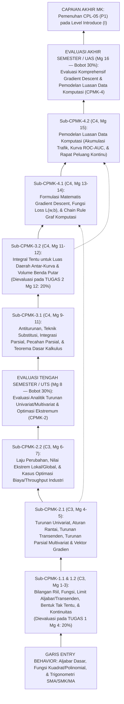

# 056_1 — RENCANA PEMBELAJARAN SEMESTER (RPS)
## STI-102 — KALKULUS (*Calculus*)

**Program Studi:** S1 Sistem dan Teknologi Informasi (SISTEKIN)  
**Fakultas:** Fakultas Sains dan Teknologi Informasi (FSTI) — Universitas Widyagama Malang  
**Kurikulum:** Kurikulum OBE SISTEKIN 2026 (Semester 1 — Tahap Fondasi)  
**Nomor Dokumen SPMI:** `071030.B4.5.2.RPS-STI102`  
**Tanggal Penyusunan:** 07 November 2026  
**Rujukan Utama:** Template Master RPS Generator FSTI UWG (`Template_RPS_GEN_2026_20092026-SWO.docx` / Dok 052 & 053) · Dok 003 (14 CPL & BoK) · Dok 004 (Matriks Keterlacakan & IRM) · Dok 005 (Struktur 8 Semester) · Dok 007 §4 (Silabus 3-Tabel) · Dok 008 & 018 (Asesmen 4 Titik & Rubrik Klaster K-1) · Dok 043 (Matriks CPL–CPMK–BoK & Boundary Guardrails).  
**Perangkat Pendamping Seri `056`:**  
- `056_2_SAP_STI-102_KALKULUS_07112026.md` (Satuan Acara Perkuliahan 16 Pertemuan)  
- `056_3_OUTLINE_MODUL_STI-102_KALKULUS_07112026.md` (Outline Buku Modul Pembelajaran)  
- `056_4_RENCANA_EVALUASI_ASESMEN_STI-102_KALKULUS_07112026.md` (Rencana Evaluasi & Asesmen OBE)  
- `056_5_RUBRIK_PENILAIAN_STI-102_KALKULUS_07112026.md` (Rubrik Penilaian OBE)

> [!IMPORTANT]
> **Catatan Anti-Kolisi Kode Kurikulum (AGENTS.md Butir 7):**  
> Dokumen ini berlaku khusus untuk **`STI-102` pada Kurikulum OBE SISTEKIN 2026**, yaitu mata kuliah **Kalkulus (*Calculus*, 3 SKS Teori)**. Jangan mencampuradukkan kode ini dengan `STI-102` pada Kurikulum 2025 lama (Algoritma dan Pemrograman, yang pada Kurikulum 2026 bertransformasi menjadi `FST-102`).

---

## HALAMAN 1 — SAMPUL & IDENTITAS MATA KULIAH

### A. Blok Sampul Dokumen (Cover — Landscape)
* **Judul Dokumen:** RENCANA PEMBELAJARAN SEMESTER (RPS)
* **Mata Kuliah:** Kalkulus (*Calculus*)
* **Kode Mata Kuliah:** `STI-102` (Kurikulum OBE SISTEKIN 2026)
* **Penyusun:** Tim KBK Matematika & Sains Komputasi (`[PERLU KONFIRMASI: Nama Dosen Koordinator STI-102]` / NUPTK: `[PERLU KONFIRMASI: NUPTK Dosen]`)
* **Institusi:** UNIVERSITAS WIDYAGAMA MALANG — FAKULTAS SAINS DAN TEKNOLOGI INFORMASI
* **Periode Penetapan:** NOVEMBER 2026

### B. Tabel Identitas Mata Kuliah & Otorisasi SPMI

| Atribut Identitas Template (`{{tag}}`) | Spesifikasi Resmi Kurikulum OBE SISTEKIN 2026 |
|---|---|
| **Institusi & UPPS** | Universitas Widyagama Malang — Fakultas Sains dan Teknologi Informasi (FSTI) |
| **Program Studi (`{{prodi}}`)** | S1 Sistem dan Teknologi Informasi (SISTEKIN) |
| **Nomor Dokumen SPMI (`071030.{{kodeprodi}}`)** | `071030.B4.5.2.RPS-STI102` |
| **Mata Kuliah (`{{namamk}}`)** | Kalkulus (*Calculus*) |
| **Kode MK (`{{kodemk}}`)** | `STI-102` |
| **Rumpun MK (`{{rumpunmk}}`)** | Matematika & Sains Komputasi (Mata Kuliah Inti Program Studi / *Core STI*) |
| **Bobot SKS (`T={{skst}} P={{sksp}}`)** | **T = 3 SKS, P = 0 SKS** (Total **3 SKS**, Tipe: **Teori**) |
| **Alokasi Waktu Belajar per Pekan** | Tatap Muka (TM) = $3 \times 50' = 150\text{ menit}$ · Penugasan Terstruktur (PT) = $3 \times 60' = 180\text{ menit}$ · Belajar Mandiri (BM) = $3 \times 60' = 180\text{ menit}$ (Total $510\text{ menit/pekan}$ atau $136\text{ jam/semester}$) |
| **Semester (`{{sms}}`)** | **Semester 1** (Ganjil — Tahap Fondasi) |
| **Tanggal Penyusunan (`{{tglsusun}}`)** | 07 November 2026 |
| **Matakuliah Prasyarat (`{{mkprasyarat}}`)** | `-` (Tidak Ada — Mata Kuliah Fondasi Sains Semester Pertama) |
| **Status & Nilai Minimal Kelulusan** | Wajib Program Studi · Nilai Minimal Lulus: **C** (Ambang Ketercapaian OBE: $\ge 65,0$ / Kategori B) |
| **Pengembang RPS (`{{pengembangrps}}`)** | Tim KBK Matematika & Sains Komputasi |
| **Koordinator RMK (`{{koordinatormk}}`)** | `[PERLU KONFIRMASI: Nama Koordinator RMK Matematika & Sains Komputasi]` |
| **Ketua Program Studi (`{{ketuaprodi}}`)** | `[PERLU KONFIRMASI: Nama Ketua Prodi SISTEKIN]` *(Ref. Dok 054: Ahmad Fairuzabadi, S.Kom., M.Kom.)* |
| **Dosen Pengampu (`{{dosenpengampu}}`)** | 1. `[PERLU KONFIRMASI: Nama Dosen Pengampu 1]` (Koordinator MK) 2. `[PERLU KONFIRMASI: Nama Dosen Pengampu 2]` (Kelas Paralel) |

---

## HALAMAN 2 — CAPAIAN PEMBELAJARAN, KORELASI, DESKRIPSI, BAHAN KAJIAN & PUSTAKA

### 1. Capaian Pembelajaran Lulusan (CPL-PRODI) yang Dibebankan pada MK (`[nocpl]` & `[cpl]`)

Merujuk **Dokumen 003**, **Dokumen 004 Bagian 0 & Tabel 3.1** (kode baku `CPL-05`, level penguasaan **IRM = `I` / *Introduce***), serta **Dokumen 043**:

| Kode Baku CPL | Alias Kategori | Rumusan Resmi CPL (Verbatim Dokumen 003) | Target Bloom CPL | Posisi IRM di MK Ini | Profil Lulusan & PEO Didukung |
|:---:|:---:|---|:---:|:---:|---|
| **`CPL-05`** | **`P1`** | Menguasai konsep dasar sains, matematika terapan (kalkulus, aljabar linear, statistika, matematika diskrit, logika) sebagai fondasi pemecahan masalah rekayasa sistem informasi dan komputasi cerdas yang kompleks. | **C3** (*Apply*) | **`I`** (*Introduce*) | `PL-1` (*Intelligent IS & AI Engineer*), `PL-2` (*Cloud Infra & Smart Systems*) · `PEO-1` & `PEO-3` |

### 2. Capaian Pembelajaran Mata Kuliah (CPMK) — Format ABCD & Level Bloom (`[nocpmk]` & `[cpmk]`)

Rumusan **verbatim** dari **Dokumen 043** dan **Dokumen 007 Tabel 4.B** (4 CPMK terpetakan 1-ke-1 ke 4 titik asesmen):

| Kode CPMK | Rumusan Capaian Pembelajaran Mata Kuliah (Format ABCD) | Level Bloom | CPL Didukung |
|:---:|---|:---:|:---:|
| **`CPMK-1`** | Mahasiswa (*A*) mampu **menghitung** limit fungsi aljabar/transenden dan memeriksa kontinuitas (*B*) menggunakan kaidah kalkulus baku (*C*) secara teliti dan benar (*D*). | **C3** (*Apply*) | `CPL-05` (`P1`) |
| **`CPMK-2`** | Mahasiswa (*A*) mampu **menerapkan** konsep turunan fungsi multivariat dan gradien (*B*) pada permasalahan laju perubahan dan optimasi ekstremum (*C*) dengan prosedur matematis standar (*D*). | **C3** (*Apply*) | `CPL-05` (`P1`) |
| **`CPMK-3`** | Mahasiswa (*A*) mampu **menganalisis** permasalahan integral tentu dan tak tentu (*B*) menggunakan teknik substitusi dan integrasi parsial (*C*) untuk pemodelan fungsi komputasi (*D*). | **C4** (*Analyze*) | `CPL-05` (`P1`) |
| **`CPMK-4`** | Mahasiswa (*A*) mampu **merumuskan** aplikasi kalkulus diferensial-integral (*B*) pada algoritma optimasi penurunan gradien (Gradient Descent) dan luasan data (*C*) secara matematis (*D*). | **C4** (*Analyze*) | `CPL-05` (`P1`) |

### 3. Kemampuan Akhir Tiap Tahapan Belajar (Sub-CPMK) (`[nosubcpmk]` & `[subcpmk]`)

Rumusan **verbatim** dari **Dokumen 043** (8 Sub-CPMK operasional):

| Kode Sub-CPMK | Rumusan Kemampuan Akhir Tahapan Belajar (Kompetensi Spesifik) | Induk CPMK | Level Bloom | Rentang Pekan |
|:---:|---|:---:|:---:|:---:|
| **`Sub-CPMK-1.1`** | Menghitung limit fungsi aljabar dan transenden serta memeriksa kontinuitas fungsi. | `CPMK-1` | **C3** | Pekan 1–3 |
| **`Sub-CPMK-1.2`** | Menerapkan teorema limit dan bentuk tak tentu untuk menyelesaikan limit fungsi transenden. | `CPMK-1` | **C3** | Pekan 2–3 |
| **`Sub-CPMK-2.1`** | Menghitung turunan fungsi univariat dan multivariat beserta gradiennya. | `CPMK-2` | **C3** | Pekan 4–5 |
| **`Sub-CPMK-2.2`** | Menerapkan turunan pada masalah laju perubahan dan optimasi ekstremum (maksimum/minimum). | `CPMK-2` | **C3** | Pekan 6–7 |
| **`Sub-CPMK-3.1`** | Menganalisis teknik integrasi substitusi dan parsial untuk integral tentu dan tak tentu. | `CPMK-3` | **C4** | Pekan 9–11 |
| **`Sub-CPMK-3.2`** | Menghitung integral untuk luasan di bawah kurva dan volume benda putar. | `CPMK-3` | **C4** | Pekan 11–12 |
| **`Sub-CPMK-4.1`** | Menerapkan turunan parsial dan gradien pada prinsip optimasi Gradient Descent. | `CPMK-4` | **C4** | Pekan 13–14 |
| **`Sub-CPMK-4.2`** | Menerapkan integral untuk pemodelan luasan data pada fungsi komputasi. | `CPMK-4` | **C4** | Pekan 15 |

### 4. Peta Analisis Pembelajaran (*Instructional Analysis* — Standar KPT 2024)

### 5. Matriks Korelasi CPL terhadap CPMK & Bobot Penilaian (`[tabelkolerasi]`)

Mengacu **Dokumen 008 §2** dan **Dokumen 018 §3 Klaster K-1** (Sains Dasar & Teori Formal: `20% + 30% + 20% + 30% = 100%`, pemetaan 1-ke-1):

| Kode CPMK | `CPL-05` (`P1`) (%) | Bobot Penilaian (%) | Jumlah Minggu | Instrumen & Titik Asesmen Sumatif | Keterkaitan Metode Kasus/Problem (IKU 7) |
|:---:|:---:|:---:|:---:|---|---|
| **`CPMK-1`** | 20% | **20%** | 3 Minggu (Mg 1–3) | **Tugas 1** (Pekan 4 — 20%): *Problem Solving Set* Limit Aljabar/Transenden & Kontinuitas | *Problem-Based Case* (20%) |
| **`CPMK-2`** | 30% | **30%** | 5 Minggu (Mg 4–8) | **UTS** (Pekan 8 — 30%): Ujian Tertulis Analitik Turunan, Gradien, & Kasus Optimasi Ekstremum | Ujian Analitik & Kasus Optimasi |
| **`CPMK-3`** | 20% | **20%** | 4 Minggu (Mg 9–12) | **Tugas 2** (Pekan 12 — 20%): Studi Kasus Pemodelan Teknik Integrasi & Luas/Volume | *Case-Based Modeling* (20%) |
| **`CPMK-4`** | 30% | **30%** | 4 Minggu (Mg 13–16) | **UAS** (Pekan 16 — 30%): Studi Kasus Matematis *Gradient Descent* & Luasan Data Komputasi | *Case-Based Mathematical Formulation* (30%) |
| **TOTAL** | **100%** | **100%** | **16 Minggu** | **4 Titik Evaluasi Baku (1-to-1 CPMK) = 100%** | **Bobot Problem/Case-Based = 70% ($\ge 50\%$)** |

### 6. Deskripsi Singkat Mata Kuliah (`{{deskripsimk}}`)

Mata kuliah **Kalkulus (`STI-102`)** adalah mata kuliah wajib inti program studi (*Core STI*) berbobot 3 SKS Teori pada Semester 1 yang membangun fondasi penalaran matematika kontinu bagi rekayasa sistem informasi cerdas dan sains data/AI. Perkuliahan diawali dengan penguatan sistem bilangan riil, pemodelan fungsi, perhitungan limit fungsi aljabar maupun transenden, penyelesaian bentuk tak tentu, serta analisis kontinuitas fungsi. Selanjutnya mahasiswa mempelajari kalkulus diferensial baik untuk fungsi satu peubah maupun fungsi multivariat—mencakup aturan rantai, diferensiasi implisit, turunan parsial, dan vektor gradien ($\nabla f$)—beserta penerapannya pada permasalahan laju perubahan dan optimasi nilai ekstremum biaya/kinerja industri. Pada paruh kedua semester, mahasiswa menganalisis kalkulus integral (antiturunan, teknik substitusi, integrasi parsial, pecahan parsial, Teorema Dasar Kalkulus, luas daerah antar-kurva, dan volume benda putar) yang kemudian dirangkai secara aplikatif menuju formulasi matematis algoritma penurunan gradien (*Gradient Descent* pada fungsi kerugian dua parameter) serta pemodelan luasan data komputasi (akumulasi laju aliran data jaringan dan luasan di bawah kurva evaluasi *AUC*). Sesuai *Boundary Guardrails* Dokumen 043, mata kuliah ini berfokus pada formulasi dan prosedur kalkulus analitis simbolik, serta menyerahkan aljabar matriks ke `STI-205`, probabilitas-statistika ke `FST-408`, pelatihan model *Machine Learning* ke `STI-413`, dan komputasi klaster terdistribusi ke `STA-601`.

### 7. Pagar Pembatas Materi (*Boundary Guardrails* — Verbatim Dokumen 043)

| Lapisan Guardrail | Ketentuan Wajib Dosen Pengampu & Audit GPM |
|---|---|
| 🟢 **IN-SCOPE (Wajib Diajarkan)** | Fungsi, sistem bilangan riil, limit & kontinuitas fungsi aljabar/transenden; turunan diferensial simbolik analitis (univariat & turunan parsial multivariat, aturan rantai, vektor gradien); aplikasi optimasi ekstremum; integral tak tentu & tentu (substitusi, parsial, luas kurva, volume); formulasi matematis *Gradient Descent* & pemodelan luasan data komputasi. |
| ❌ **OUT-OF-SCOPE (Dilarang Diajarkan)** | ❌ Dilarang mengajarkan komputasi klaster terdistribusi Spark/Kafka (ranah `STA-601`); pembuktian teorema analisis riil/aljabar abstrak murni; operasi ruang vektor dimensi-$n$, nilai eigen, & dekomposisi matriks SVD (ranah `STI-205`); atau pelatihan *end-to-end pipeline Machine Learning* dengan pustaka `scikit-learn`/`PyTorch` (ranah `STI-413` & `STI-624`). |
| 🔄 **HANDOFF ANCHOR (Titik Serah Terima)** | Penguasaan turunan parsial, vektor gradien, dan integral kontinu menjadi fondasi matematis langsung bagi `STI-205 Aljabar Linear dan Matriks` (Semester 2), `FST-408 Probabilitas dan Statistika` (Semester 4 — fungsi padat peluang kontinu), dan `STI-413 Pembelajaran Mesin` (Semester 4 — optimasi parameter model); komputasi skala besar diserahkan ke `STA-601`. |

### 8. Bahan Kajian / Materi Pembelajaran (`{{bahankajian}}`)

**Rujukan Body of Knowledge (BoK) APTIKOM (Dokumen 003 & 043):**
1. **`BK-IS10` — *Applied Mathematics and Logic*** *(BoK Primer IS2020)*: Kalkulus diferensial-integral, optimasi kontinu, dan pemodelan matematis terapan untuk komputasi.
2. **`BK-IT01` — *Information Technology Fundamentals*** *(BoK Sekunder IT2017)*: Landasan kuantitatif performa sistem komputasi dan optimasi model cerdas.

**Daftar 14 Pokok Bahasan Mingguan (Harmonisasi Dokumen 007 Tabel 4.C & Dokumen 043):**
1. Sistem Bilangan Riil, Pertidaksamaan, Nilai Mutlak, dan Pemodelan Fungsi dalam Komputasi `[Sub-CPMK-1.1]`
2. Konsep Limit Fungsi Aljabar, Limit Sepihak, Teorema Limit, dan Limit Tak-Hingga / Asimtot `[Sub-CPMK-1.1, Sub-CPMK-1.2]`
3. Limit Fungsi Transenden, Bentuk Tak Tentu ($0/0, \infty/\infty$), dan Analisis Kontinuitas Fungsi `[Sub-CPMK-1.1, Sub-CPMK-1.2]`
4. Konsep Turunan, Aturan Dasar Diferensiasi (Pangkat, Hasil Kali, Hasil Bagi), & Turunan Fungsi Transenden `[Sub-CPMK-2.1]`
5. Aturan Rantai (*Chain Rule*), Diferensiasi Implisit, Fungsi Multivariat, Turunan Parsial ($\partial f/\partial x$), & Vektor Gradien ($\nabla f$) `[Sub-CPMK-2.1]`
6. Laju Perubahan Terkait, Titik Kritis, Nilai Ekstrem Lokal/Global, Kecekungan, dan Uji Turunan Pertama & Kedua `[Sub-CPMK-2.2]`
7. Aplikasi Optimasi Ekstremum pada Permasalahan Industri & Sistem Komputasi (Minimasi Biaya Server, Optimasi Ukuran *Batch/Throughput*) `[Sub-CPMK-2.2]`
8. Konsep Antiturunan, Integral Tak Tentu, dan Teknik Integrasi Substitusi (`u-substitution`) `[Sub-CPMK-3.1]`
9. Teknik Integrasi Parsial (*Integration by Parts*) dan Integrasi Fungsi Rasional (Dekomposisi Pecahan Parsial) `[Sub-CPMK-3.1]`
10. Jumlah Riemann, Sifat-Sifat Integral Tentu, serta Teorema Dasar Kalkulus I & II `[Sub-CPMK-3.1, Sub-CPMK-3.2]`
11. Aplikasi Integral Tentu: Perhitungan Luas Daerah di Bawah/Antar Kurva dan Volume Benda Putar `[Sub-CPMK-3.2]`
12. Formulasi Matematis Optimasi Penurunan Gradien (*Gradient Descent*): Iterasi Parameter $\theta_{t+1} = \theta_t - \eta \nabla J(\theta)$ pada Fungsi Kuadratik/*MSE Sederhana* `[Sub-CPMK-4.1]`
13. Aturan Rantai Multivariat pada Graf Komputasi Sederhana dan Analisis Konvergensi (*Learning Rate*, Minimum Lokal vs *Saddle Point*) `[Sub-CPMK-4.1]`
14. Aplikasi Integral pada Pemodelan Luasan Data Komputasi: Akumulasi Trafik Jaringan, Luas di Bawah Kurva Evaluasi (*AUC*), & Pengantar Luas Kurva Rapat Data `[Sub-CPMK-4.2]`

### 9. Daftar Pustaka (`[pustakautama]` & `[pustakapendukung]`)

> *Catatan Status (Dok 053 T3): Daftar pustaka di bawah merupakan komposisi buku teks kalkulus standar internasional dan matematika untuk komputasi/ML — perlu validasi ketersediaan koleksi perpustakaan oleh KBK/GPM.*

**Pustaka Utama (`[pustakautama]`):**
1. Varberg, D., Purcell, E. J., & Rigdon, S. E. (2019). *Calculus* (9th ed. / Edisi Bahasa Indonesia: *Kalkulus* Jilid 1 & 2, Penerbit Erlangga). Harlow: Pearson Education.
2. Stewart, J., Clegg, D. K., & Watson, S. (2021). *Calculus: Early Transcendentals* (9th ed.). Boston: Cengage Learning.
3. Thomas, G. B., Hass, J., Heil, C., & Weir, M. D. (2018). *Thomas' Calculus* (14th ed.). Boston: Pearson.

**Pustaka Pendukung (`[pustakapendukung]`):**
4. Deisenroth, M. P., Faisal, A. A., & Ong, C. S. (2020). *Mathematics for Machine Learning* (Bab 5: *Vector Calculus*). Cambridge: Cambridge University Press. *(Open Access: https://mml-book.github.io)*
5. Anton, H., Bivens, I., & Davis, S. (2021). *Calculus: Early Transcendentals* (12th ed.). Hoboken: John Wiley & Sons.
6. Strang, G., & Herman, E. (2020). *Calculus Volume 1–3*. Houston: OpenStax, Rice University. *(Open Access Textbook)*

---

## HALAMAN 3–4 — MATRIKS RENCANA PEMBELAJARAN 16 PEKAN (8 KOLOM BAKU)

| Mg ke- `(1)` | Kemampuan Akhir Tiap Tahapan Belajar (Sub-CPMK) `(2)` | Penilaian: Indikator `(3)` | Penilaian: Kriteria & Teknik `(4)` | Bentuk, Metode Pembelajaran & Penugasan Mahasiswa [Estimasi Waktu] — Luring (Offline) `(5)` | Bentuk, Metode Pembelajaran & Penugasan Mahasiswa — Daring (Online) `(6)` | Materi Pembelajaran [Pustaka] `(7)` | Bobot Penilaian (%) `(8)` |
|:---:|---|---|---|---|---|---|:---:|
| **1** | **Sub-CPMK-1.1:** Menyelesaikan pertidaksamaan, nilai mutlak, dan merepresentasikan domain-kodomain fungsi komputasi sebagai prasyarat limit (C3) | 1.1.1 Ketepatan menentukan himpunan penyelesaian pertidaksamaan rasional dan nilai mutlak. 1.1.2 Ketepatan menentukan domain, range, dan komposisi fungsi aljabar/sepotong-sepotong (*piecewise*, mis. fungsi ReLU). | **Kriteria:** Rubrik ketelitian langkah aljabar formatif. **Teknik:** Tes diagnostik awal & latihan terbimbing di kelas. | **Kuliah Interaktif & *Guided Problem Solving*** `[TM: 3x50' = 150']` Latihan mandiri himpunan selang & fungsi: `[PT: 3x60' = 180']` `[BM: 3x60' = 180']` | LMS Edlink: kontrak belajar, unduh RPS, kuis diagnostik prasyarat aljabar SMA/SMK. | Kontrak Belajar, Peran Kalkulus pada AI & Sistem Cerdas, Sistem Bilangan Riil, Pertidaksamaan, Nilai Mutlak, & Fungsi Komputasi (`piecewise`/aktivasi) `[1] Bab 0–1; [2] Bab 1` | — |
| **2** | **Sub-CPMK-1.1 & Sub-CPMK-1.2:** Menghitung limit fungsi aljabar, limit sepihak, dan limit tak-hingga menggunakan teorema limit baku (C3) | 1.1.3 Ketepatan mengevaluasi limit kiri, limit kanan, dan eksistensi limit pada titik batas fungsi. 1.2.1 Ketepatan menerapkan teorema limit utama, pemfaktoran, dan perkalian sekawan pada limit aljabar serta menentukan asimtot datar/tegak. | **Kriteria:** Checklist keruntutan prosedur perhitungan limit. **Teknik:** Non-tes (penyelesaian soal di papan tulis & diskusi kelompok kecil). | **Kuliah & *Collaborative Problem Solving*** `[TM: 3x50' = 150']` Lembar latihan 10 soal limit aljabar & asimtot: `[PT: 3x60' = 180']` `[BM: 3x60' = 180']` | LMS Edlink: materi visualisasi grafik limit (Desmos/GeoGebra tanpa instalasi berat) & forum tanya jawab soal sulit. | Konsep Intuitif Limit, Limit Sepihak, Teorema Limit Utama, Limit di Tak-Hingga (Perilaku Pertumbuhan Fungsi), & Asimtot `[1] Bab 1; [2] Bab 2` | — |
| **3** | **Sub-CPMK-1.1 & Sub-CPMK-1.2:** Menyelesaikan limit fungsi transenden, bentuk tak tentu, dan memeriksa kontinuitas fungsi pada titik/selang (C3) | 1.2.2 Ketepatan menyelesaikan limit trigonometri, eksponensial (bilangan Euler $e$), dan logaritma pada bentuk tak tentu. 1.1.4 Ketepatan memeriksa 3 syarat kontinuitas fungsi di titik $x=c$ dan mengklasifikasikan jenis diskontinuitas (*removable, jump, infinite*). | **Kriteria:** Rubrik analitik formatif. **Teknik:** *Problem-Based Learning* (menguji syarat kemulusan/kontinuitas kurva komputasi). | ***Problem-Based Learning* & Klinik Soal** `[TM: 3x50' = 150']` Pengerjaan paket soal persiapan Tugas 1: `[PT: 3x60' = 180']` `[BM: 3x60' = 180']` | LMS Edlink: rilis naskah resmi **RTM-1 (Tugas 1)** untuk dikumpulkan Pekan 4 + video contoh langkah pengerjaan. | Limit Fungsi Transenden (Trigonometri, Eksponen, Logaritma), Penyelesaian Bentuk Tak Tentu, Kontinuitas pada Titik/Selang, & Teorema Nilai Antara `[1] Bab 1 & 6; [2] Bab 2` | — |
| **4** | **Sub-CPMK-2.1:** Menghitung turunan fungsi univariat (aljabar & transenden) menggunakan definisi limit dan aturan dasar diferensiasi (C3) | 2.1.1 Ketepatan menurunkan fungsi dari definisi limit hasil bagi selisih dan menafsirkannya sebagai kemiringan garis singgung. 2.1.2 Ketepatan menerapkan aturan pangkat, hasil kali, hasil bagi, serta turunan fungsi eksponensial $e^x$, $\ln x$ (termasuk fungsi sigmoid $\sigma(x)$). *(Sekaligus evaluasi sumatif `CPMK-1` via Tugas 1)*. | **Kriteria:** **Rubrik Analitik Tugas 1** (lihat Lampiran 1 / Dok `056_5`). **Teknik:** Penugasan *Problem Set* tertulis mandiri + kuis verifikasi singkat di kelas. | **Kuliah & Latihan Terstruktur + Verifikasi Tugas 1** `[TM: 3x50' = 150']` Penyelesaian & pengumpulan Tugas 1: `[PT: 3x60' = 180']` `[BM: 3x60' = 180']` | LMS Edlink: pengumpulan berkas **Tugas 1** (batas akhir Pekan 4). | Definisi Turunan dan Garis Singgung, Keterdiferensialan vs Kontinuitas, Aturan Pangkat/Kali/Bagi, & Turunan Fungsi Transenden (`exp`, `ln`, trigonometri) `[1] Bab 2 & 6; [2] Bab 3` | **Tugas 1: 20%** *(Evaluasi `CPMK-1`: `Sub-CPMK-1.1` & `1.2`)* |
| **5** | **Sub-CPMK-2.1:** Menerapkan aturan rantai (*Chain Rule*), diferensiasi implisit, serta menghitung turunan parsial fungsi multivariat dan vektor gradien (C3) | 2.1.3 Ketepatan menerapkan *Chain Rule* pada fungsi komposisi bersusun dan diferensiasi implisit. 2.1.4 Ketepatan menghitung turunan parsial orde pertama ($\frac{\partial f}{\partial x}, \frac{\partial f}{\partial y}$) dan menyusun vektor gradien $\nabla f(x,y)$ pada titik tertentu. | **Kriteria:** Rubrik ketepatan prosedur diferensiasi formatif. **Teknik:** Latihan terbimbing & visualisasi kontur permukaan 3D. | ***Problem-Solving Class* & Visualisasi 3D** `[TM: 3x50' = 150']` Latihan soal aturan rantai & turunan parsial multivariat: `[PT: 3x60' = 180']` `[BM: 3x60' = 180']` | LMS Edlink: eksplorasi interaktif bidang singgung & arah vektor gradien pada grafik permukaan 3D. | Aturan Rantai (*Chain Rule*), Diferensiasi Implisit, Fungsi Dua/Lebih Peubah, Turunan Parsial Orde-1 & Orde-2, serta Vektor Gradien $\nabla f$ `[1] Bab 2 & 12; [4] Bab 5` | — |
| **6** | **Sub-CPMK-2.2:** Menentukan laju perubahan, titik kritis, nilai ekstrem lokal/global, dan kecekungan kurva dengan uji turunan (C3/C4) | 2.2.1 Ketepatan menyelesaikan permasalahan laju perubahan terkait (*related rates*). 2.2.2 Ketepatan menentukan titik stasioner/kritis ($f'(x)=0$), interval kemonotonan, kecekungan, titik belok, serta klasifikasi maksimum/minimum dengan Uji Turunan ke-1 dan ke-2. | **Kriteria:** Rubrik analisis kurva & ekstremum formatif. **Teknik:** Diskusi kelompok pemecahan masalah analisis kurva. | ***Case-Based Learning* & Analisis Grafik** `[TM: 3x50' = 150']` Latihan penentuan ekstremum univariat & titik stasioner $\nabla f = \mathbf{0}$ sederhana: `[PT: 3x60' = 180']` `[BM: 3x60' = 180']` | LMS Edlink: lembar latihan mandiri uji turunan pertama & kedua beserta kunci jawaban langkah pokok. | Laju Perubahan Terkait, Nilai Ekstrem pada Selang Tertutup, Kemonotonan & Kecekungan, Uji Turunan ke-1 & ke-2, serta Kondisi Stasioner $\nabla f = \mathbf{0}$ `[1] Bab 3 & 12; [2] Bab 4` | — |
| **7** | **Sub-CPMK-2.2:** Menerapkan konsep turunan dan gradien pada studi kasus optimasi biaya, laba, dan kapasitas sistem komputasi (C3/C4) | 2.2.3 Ketepatan memodelkan cerita masalah nyata ke dalam fungsi objektif matematis berserta batasannya. 2.2.4 Ketepatan menentukan solusi optimal (minimasi biaya server/inventori EOQ, maksimasi laba atau *throughput* jaringan) dengan prosedur kalkulus baku. | **Kriteria:** Rubrik pemodelan & optimasi kasus formatif. **Teknik:** *Problem-Solving Workshop* kasus industri & review pra-UTS. | ***Problem-Solving Workshop* & Review Pra-UTS** `[TM: 3x50' = 150']` Simulasi soal latihan komprehensif persiapan UTS: `[PT: 3x60' = 180']` `[BM: 3x60' = 180']` | LMS Edlink: kisi-kisi resmi UTS & pembahasan soal kasus optimasi industri. | Pemodelan Masalah Optimasi Terapan: Minimasi Biaya Operasional/Server Cloud, Kuantitas Pesanan Ekonomis (EOQ), Maksimasi *Throughput*, & Konsolidasi Pra-UTS `[1] Bab 3; [3] Bab 4` | — |
| **8** | **Evaluasi Tengah Semester (UTS) — Menguji `CPMK-2` (`Sub-CPMK-2.1` & `Sub-CPMK-2.2`) serta penguatan `CPMK-1` (C3/C4)** | **Indikator:** Ketepatan menghitung turunan komposisi (*Chain Rule*), turunan parsial & vektor gradien $\nabla f$, serta menyelesaikan masalah laju perubahan dan studi kasus optimasi ekstremum dengan prosedur matematis standar secara teliti (skor $\ge 65$). **Kriteria & Teknik:** **Rubrik Analitik UTS** (lihat Lampiran 2 / Dok `056_5`); Ujian Tertulis Uraian Terstruktur & Kasus Optimasi (`150 menit`). **Luring:** Ujian Tertulis Terjadwal di Ruang Kelas `[150']`. **Daring:** LMS Edlink — pengumuman ruang, tata tertib, & publikasi umpan balik koreksi. **Materi:** Cakupan Pekan 1–7 (fokus utama Pekan 4–7: Turunan, *Chain Rule*, Turunan Parsial, Gradien, & Optimasi Ekstremum) `[1][2][4]`. | | | | | **UTS: 30%** *(Evaluasi `CPMK-2`)* |
| **9** | **Sub-CPMK-3.1:** Menganalisis dan menyelesaikan integral tak tentu menggunakan rumus dasar antiturunan dan teknik substitusi (C4) | 3.1.1 Ketepatan menentukan keluarga fungsi antiturunan $F(x)+C$ untuk fungsi aljabar dan transenden. 3.1.2 Ketepatan memilih pemisalan variabel $u = g(x)$ yang efektif untuk menyederhanakan integral komposisi. | **Kriteria:** Rubrik pemilihan strategi integrasi formatif. **Teknik:** Latihan terarah & verifikasi hasil integral melalui diferensiasi balik. | **Kuliah Interaktif & Latihan Terbimbing** `[TM: 3x50' = 150']` Set latihan 12 soal antiturunan & substitusi: `[PT: 3x60' = 180']` `[BM: 3x60' = 180']` | LMS Edlink: evaluasi refleksi UTS & modul strategi pemilihan teknik substitusi. | Konsep Antiturunan (Integral Tak Tentu), Sifat Linearitas Integral, Masalah Nilai Awal Sederhana, & Teknik Integrasi Substitusi (`u-substitution`) `[1] Bab 3–4 & 7; [2] Bab 5` | — |
| **10** | **Sub-CPMK-3.1:** Menganalisis dan menyelesaikan integral menggunakan teknik integrasi parsial dan dekomposisi pecahan parsial (C4) | 3.1.3 Ketepatan memilih komponen $u$ dan $dv$ (kaidah LIATE/ILATE) pada rumus $\int u\,dv = uv - \int v\,du$ (termasuk integrasi parsial berulang/tabular). 3.1.4 Ketepatan menguraikan fungsi rasional menjadi pecahan parsial faktor linear untuk diintegralkan. | **Kriteria:** Rubrik analitik pemilihan metode integrasi formatif. **Teknik:** *Problem-Solving Class* perbandingan strategi substitusi vs parsial vs pecahan parsial. | ***Problem-Solving Class*** `[TM: 3x50' = 150']` Latihan diagnostik *"Pilih Metode Integrasi yang Tepat"*: `[PT: 3x60' = 180']` `[BM: 3x60' = 180']` | LMS Edlink: rilis naskah resmi **RTM-2 (Tugas 2)** untuk dikumpulkan Pekan 12 + kuis mandiri kaidah LIATE. | Teknik Integrasi Lanjut: Integrasi Parsial (*Integration by Parts*), Metode Tabular, & Integrasi Fungsi Rasional dengan Pecahan Parsial `[1] Bab 7; [2] Bab 7` | — |
| **11** | **Sub-CPMK-3.1 & Sub-CPMK-3.2:** Menghitung integral tentu menggunakan Jumlah Riemann dan Teorema Dasar Kalkulus (C3/C4) | 3.1.5 Ketepatan menafsirkan integral tentu $\int_a^b f(x)\,dx$ sebagai limit Jumlah Riemann (aproksimasi persegi panjang diskrit ke kontinu). 3.2.1 Ketepatan menerapkan Teorema Dasar Kalkulus I & II serta pergantian batas integrasi pada teknik substitusi/parsial. | **Kriteria:** Rubrik ketepatan batas dan perhitungan integral tentu. **Teknik:** Diskusi konsep diskrit-ke-kontinu & latihan soal. | **Kuliah & Latihan Soal Terstruktur** `[TM: 3x50' = 150']` Latihan perhitungan integral tentu & nilai rata-rata fungsi: `[PT: 3x60' = 180']` `[BM: 3x60' = 180']` | LMS Edlink: simulasi visual konvergensi Jumlah Riemann saat lebar partisi $\Delta x \to 0$. | Partisi Selang, Jumlah Riemann, Definisi & Sifat Integral Tentu, Nilai Rata-Rata Fungsi, serta Teorema Dasar Kalkulus I & II `[1] Bab 4; [2] Bab 5` | — |
| **12** | **Sub-CPMK-3.2:** Menghitung integral tentu untuk menentukan luas daerah di bawah/antar kurva dan volume benda putar (C3/C4) | 3.2.2 Ketepatan menyusun batas titik potong dan menghitung luas daerah di bawah kurva maupun di antara dua kurva. 3.2.3 Ketepatan menghitung volume benda putar menggunakan metode cakram (*disk*) dan cincin (*washer*). *(Sekaligus evaluasi sumatif `CPMK-3` via Tugas 2)*. | **Kriteria:** **Rubrik Analitik Tugas 2** (lihat Lampiran 3 / Dok `056_5`). **Teknik:** Penilaian Studi Kasus Pemodelan Integrasi (**Tugas 2**) + kuis konfirmasi di kelas. | ***Problem-Based Learning* + Verifikasi Tugas 2** `[TM: 3x50' = 150']` Finalisasi & pengumpulan Tugas 2: `[PT: 3x60' = 180']` `[BM: 3x60' = 180']` | LMS Edlink: pengumpulan berkas **Tugas 2** (batas akhir Pekan 12). | Aplikasi Geometri Integral Tentu: Luas Daerah di Bawah Kurva, Luas Daerah di Antara Dua Kurva ($dx$ & $dy$), serta Volume Benda Putar (Cakram & Cincin) `[1] Bab 5; [2] Bab 6` | **Tugas 2: 20%** *(Evaluasi `CPMK-3`: `Sub-CPMK-3.1` & `3.2`)* |
| **13** | **Sub-CPMK-4.1:** Merumuskan penerapan turunan parsial dan vektor gradien pada algoritma optimasi penurunan gradien (*Gradient Descent*) (C4) | 4.1.1 Ketepatan menurunkan gradien fungsi kerugian (*Mean Squared Error* / fungsi kuadratik 2 parameter $J(w,b)$) secara analitis. 4.1.2 Ketepatan menghitung minimal 2–3 iterasi manual pembaruan parameter $w^{(t+1)} = w^{(t)} - \eta \frac{\partial J}{\partial w}$ dan menganalisis pengaruh *learning rate* $\eta$. | **Kriteria:** Rubrik ketepatan formulasi & iterasi gradien formatif. **Teknik:** *Case-Based Mathematical Workshop* (simulasi iterasi regresi 3 titik data secara manual). | ***Case-Based Workshop*: Matematika di Balik AI** `[TM: 3x50' = 150']` Latihan perhitungan manual 3 langkah *Gradient Descent* pada dataset mini: `[PT: 3x60' = 180']` `[BM: 3x60' = 180']` | LMS Edlink: visualisasi lintasan penurunan gradien pada kurva kontur 2D (*overshooting* saat $\eta$ terlalu besar vs konvergen lambat). | Matematika Optimasi Kecerdasan Artifisial: Konsep Fungsi *Loss* $J(w,b)$, Makna Arah Negatif Gradien ($-\nabla J$), Aturan Pembaruan *Gradient Descent*, & Efek *Learning Rate* $\eta$ `[4] Bab 5 & 7; [2] Bab 14` | — |
| **14** | **Sub-CPMK-4.1:** Merumuskan aturan rantai multivariat pada graf komputasi sederhana dan menganalisis kondisi konvergensi optimasi (C4) | 4.1.3 Ketepatan menerapkan aturan rantai pada graf komputasi berantai 2 lapis ($x \to z \to \hat{y} \to L$) untuk mendapatkan $\frac{\partial L}{\partial w}$. 4.1.4 Ketepatan membedakan secara matematis kondisi minimum global (fungsi konveks), minimum lokal, dan titik pelana (*saddle point*). | **Kriteria:** Rubrik penelusuran turunan berantai formatif. **Teknik:** Latihan penelusuran maju-mundur (*forward & backward pass* matematis di kertas). | ***Problem-Solving Class*** `[TM: 3x50' = 150']` Latihan *chain rule* pada neuron tunggal beraktivasi sigmoid: `[PT: 3x60' = 180']` `[BM: 3x60' = 180']` | LMS Edlink: lembar latihan mandiri graf komputasi & jembatan konsep menuju `STI-413`/`STI-624`. | Aturan Rantai pada Graf Komputasi (*Computational Graph Chain Rule*), Konveksitas Fungsi, Minimum Lokal vs Global, & Titik Pelana (*Saddle Point*) `[4] Bab 5.6 & 7.1` | — |
| **15** | **Sub-CPMK-4.2:** Merumuskan penerapan integral tentu dan aproksimasi trapesium untuk pemodelan luasan data pada fungsi komputasi (C4) | 4.2.1 Ketepatan memodelkan total volume data terkirim $V = \int_{t_1}^{t_2} r(t)\,dt$ dari fungsi laju *throughput* jaringan $r(t)$. 4.2.2 Ketepatan menghitung luasan di bawah kurva kinerja model (*Area Under Curve / AUC*) baik secara analitis maupun aproksimasi aturan trapesium pada titik data diskrit, serta memvalidasi syarat normalisasi luas kurva rapat data $\int f(x)\,dx = 1$. | **Kriteria:** Rubrik pemodelan integral komputasi formatif. **Teknik:** *Case Method* perhitungan *AUC* dan akumulasi trafik server + review pra-UAS. | ***Case Method Workshop* & Review Komprehensif Pra-UAS** `[TM: 3x50' = 150']` Pengerjaan paket simulasi soal UAS: `[PT: 3x60' = 180']` `[BM: 3x60' = 180']` | LMS Edlink: kisi-kisi resmi UAS & survei evaluasi reflektif ketercapaian Sub-CPMK mahasiswa. | Pemodelan Luasan Data dengan Integral: Akumulasi Trafik/Beban Komputasi, Konsep Matematis *Area Under Curve* (AUC) & Aturan Trapesium, serta Syarat Luas Kurva Rapat Data Kontinu `[1] Bab 4–5; [6] Vol. 2` | — |
| **16** | **Evaluasi Akhir Semester (UAS) — Menguji `CPMK-4` (`Sub-CPMK-4.1` & `Sub-CPMK-4.2`) serta sintesis komprehensif `CPMK-1` s.d. `CPMK-4` (C4)** | **Indikator:** Ketepatan merumuskan gradien fungsi kerugian & menghitung langkah optimasi *Gradient Descent*, menerapkan aturan rantai graf komputasi, serta memodelkan permasalahan luasan data komputasi (akumulasi laju aliran data & *AUC*) menggunakan integral secara teliti dan benar (skor $\ge 65$). **Kriteria & Teknik:** **Rubrik Analitik & Holistik UAS** (lihat Lampiran 4 / Dok `056_5`); Ujian Tertulis Komprehensif Berbasis Kasus Komputasi (`150 menit`). **Luring:** Ujian Tertulis Akhir Terjadwal di Ruang Kelas `[150']`. **Daring:** LMS Edlink — pengumuman nilai komponen, transparansi koreksi, & rekap capaian `CPL-05`. **Materi:** Fokus utama Pekan 13–15 (`CPMK-4`: *Gradient Descent*, *Computational Graph Chain Rule*, Integral Luasan Data/*AUC*) terintegrasi dengan fondasi diferensial-integral Pekan 1–12 `[1][2][4]`. | | | | | **UAS: 30%** *(Evaluasi `CPMK-4` & Sintesis)* |
| — | **TOTAL BOBOT PENILAIAN AKHIR SEMESTER** | | | | | | **100%** |

> **Catatan Standar Beban Waktu Pembelajaran:** Untuk `STI-102` (3 SKS Teori): `TM = 150 menit/pekan`, `PT = 180 menit/pekan`, `BM = 180 menit/pekan`.

---

## HALAMAN 5–8 — RINGKASAN LAMPIRAN INSTRUMEN SOAL & RUBRIK ASESMEN (4 TITIK BAKU)

*(Rincian penuh kisi-kisi, RTM, formula CPL, serta rubrik 5-level lengkap termuat pada `056_4_RENCANA_EVALUASI_ASESMEN_STI-102_KALKULUS_07112026.md` dan `056_5_RUBRIK_PENILAIAN_STI-102_KALKULUS_07112026.md`).*

### Lampiran 1 (Hal. 5 Template) — Penugasan Terstruktur 1 (`[penugasan1]` & `[rubriktugas1]`)
* **Nama Instrumen:** **Tugas 1 — *Problem Set* Mandiri: Analisis Limit Aljabar/Transenden, Bentuk Tak Tentu, & Kontinuitas Fungsi Komputasi**
* **Jadwal & Bobot:** Pekan 4 · Bobot **20%** · Mengukur **`CPMK-1`** (`Sub-CPMK-1.1` & `Sub-CPMK-1.2` → `CPL-05`/`P1`)
* **Struktur Naskah Soal (5 Butir Soal Berjenjang):** (1) Penentuan domain dan evaluasi limit sepihak pada fungsi aktivasi sepotong-sepotong (*piecewise*); (2) Perhitungan limit aljabar bentuk tak tentu $0/0$ dengan pemfaktoran & perkalian sekawan; (3) Perhitungan limit di tak-hingga ($\infty/\infty$) untuk membandingkan laju pertumbuhan dua fungsi biaya komputasi; (4) Penyelesaian limit fungsi transenden (trigonometri & eksponensial Euler); (5) Penentuan nilai parameter $k$ agar fungsi tarif/beban sistem kontinu di seluruh bilangan riil disertai pemeriksaan 3 syarat kontinuitas.
* **Ringkasan Kriteria Rubrik Tugas 1 (Total 100%):** (1) Ketepatan pemilihan teorema/kaidah limit & syarat kontinuitas = **40%**; (2) Keruntutan alur langkah aljabar dari premis ke simpulan = **40%**; (3) Presisi hasil akhir & notasi matematis = **20%**.

### Lampiran 2 (Hal. 6 Template) — Ujian Tengah Semester (`[soaluts]` & `[rubrikuts]`)
* **Nama Instrumen:** **UTS — Ujian Tertulis Analitik: Turunan Univariat/Multivariat, Vektor Gradien, & Studi Kasus Optimasi Ekstremum**
* **Jadwal & Bobot:** Pekan 8 (150 menit, terjadwal) · Bobot **30%** · Mengukur **`CPMK-2`** (`Sub-CPMK-2.1` & `Sub-CPMK-2.2` → `CPL-05`/`P1`)
* **Struktur Naskah Soal (4 Butir Utama):** (1 — 20%) Diferensiasi fungsi komposisi transenden menggunakan *Chain Rule* (termasuk membuktikan sifat $\sigma'(x) = \sigma(x)(1-\sigma(x))$ pada fungsi sigmoid); (2 — 25%) Perhitungan turunan parsial orde pertama dan penyusunan vektor gradien $\nabla f(x,y)$ serta arah laju kenaikan maksimum pada fungsi permukaan galat; (3 — 25%) Analisis titik kritis, selang kemonotonan, kecekungan, dan nilai ekstrem fungsi dengan Uji Turunan ke-1 & ke-2; (4 — 30%) Studi kasus optimasi nyata: menentukan jumlah *instance* alokasi beban atau ukuran *batch* pemrosesan yang meminimalkan fungsi biaya total operasional cloud $C(x)$.
* **Ringkasan Kriteria Rubrik UTS (Total 100%):** (1) Ketepatan konsep & formula diferensiasi/gradien = **40%**; (2) Keruntutan alur pemodelan optimasi & uji ekstremum = **40%**; (3) Akurasi hasil numerik akhir & interpretasi konteks = **20%**.

### Lampiran 3 (Hal. 7 Template) — Penugasan Terstruktur 2 (`[tugas2]` & `[rubriktugas2]`)
* **Nama Instrumen:** **Tugas 2 — Studi Kasus & *Problem Set* Pemodelan Teknik Integrasi (Substitusi, Parsial) serta Perhitungan Luas/Volume**
* **Jadwal & Bobot:** Pekan 12 · Bobot **20%** · Mengukur **`CPMK-3`** (`Sub-CPMK-3.1` & `Sub-CPMK-3.2` → `CPL-05`/`P1`)
* **Struktur Naskah Tugas (4 Studi Masalah):** (1) Analisis pemilihan strategi dan penyelesaian integral tak tentu/tentu dengan teknik substitusi; (2) Penyelesaian integral perkalian fungsi aljabar-eksponensial/logaritma dengan integrasi parsial dan fungsi rasional dengan pecahan parsial; (3) Perhitungan luas daerah yang dibatasi oleh dua kurva penawaran-permintaan / dua profil kurva kinerja menggunakan Teorema Dasar Kalkulus; (4) Pemodelan dan perhitungan volume benda putar komponen wadah sensor menggunakan metode cakram/cincin disertai sketsa daerah integrasi.
* **Ringkasan Kriteria Rubrik Tugas 2 (Total 100%):** (1) Ketepatan analisis pemilihan teknik integrasi & batas integral = **35%**; (2) Keruntutan langkah integrasi & Teorema Dasar Kalkulus = **40%**; (3) Ketepatan sketsa daerah & presisi nilai luas/volume akhir = **25%**.

### Lampiran 4 (Hal. 8 Template) — Ujian Akhir Semester (`[soaluas]` & `[rubrikuas]`)
* **Nama Instrumen:** **UAS — Ujian Komprehensif Aplikasi Kalkulus pada Optimasi *Gradient Descent* dan Pemodelan Luasan Data Komputasi**
* **Jadwal & Bobot:** Pekan 16 (150 menit, terjadwal) · Bobot **30%** · Mengukur **`CPMK-4`** (`Sub-CPMK-4.1` & `Sub-CPMK-4.2` → `CPL-05`/`P1`) serta sintesis
* **Struktur Naskah Soal (4 Kasus Komputasi Matematis):** (1 — 30%) Diberikan 3 pasang titik data $(x_i, y_i)$ dan model linear $\hat{y} = wx + b$ dengan fungsi kerugian $J(w,b) = \frac{1}{3}\sum (wx_i + b - y_i)^2$: mahasiswa menurunkan rumus analitis $\frac{\partial J}{\partial w}$ dan $\frac{\partial J}{\partial b}$, lalu menghitung 2 iterasi *Gradient Descent* dari titik awal $(w_0, b_0)$ dengan $\eta = 0,1$ dan membuktikan bahwa nilai $J$ menurun; (2 — 25%) Menerapkan aturan rantai multivariat pada graf komputasi 2 tahap dan menganalisis pengaruh pemilihan $\eta$ terhadap konvergensi; (3 — 25%) Menghitung total paket data (Gigabyte) yang melewati *gateway* server selama interval waktu puncak dari fungsi laju trafik $r(t)$ menggunakan integral tentu; (4 — 20%) Menghitung nilai konstanta normalisasi kurva fungsi rapat data non-negatif agar luas totalnya bernilai $1$ serta menghitung luasan *AUC* kurva karakteristik model dengan integral/aturan trapesium.
* **Ringkasan Kriteria Rubrik UAS (Total 100%):** (1) Ketepatan perumusan matematis gradien & model integral komputasi = **40%**; (2) Keruntutan alur penurunan aturan rantai & langkah iterasi/integrasi = **40%**; (3) Presisi perhitungan akhir & ketepatan interpretasi makna komputasi = **20%**.

---

## HALAMAN 9 — LEMBAR VALIDASI & PENGESAHAN TRIPARTIT SPMI

| Memvalidasi, **Unit Penjaminan Mutu (UPM) FSTI** | Malang, 07 November 2026 **Dosen Pengampu / Koordinator MK,** |
|---|---|
| *(Tanda Tangan & Stempel)*  **`[PERLU KONFIRMASI: Nama Kepala UPM FSTI]`** NUPTK. `[PERLU KONFIRMASI]` | *(Tanda Tangan)*  **`[PERLU KONFIRMASI: Nama Dosen Koordinator STI-102]`** NUPTK. `[PERLU KONFIRMASI]` |
| **Mengesahkan,** **Ketua Program Studi S1 Sistem dan Teknologi Informasi** | |
| *(Tanda Tangan & Stempel)*  **`[PERLU KONFIRMASI: Nama Ketua Prodi SISTEKIN]`** NUPTK. `[PERLU KONFIRMASI]` | |

---

## LAMPIRAN TATA KELOLA — CATATAN HARMONISASI T1 & DAFTAR BUTIR KONFIRMASI (DOK 053)

1. **Verifikasi Keselarasan Sumber T1:** Kode `STI-102`, Nama `Kalkulus` (*Calculus*), Bobot `3 SKS Teori`, `Semester 1`, Prasyarat `-`, `CPL-05` (`P1`), 4 `CPMK` (C3, C3, C4, C4), 8 `Sub-CPMK` (`1.1` s.d. `4.2`), BoK (`BK-IS10`, `BK-IT01`), dan *Boundary Guardrails* telah **100% verbatim selaras** dengan Dokumen `003`, `004`, `005`, `007`, dan `043`.
2. **Catatan Penyelarasan Kronologis Pekan 9–15:** Seluruh topik dari Dokumen 007 Tabel 4.C dipertahankan penuh dan ditata secara kronologis agar `Sub-CPMK-2.1` (termasuk turunan parsial & gradien pengantar) tuntas sebelum UTS Pekan 8 (`CPMK-2`), `Sub-CPMK-3.1` & `3.2` (teknik integrasi & luas/volume) tuntas tepat pada Pekan 12 untuk dievaluasi di **Tugas 2 (`CPMK-3`)**, serta aplikasi puncak `Sub-CPMK-4.1` (*Gradient Descent*) & `Sub-CPMK-4.2` (pemodelan luasan data komputasi) bermuara pada Pekan 13–16 untuk **UAS (`CPMK-4`)**. Dengan demikian pemetaan **1-to-1 antara 4 Titik Asesmen dan 4 CPMK (Dokumen 008 & 018)** terpenuhi tanpa cacat kronologis.
3. **Daftar Butir Konfirmasi Administratif:** Pengisian nama resmi & NUPTK pejabat/dosen pengampu serta validasi edisi buku teks pustaka di perpustakaan UWG.
