# 057_1 — RENCANA PEMBELAJARAN SEMESTER (RPS)
## STI-103 — ARSITEKTUR DAN ORGANISASI SISTEM TEKNOLOGI INFORMASI (*Information Technology Systems Architecture and Organization*)

**Program Studi:** S1 Sistem dan Teknologi Informasi (SISTEKIN)  
**Fakultas:** Fakultas Sains dan Teknologi Informasi (FSTI) — Universitas Widyagama Malang  
**Kurikulum:** Kurikulum OBE SISTEKIN 2026 (Semester 1 — Tahap Fondasi)  
**Nomor Dokumen SPMI:** `071030.B4.5.2.RPS-STI103`  
**Tanggal Penyusunan:** 07 November 2026  
**Rujukan Utama:** Template Master RPS Generator FSTI UWG (`Template_RPS_GEN_2026_20092026-SWO.docx` / Dok 052 & 053) · Dok 003 (14 CPL & BoK) · Dok 004 (Matriks Keterlacakan & IRM) · Dok 005 (Struktur 8 Semester) · Dok 007 §5 (Silabus 3-Tabel) · Dok 008 & 018 (Asesmen 4 Titik & Rubrik Klaster K-1) · Dok 043 (Matriks CPL–CPMK–BoK & Boundary Guardrails).  
**Perangkat Pendamping Seri `057`:**  
- `057_2_SAP_STI-103_ARSITEKTUR_DAN_ORGANISASI_SISTEM_TEKNOLOGI_INFORMASI_07112026.md`  
- `057_3_OUTLINE_MODUL_STI-103_ARSITEKTUR_DAN_ORGANISASI_SISTEM_TEKNOLOGI_INFORMASI_07112026.md`  
- `057_4_RENCANA_EVALUASI_ASESMEN_STI-103_ARSITEKTUR_DAN_ORGANISASI_SISTEM_TEKNOLOGI_INFORMASI_07112026.md`  
- `057_5_RUBRIK_PENILAIAN_STI-103_ARSITEKTUR_DAN_ORGANISASI_SISTEM_TEKNOLOGI_INFORMASI_07112026.md`

> [!IMPORTANT]
> **Catatan Anti-Kolisi Kode Kurikulum (AGENTS.md Butir 7):**  
> Dokumen ini berlaku khusus untuk **`STI-103` pada Kurikulum OBE SISTEKIN 2026**, yaitu **Arsitektur dan Organisasi Sistem Teknologi Informasi (3 SKS Teori)**. Mata kuliah Kurikulum 2025 sebelumnya dengan nomor urut serupa, yakni Logika Informatika (Lama), telah direstrukturisasi dan diintegrasikan ke dalam `STI-204 Matematika Diskrit dan Logika` pada Semester 2.

---

## HALAMAN 1 — SAMPUL & IDENTITAS MATA KULIAH

### A. Blok Sampul Dokumen (Cover — Landscape)
* **Judul Dokumen:** RENCANA PEMBELAJARAN SEMESTER (RPS)
* **Mata Kuliah:** Arsitektur dan Organisasi Sistem Teknologi Informasi (*Information Technology Systems Architecture and Organization*)
* **Kode Mata Kuliah:** `STI-103` (Kurikulum OBE SISTEKIN 2026)
* **Penyusun:** Tim KBK Infrastruktur, Sistem & Komputasi Awan (`[PERLU KONFIRMASI: Nama Dosen Koordinator STI-103]` / NUPTK: `[PERLU KONFIRMASI: NUPTK Dosen]`)
* **Institusi:** UNIVERSITAS WIDYAGAMA MALANG — FAKULTAS SAINS DAN TEKNOLOGI INFORMASI
* **Periode Penetapan:** NOVEMBER 2026

### B. Tabel Identitas Mata Kuliah & Otorisasi SPMI

| Atribut Identitas Template (`{{tag}}`) | Spesifikasi Resmi Kurikulum OBE SISTEKIN 2026 |
|---|---|
| **Institusi & UPPS** | Universitas Widyagama Malang — Fakultas Sains dan Teknologi Informasi (FSTI) |
| **Program Studi (`{{prodi}}`)** | S1 Sistem dan Teknologi Informasi (SISTEKIN) |
| **Nomor Dokumen SPMI (`071030.{{kodeprodi}}`)** | `071030.B4.5.2.RPS-STI103` |
| **Mata Kuliah (`{{namamk}}`)** | Arsitektur dan Organisasi Sistem Teknologi Informasi (*Information Technology Systems Architecture and Organization*) |
| **Kode MK (`{{kodemk}}`)** | `STI-103` |
| **Rumpun MK (`{{rumpunmk}}`)** | Infrastruktur, Sistem & Komputasi Awan (Mata Kuliah Inti Program Studi / *Core STI*) |
| **Bobot SKS (`T={{skst}} P={{sksp}}`)** | **T = 3 SKS, P = 0 SKS** (Total **3 SKS**, Tipe: **Teori**) |
| **Alokasi Waktu Belajar per Pekan** | Tatap Muka (TM) = $3 \times 50' = 150\text{ menit}$ · Penugasan Terstruktur (PT) = $3 \times 60' = 180\text{ menit}$ · Belajar Mandiri (BM) = $3 \times 60' = 180\text{ menit}$ (Total $510\text{ menit/pekan}$ atau $136\text{ jam/semester}$) |
| **Semester (`{{sms}}`)** | **Semester 1** (Ganjil — Tahap Fondasi) |
| **Tanggal Penyusunan (`{{tglsusun}}`)** | 07 November 2026 |
| **Matakuliah Prasyarat (`{{mkprasyarat}}`)** | `-` (Tidak Ada — Mata Kuliah Fondasi Infrastruktur Semester Pertama) |
| **Status & Nilai Minimal Kelulusan** | Wajib Program Studi · Nilai Minimal Lulus: **C** (Ambang Ketercapaian OBE: $\ge 65,0$ / Kategori B) |
| **Pengembang RPS (`{{pengembangrps}}`)** | Tim KBK Infrastruktur, Sistem & Komputasi Awan |
| **Koordinator RMK (`{{koordinatormk}}`)** | `[PERLU KONFIRMASI: Nama Koordinator RMK Infrastruktur, Sistem & Komputasi Awan]` |
| **Ketua Program Studi (`{{ketuaprodi}}`)** | `[PERLU KONFIRMASI: Nama Ketua Prodi SISTEKIN]` *(Ref. Dok 054: Ahmad Fairuzabadi, S.Kom., M.Kom.)* |
| **Dosen Pengampu (`{{dosenpengampu}}`)** | 1. `[PERLU KONFIRMASI: Nama Dosen Pengampu 1]` (Koordinator MK) 2. `[PERLU KONFIRMASI: Nama Dosen Pengampu 2]` (Kelas Paralel) |

---

## HALAMAN 2 — CAPAIAN PEMBELAJARAN, KORELASI, DESKRIPSI, BAHAN KAJIAN & PUSTAKA

### 1. Capaian Pembelajaran Lulusan (CPL-PRODI) yang Dibebankan pada MK (`[nocpl]` & `[cpl]`)

Merujuk **Dokumen 003**, **Dokumen 004 Bagian 0 & Tabel 3.1** (seluruhnya pada level penguasaan **IRM = `I` / *Introduce***), serta **Dokumen 043**:

| Kode Baku CPL | Alias Kategori | Rumusan Resmi CPL (Verbatim Dokumen 003) | Target Bloom CPL | Posisi IRM di MK Ini | Profil Lulusan & PEO Didukung |
|:---:|:---:|---|:---:|:---:|---|
| **`CPL-05`** | **`P1`** | Menguasai konsep dasar sains, matematika terapan (kalkulus, aljabar linear, statistika, matematika diskrit, logika) sebagai fondasi pemecahan masalah rekayasa sistem informasi dan komputasi cerdas yang kompleks. | **C3** (*Apply*) | **`I`** (*Introduce*) | `PL-1`, `PL-2` · `PEO-1`, `PEO-3` |
| **`CPL-07`** | **`P3`** | Menguasai konsep teoretis dan prinsip arsitektur komputer, sistem operasi, jaringan komputer, infrastruktur komputasi awan (cloud computing), dan keamanan siber untuk menjamin ketersediaan, keandalan, dan skalabilitas layanan TI. | **C4** (*Analyze*) | **`I`** (*Introduce*) | `PL-2` (*Cloud Infrastructure & Smart Systems Specialist*) · `PEO-1`, `PEO-3` |
| **`CPL-02`** | **`KU1`** | Mampu menerapkan pemikiran logis, kritis, sistematis, dan inovatif dalam konteks pengembangan atau implementasi ilmu pengetahuan dan teknologi yang memperhatikan dan menerapkan nilai humaniora yang sesuai dengan bidang keahliannya. | **C4** (*Analyze*) | **`I`** (*Introduce*) | `PL-1` s.d. `PL-4` · `PEO-1`, `PEO-2`, `PEO-3` |

### 2. Capaian Pembelajaran Mata Kuliah (CPMK) — Format ABCD & Level Bloom (`[nocpmk]` & `[cpmk]`)

Rumusan **verbatim** dari **Dokumen 043** dan **Dokumen 007 Tabel 5.B** (4 CPMK terpetakan 1-ke-1 ke 4 titik asesmen):

| Kode CPMK | Rumusan Capaian Pembelajaran Mata Kuliah (Format ABCD) | Level Bloom | CPL Didukung |
|:---:|---|:---:|:---:|
| **`CPMK-1`** | Mahasiswa (*A*) mampu **menerapkan** representasi data biner, heksadesimal, floating point IEEE 754, dan siklus eksekusi instruksi Von Neumann (*B*) pada arsitektur prosesor (*C*) secara tepat dan akurat (*D*). | **C3** (*Apply*) | `CPL-05` (`P1`), `CPL-07` (`P3`) |
| **`CPMK-2`** | Mahasiswa (*A*) mampu **menganalisis** rancangan rangkaian logika kombinasional dan sekuensial (*B*) menggunakan gerbang logika biner dan flip-flop (*C*) sebagai dasar operasi Arithmetic Logic Unit (ALU) (*D*). | **C4** (*Analyze*) | `CPL-05` (`P1`), `CPL-02` (`KU1`) |
| **`CPMK-3`** | Mahasiswa (*A*) mampu **membandingkan** karakteristik arsitektur prosesor CISC (x86_64) vs RISC (ARM64 / RISC-V), hirarki memori cache L1/L2/L3, dan akselerator komputasi GPU/NPU (*B*) dalam skenario beban kerja komputasi nyata (*C*) secara kritis (*D*). | **C4** (*Analyze*) | `CPL-07` (`P3`), `CPL-02` (`KU1`) |
| **`CPMK-4`** | Mahasiswa (*A*) mampu **mengevaluasi** mekanisme bus sistem, interupsi I/O, abstraksi virtualisasi hardware (Hypervisor), dan organisasi server data center (*B*) untuk mendukung infrastruktur cloud modern (*C*) secara komprehensif (*D*). | **C5** (*Evaluate*) | `CPL-07` (`P3`), `CPL-02` (`KU1`) |

### 3. Kemampuan Akhir Tiap Tahapan Belajar (Sub-CPMK) (`[nosubcpmk]` & `[subcpmk]`)

Rumusan **verbatim** dari **Dokumen 043** (8 Sub-CPMK operasional):

| Kode Sub-CPMK | Rumusan Kemampuan Akhir Tahapan Belajar (Kompetensi Spesifik) | Induk CPMK | Level Bloom | Rentang Pekan |
|:---:|---|:---:|:---:|:---:|
| **`Sub-CPMK-1.1`** | Mengonversi representasi bilangan biner, heksadesimal, dan floating point IEEE 754. | `CPMK-1` | **C3** | Pekan 2–3 |
| **`Sub-CPMK-1.2`** | Menjelaskan siklus eksekusi instruksi Fetch-Decode-Execute pada arsitektur Von Neumann. | `CPMK-1` | **C3** | Pekan 1 & 3 |
| **`Sub-CPMK-2.1`** | Menganalisis gerbang logika biner dan rangkaian kombinasional sebagai dasar ALU. | `CPMK-2` | **C4** | Pekan 4–5 & 7 |
| **`Sub-CPMK-2.2`** | Menganalisis flip-flop dan rangkaian logika sekuensial dasar. | `CPMK-2` | **C4** | Pekan 6–7 |
| **`Sub-CPMK-3.1`** | Membandingkan karakteristik arsitektur prosesor CISC (x86_64) dan RISC (ARM64/RISC-V). | `CPMK-3` | **C4** | Pekan 9 & 12 |
| **`Sub-CPMK-3.2`** | Menganalisis hierarki memori dan cache (L1/L2/L3) serta akselerator GPU/NPU. | `CPMK-3` | **C4** | Pekan 10–12 |
| **`Sub-CPMK-4.1`** | Mengevaluasi mekanisme bus sistem dan interupsi I/O. | `CPMK-4` | **C5** | Pekan 13 |
| **`Sub-CPMK-4.2`** | Mengevaluasi abstraksi virtualisasi hardware (Hypervisor) dan organisasi server data center untuk cloud. | `CPMK-4` | **C5** | Pekan 14–15 |

### 4. Peta Analisis Pembelajaran (*Instructional Analysis* — Standar KPT 2024)

```mermaid
graph BT
    EB["GARIS ENTRY BEHAVIOR: Operasi Aritmetika Dasar & Pengenalan Perangkat Komputer Umum SMA/SMK/MA"] --> S12
    S12["Sub-CPMK-1.1 & 1.2 (C3, Mg 1-3):<br/>Arsitektur Von Neumann vs Harvard, Siklus Fetch-Decode-Execute, Biner/Hex, Two's Complement, & IEEE 754<br/>(Dievaluasi pada TUGAS 1 Mg 4: 20%)"] --> S21
    S21["Sub-CPMK-2.1 (C4, Mg 4-5):<br/>Gerbang Logika Biner, Rangkaian Kombinasional (Adder, Mux, Decoder), & Konstruksi ALU"] --> S22
    S22["Sub-CPMK-2.2 (C4, Mg 6-7):<br/>Flip-Flop, Register Sekuensial, Integrasi Datapath CPU, & Pengantar Pipelining"] --> UTS
    UTS["EVALUASI TENGAH SEMESTER / UTS (Mg 8 — Bobot 30%):<br/>Analisis Rangkaian Logika Kombinasional/Sekuensial & Operasi ALU (CPMK-2)"] --> S31
    S31["Sub-CPMK-3.1 (C4, Mg 9):<br/>Komparasi Arsitektur Set Instruksi CISC (x86_64) vs RISC (ARM64 / RISC-V)"] --> S32
    S32["Sub-CPMK-3.2 (C4, Mg 10-12):<br/>Hierarki Memori, Cache L1/L2/L3, NVMe/RAID, & Akselerator Paralel GPU/NPU untuk Beban AI<br/>(Dievaluasi pada TUGAS 2 Mg 12: 20%)"] --> S41
    S41["Sub-CPMK-4.1 (C5, Mg 13):<br/>Evaluasi Interkoneksi Bus Sistem (PCIe), Interrupt-Driven I/O, & Direct Memory Access (DMA)"] --> S42
    S42["Sub-CPMK-4.2 (C5, Mg 14-15):<br/>Evaluasi Abstraksi Virtualisasi Hardware (Hypervisor Tipe 1 vs 2) & Organisasi Server Data Center Cloud"] --> UAS
    UAS["EVALUASI AKHIR SEMESTER / UAS (Mg 16 — Bobot 30%):<br/>Evaluasi Komprehensif Bus/I-O, Hypervisor, & Desain Spesifikasi Server Infrastruktur Cloud (CPMK-4)"] --> CPL["CAPAIAN AKHIR MK: Pemenuhan CPL-05 (P1), CPL-07 (P3), & CPL-02 (KU1) pada Level Introduce (I)"]
```

### 5. Matriks Korelasi CPL terhadap CPMK & Bobot Penilaian (`[tabelkolerasi]`)

Mengacu **Dokumen 007 Tabel 5.B**, **Dokumen 008 §2–3**, dan **Dokumen 018 Klaster `K-1`** (`20% + 30% + 20% + 30% = 100%`):

| Kode CPMK | `CPL-05` (`P1`) (%) | `CPL-07` (`P3`) (%) | `CPL-02` (`KU1`) (%) | Bobot Total CPMK (%) | Jumlah Minggu | Instrumen & Titik Asesmen Sumatif | Keterkaitan Metode Kasus (IKU 7) |
|:---:|:---:|:---:|:---:|:---:|:---:|---|---|
| **`CPMK-1`** | 10% | 10% | 0% | **20%** | 3 Minggu (Mg 1–3) | **Tugas 1** (Pekan 4 — 20%): Konversi IEEE 754 & Penelusuran Siklus Instruksi Von Neumann | *Problem-Based Tracing* (20%) |
| **`CPMK-2`** | 15% | 0% | 15% | **30%** | 5 Minggu (Mg 4–8) | **UTS** (Pekan 8 — 30%): Analisis Rangkaian Kombinasional, Flip-Flop Sekuensial, & ALU | Ujian Analitik Rangkaian |
| **`CPMK-3`** | 0% | 12% | 8% | **20%** | 4 Minggu (Mg 9–12) | **Tugas 2** (Pekan 12 — 20%): Studi Kasus *Benchmarking* Spesifikasi CISC vs RISC, Cache, & GPU/NPU | *Case Method* (20%) |
| **`CPMK-4`** | 0% | 18% | 12% | **30%** | 4 Minggu (Mg 13–16) | **UAS** (Pekan 16 — 30%): Studi Kasus Evaluasi Arsitektur Bus/DMA, Hypervisor, & *Data Center* Cloud | *Case-Based Evaluation* (30%) |
| **TOTAL** | **25%** | **40%** | **35%** | **100%** | **16 Minggu** | **4 Titik Evaluasi Baku (1-to-1 CPMK) = 100%** | **Bobot Case/Problem = 70% ($\ge 50\%$)** |

### 6. Deskripsi Singkat Mata Kuliah (`{{deskripsimk}}`)

Mata kuliah **Arsitektur dan Organisasi Sistem Teknologi Informasi (`STI-103`)** adalah mata kuliah wajib inti program studi (*Core STI*) berbobot 3 SKS Teori pada Semester 1 yang meletakkan pemahaman menyeluruh dari level bit dan gerbang logika fisik hingga arsitektur server *data center* pendukung komputasi awan dan kecerdasan artifisial. Perkuliahan membahas perbedaan arsitektur dan organisasi komputer, model Von Neumann vs Harvard, siklus instruksi *Fetch-Decode-Execute*, serta representasi data biner, heksadesimal, *two's complement*, dan *floating point* standar IEEE 754 (termasuk format presisi tereduksi untuk komputasi AI). Selanjutnya mahasiswa menganalisis gerbang logika biner, rangkaian kombinasional (*adder, multiplexer, decoder*), serta rangkaian sekuensial (*latch, flip-flop, register*) yang menyusun *Arithmetic Logic Unit* (ALU) dan *datapath* prosesor. Pada paruh kedua semester, cakupan ditingkatkan dari level chip tunggal menuju sistem TI modern: membandingkan arsitektur set instruksi CISC (`x86_64`) terhadap RISC (`ARM64` / `RISC-V`), menganalisis hierarki memori *cache* `L1/L2/L3`, penyimpanan NVMe/RAID, dan akselerator paralel GPU/NPU, hingga mengevaluasi mekanisme bus sistem (PCIe), interupsi I/O, *Direct Memory Access* (DMA), abstraksi virtualisasi perangkat keras (*Hypervisor* Tipe 1 & 2), serta organisasi server *data center* untuk infrastruktur *cloud*. Sesuai *Boundary Guardrails* Dokumen 043, mata kuliah ini menjaga batas tegas agar logika predikat dan graf dibahas di `STI-204`, manajemen kernel proses di `STI-310`, protokol jaringan di `STI-312`, dan rekayasa orkestrasi cloud di `STI-520`.

### 7. Pagar Pembatas Materi (*Boundary Guardrails* — Verbatim Dokumen 043)

| Lapisan Guardrail | Ketentuan Wajib Dosen Pengampu & Audit GPM |
|---|---|
| 🟢 **IN-SCOPE (Wajib Diajarkan)** | Representasi biner/heksadesimal/*two's complement*/IEEE 754; siklus eksekusi Von Neumann; gerbang logika biner, rangkaian kombinasional & flip-flop sekuensial sebagai dasar organisasi ALU/register; komparasi CISC (`x86_64`) vs RISC (`ARM64`/`RISC-V`); hierarki memori & *cache* `L1/L2/L3`, akselerator GPU/NPU; bus sistem, interupsi I/O & DMA; ekstensi virtualisasi hardware (*Hypervisor*); dan organisasi server *data center*. |
| ❌ **OUT-OF-SCOPE (Dilarang Diajarkan)** | ❌ Dilarang membahas logika predikat berkuantor, himpunan, relasi-fungsi, atau teori graf (ranah `STI-204 Matematika Diskrit dan Logika`); aljabar relasional basis data (ranah `FST-207 Sistem Basis Data`); algoritma penjadwalan proses/manajemen *thread* kernel sistem operasi (ranah `STI-310 Sistem Operasi`); *subnetting*/routing jaringan TCP/IP (ranah `STI-312`); maupun deployment kontainer Kubernetes produksi (ranah `STI-520`). |
| 🔄 **HANDOFF ANCHOR (Titik Serah Terima)** | Logika biner perangkat keras diserahkan ke formalisasi matematika diskrit di `STI-204` (Sem 2); arsitektur CPU, interupsi, dan MMU menjadi fondasi langsung bagi `STI-310 Sistem Operasi` (Sem 3); serta konsep *Hypervisor* dan organisasi server *data center* diserahkan ke implementasi penuh pada `STI-520 Infrastruktur dan Komputasi Awan` (Sem 5) serta peminatan `STB-*`. |

### 8. Bahan Kajian / Materi Pembelajaran (`{{bahankajian}}`)

**Rujukan Body of Knowledge (BoK) APTIKOM (Dokumen 003 & 043):**
1. **`BK-IS03` — *IT Infrastructure*** *(IS2020)*: Organisasi perangkat keras komputasi, penyimpanan, virtualisasi, dan *data center*.
2. **`BK-IT01` — *Information Technology Fundamentals*** *(IT2017)*: Representasi data digital dan cara kerja sistem komputasi.
3. **`BK-IT05` — *Platform Technologies*** *(IT2017)*: Arsitektur prosesor, memori, I/O, akselerator komputasi, dan abstraksi platform perangkat keras.

**Daftar 14 Pokok Bahasan Mingguan (Harmonisasi Dokumen 007 Tabel 5.C & Dokumen 043):**
1. Evolusi Sistem Komputasi, Konsep Arsitektur vs Organisasi, Model Von Neumann vs Harvard, & Pengantar Siklus Instruksi `[Sub-CPMK-1.2]`
2. Sistem Bilangan (Biner, Oktal, Heksadesimal), Aritmetika *Two's Complement*, & Representasi Karakter ASCII/UTF-8 `[Sub-CPMK-1.1]`
3. Standar *Floating Point* IEEE 754 (*Single/Double Precision* & Format *FP16/BF16* AI) serta Penelusuran Register Siklus `Fetch-Decode-Execute` `[Sub-CPMK-1.1, Sub-CPMK-1.2]`
4. Gerbang Logika Biner (`AND, OR, NOT, NAND, NOR, XOR`), Aljabar Boole Perangkat Keras, & Penyederhanaan Rangkaian Dasar `[Sub-CPMK-2.1]`
5. Rangkaian Logika Kombinasional (*Half/Full Adder, Multiplexer, Decoder*) dan Organisasi Dasar *Arithmetic Logic Unit* (ALU) `[Sub-CPMK-2.1]`
6. Rangkaian Logika Sekuensial: *Latch*, *Flip-Flop* (`SR, D, JK`), Sinyal *Clock*, Register Perangkat Keras, & *Counter* `[Sub-CPMK-2.2]`
7. Integrasi *Datapath* Prosesor (Register File, ALU, Unit Kontrol) dan Pengantar *Instruction Pipelining* `[Sub-CPMK-2.1, Sub-CPMK-2.2]`
8. Arsitektur Set Instruksi (ISA): Komparasi Kritis CISC (`x86_64`) vs RISC (`ARM64` & `RISC-V`) pada Berbagai Platform `[Sub-CPMK-3.1]`
9. Hierarki Memori Internal, Karakteristik SRAM vs DRAM, Prinsip Lokalitas, dan Organisasi *Cache Memory* `L1/L2/L3` `[Sub-CPMK-3.2]`
10. Penyimpanan Eksternal Modern (NVMe SSD vs SATA/HDD, Konfigurasi RAID Dasar) & Dukungan Hardware Memori Virtual (MMU/TLB) `[Sub-CPMK-3.2]`
11. Arsitektur Komputasi Paralel (*Flynn's Taxonomy*, Multicore, SIMD) & Akselerator Khusus: CPU vs GPU vs NPU/TPU untuk Beban AI `[Sub-CPMK-3.1, Sub-CPMK-3.2]`
12. Sistem Interkoneksi Bus (PCIe, Lebar Pita Bus) dan Mekanisme Modul I/O (*Programmed I/O, Interrupt-Driven I/O,* & *DMA*) `[Sub-CPMK-4.1]`
13. Abstraksi Virtualisasi Perangkat Keras: Dukungan CPU (`Intel VT-x / AMD-V`), *Hypervisor* Tipe 1 (*Bare-Metal*) vs Tipe 2 (*Hosted*), & Partisi Sumber Daya `[Sub-CPMK-4.2]`
14. Organisasi Infrastruktur *Server Data Center* Modern (*Rack/Blade*, Redundansi Daya/Pendingin, Klasifikasi *Tier*, & Kesiapan *Cloud*) `[Sub-CPMK-4.2]`

### 9. Daftar Pustaka (`[pustakautama]` & `[pustakapendukung]`)

> *Catatan Status (Dok 053 T3): Daftar pustaka di bawah merupakan buku teks rujukan internasional standar arsitektur & organisasi sistem komputer — perlu validasi ketersediaan koleksi perpustakaan oleh KBK/GPM.*

**Pustaka Utama (`[pustakautama]`):**
1. Stallings, W. (2019). *Computer Organization and Architecture: Designing for Performance* (11th ed.). Boston: Pearson Education.
2. Patterson, D. A., & Hennessy, J. L. (2021). *Computer Organization and Design: RISC-V / ARM Edition — The Hardware Software Interface* (2nd/6th ed.). Cambridge, MA: Morgan Kaufmann / Elsevier.
3. Englander, I., & Wong, W. (2021). *The Architecture of Computer Hardware, Systems Software, and Networking: An Information Technology Approach* (6th ed.). Hoboken: John Wiley & Sons. *(Sangat relevan khusus pendekatan Sistem & Teknologi Informasi).*

**Pustaka Pendukung (`[pustakapendukung]`):**
4. Mano, M. M., & Ciletti, M. D. (2018). *Digital Design: With an Introduction to the Verilog HDL, VHDL, and SystemVerilog* (6th ed.). Harlow: Pearson.
5. Null, L., & Lobur, J. (2019). *The Essentials of Computer Organization and Architecture* (5th ed.). Burlington, MA: Jones & Bartlett Learning.
6. Hennessy, J. L., & Patterson, D. A. (2019). A New Golden Age for Computer Architecture. *Communications of the ACM*, 62(2), 48–60. *(Artikel kunci kebangkitan domain-specific accelerators GPU/TPU/NPU & RISC-V).*

---

## HALAMAN 3–4 — MATRIKS RENCANA PEMBELAJARAN 16 PEKAN (8 KOLOM BAKU)

| Mg ke- `(1)` | Kemampuan Akhir Tiap Tahapan Belajar (Sub-CPMK) `(2)` | Penilaian: Indikator `(3)` | Penilaian: Kriteria & Teknik `(4)` | Bentuk, Metode Pembelajaran & Penugasan Mahasiswa [Estimasi Waktu] — Luring (Offline) `(5)` | Bentuk, Metode Pembelajaran & Penugasan Mahasiswa — Daring (Online) `(6)` | Materi Pembelajaran [Pustaka] `(7)` | Bobot Penilaian (%) `(8)` |
|:---:|---|---|---|---|---|---|:---:|
| **1** | **Sub-CPMK-1.2:** Membedakan konsep arsitektur vs organisasi komputer serta menjelaskan struktur dan garis besar siklus kerja arsitektur Von Neumann (C2/C3) | 1.2.1 Ketepatan membedakan atribut arsitektural (tampak bagi pemrogram/ISA) vs organisasional (implementasi perangkat keras). 1.2.2 Ketepatan memetakan komponen utama Von Neumann (CPU, Memori Utama, I/O, Sistem Interkoneksi) vs arsitektur Harvard serta isu *Von Neumann Bottleneck*. | **Kriteria:** Rubrik pemahaman konsep dasar formatif. **Teknik:** Diskusi interaktif & kuis diagnostik awal. | **Kuliah Interaktif & Diskusi Konseptual** `[TM: 3x50' = 150']` Studi perbandingan spesifikasi fisik komputer/ponsel: `[PT: 3x60' = 180']` `[BM: 3x60' = 180']` | LMS Edlink: kontrak belajar, unduh RPS, kuis pengenalan komponen perangkat keras. | Kontrak Belajar, Evolusi Generasi Komputasi, Arsitektur vs Organisasi Sistem TI, Model Von Neumann vs Harvard, & Gambaran Umum Siklus Instruksi `[1] Bab 1–2; [3] Bab 1 & 6` | — |
| **2** | **Sub-CPMK-1.1:** Mengonversi representasi bilangan biner, oktal, heksadesimal, serta melakukan operasi bilangan bulat bertanda (*Two's Complement*) (C3) | 1.1.1 Ketepatan mengonversi antar-basis bilangan (desimal, biner, oktal, heksadesimal) tanpa galat. 1.1.2 Ketepatan merepresentasikan bilangan bulat negatif dengan *Two's Complement*, mendeteksi kondisi *overflow* aritmetika, dan memetakan karakter ASCII/UTF-8. | **Kriteria:** Checklist akurasi konversi bit. **Teknik:** Latihan terstruktur di kelas (*Bitwise Drill*). | **Kuliah & *Guided Bitwise Problem Solving*** `[TM: 3x50' = 150']` Lembar latihan konversi basis & aritmetika *Two's Complement*: `[PT: 3x60' = 180']` `[BM: 3x60' = 180']` | LMS Edlink: modul latihan mandiri konversi bilangan & kuis otomatis cek presisi. | Sistem Bilangan Biner/Oktal/Heksadesimal, Aritmetika Biner, Representasi *Signed Integer* (*Sign-Magnitude* vs *Two's Complement*), *Overflow*, & ASCII/Unicode `[1] Bab 9–10; [3] Bab 3–4` | — |
| **3** | **Sub-CPMK-1.1 & Sub-CPMK-1.2:** Mengonversi bilangan riil ke format *floating point* IEEE 754 serta menelusuri perpindahan isi register pada siklus `Fetch-Decode-Execute` (C3) | 1.1.3 Ketepatan menguraikan bit *Sign*, *Biased Exponent*, dan *Mantissa/Fraction* pada standar IEEE 754 32-bit serta mengenali implikasi presisi *FP16/BF16* pada komputasi AI. 1.2.3 Ketepatan menelusuri perubahan nilai register `PC, MAR, MBR, IR,` dan `ACC` selama eksekusi serangkaian instruksi mesin sederhana. | **Kriteria:** Rubrik ketelitian penelusuran bit & register formatif. **Teknik:** Simulasi *Little Man Computer* (LMC) / *Von Neumann Simulator* berbasis peramban. | ***Problem-Based Tracing* & Simulasi Siklus CPU** `[TM: 3x50' = 150']` Latihan IEEE 754 & jejak eksekusi 4 instruksi Von Neumann: `[PT: 3x60' = 180']` `[BM: 3x60' = 180']` | LMS Edlink: rilis naskah resmi **RTM-1 (Tugas 1)** untuk dikumpulkan Pekan 4 + tautan simulator CPU interaktif ringan. | Standar *Floating Point* IEEE 754 (32-bit/64-bit, Galat Pembulatan, & *FP16/BF16*) serta Penelusuran Rinci Siklus `Fetch-Decode-Execute` pada Register Von Neumann `[1] Bab 3 & 10; [3] Bab 5 & 7` | — |
| **4** | **Sub-CPMK-2.1:** Menganalisis gerbang logika biner dasar/universal dan menyederhanakan ekspresi logika perangkat keras (C4) | 2.1.1 Ketepatan menyusun tabel kebenaran dan diagram simbol gerbang `AND, OR, NOT, NAND, NOR, XOR, XNOR`. 2.1.2 Ketepatan menyederhanakan rangkaian gerbang logika biner menggunakan hukum aljabar Boole hardware dan Peta Karnaugh (K-Map 3–4 variabel). *(Sekaligus evaluasi sumatif `CPMK-1` via Tugas 1)*. | **Kriteria:** **Rubrik Analitik Tugas 1** (lihat Lampiran 1 / Dok `057_5`). **Teknik:** Pengumpulan laporan **Tugas 1** + latihan analisis gerbang logika. | **Kuliah & Bengkel Analisis Gerbang Logika + Verifikasi Tugas 1** `[TM: 3x50' = 150']` Penyelesaian & pengumpulan Tugas 1: `[PT: 3x60' = 180']` `[BM: 3x60' = 180']` | LMS Edlink: pengumpulan berkas **Tugas 1** (batas akhir Pekan 4) & simulator gerbang digital berbasis web (*CircuitVerse/Logisim*). | Gerbang Logika Biner, Sifat Universalitas `NAND`/`NOR`, Ekspresi *Sum-of-Products* (SOP), dan Minimasi Gerbang dengan Peta Karnaugh `[1] Bab 11; [4] Bab 2–3` | **Tugas 1: 20%** *(Evaluasi `CPMK-1`: `Sub-CPMK-1.1` & `1.2`)* |
| **5** | **Sub-CPMK-2.1:** Menganalisis rangkaian logika kombinasional (*Adder, Multiplexer, Decoder*) sebagai blok pembangun *Arithmetic Logic Unit* (ALU) (C4) | 2.1.3 Ketepatan menganalisis skema gerbang *Half Adder*, *Full Adder*, dan penjumlah paralel *Ripple-Carry Adder* (termasuk operasi pengurangan via *Two's Complement*). 2.1.4 Ketepatan menganalisis cara kerja *Multiplexer* dan *Decoder* dalam memilih operasi aritmetika/logika di dalam sebuah ALU 4-bit sederhana. | **Kriteria:** Rubrik analisis rangkaian kombinasional formatif. **Teknik:** *Collaborative Circuit Tracing* pada skema blok ALU. | ***Collaborative Circuit Analysis*** `[TM: 3x50' = 150']` Latihan penelusuran bit input/kontrol/flag (`Zero, Carry, Overflow`) pada ALU: `[PT: 3x60' = 180']` `[BM: 3x60' = 180']` | LMS Edlink: eksplorasi skema interaktif ALU 4-bit di CircuitVerse (tanpa instalasi berat). | Rangkaian Kombinasional: *Half/Full Adder*, *Adder-Subtractor*, *Multiplexer* (MUX), *Decoder*, serta Rancangan Blok & *Status Flags* ALU `[2] Lampiran B; [4] Bab 4` | — |
| **6** | **Sub-CPMK-2.2:** Menganalisis cara kerja *latch*, *flip-flop*, dan rangkaian logika sekuensial dasar sebagai elemen penyimpan status (C4) | 2.2.1 Ketepatan membedakan rangkaian kombinasional (tanpa memori) vs sekuensial (berumpan balik & bergantung status sebelumnya). 2.2.2 Ketepatan menganalisis tabel karakteristik dan diagram pewaktuan (*timing diagram*) *SR Latch*, *D Flip-Flop*, dan *JK Flip-Flop* dalam membentuk *Register* paralel/geser dan *Counter*. | **Kriteria:** Rubrik analisis diagram pewaktuan & status sekuensial formatif. **Teknik:** Latihan penelusuran gelombang *clock* & *state* *D Flip-Flop*. | ***Problem-Solving Class*: Elemen Memori Sekuensial** `[TM: 3x50' = 150']` Latihan diagram waktu *D/JK Flip-Flop* & register 4-bit: `[PT: 3x60' = 180']` `[BM: 3x60' = 180']` | LMS Edlink: simulasi visual penyimpanan 1-bit pada *D Flip-Flop* saat tepi naik *clock*. | Logika Sekuensial Sinkron: Sinyal *Clock*, *SR Latch*, *D & JK Flip-Flop*, Konstruksi *Hardware Register*, *Shift Register*, dan *Binary Counter* `[1] Bab 11; [4] Bab 5–6` | — |
| **7** | **Sub-CPMK-2.1 & Sub-CPMK-2.2:** Menganalisis integrasi register sekuensial dengan ALU pada *datapath* prosesor serta konsep dasar *instruction pipelining* (C4) | 2.1.5 Ketepatan menelusuri aliran data dari *Register File* menuju ALU dan kembali ke register tujuan di bawah kendali sinyal kontrol. 2.2.3 Ketepatan menganalisis peningkatan *throughput* pada *pipelining* 5-tahap sederhana beserta kendala *hazard* dasar. | **Kriteria:** Rubrik analisis *datapath* formatif. **Teknik:** Studi kasus diagram *datapath* & klinik persiapan UTS. | ***Case-Based Datapath Tracing* & Review Pra-UTS** `[TM: 3x50' = 150']` Simulasi soal latihan komprehensif persiapan UTS: `[PT: 3x60' = 180']` `[BM: 3x60' = 180']` | LMS Edlink: kisi-kisi resmi UTS & pembahasan contoh soal rangkaian kombinasional/sekuensial/ALU. | Integrasi *CPU Datapath* (Register Sekuensial + ALU Kombinasional + Sinyal Kontrol), Konsep *Instruction Pipelining*, & Konsolidasi Pra-UTS `[1] Bab 14; [2] Bab 4` | — |
| **8** | **Evaluasi Tengah Semester (UTS) — Menguji `CPMK-2` (`Sub-CPMK-2.1` & `Sub-CPMK-2.2`) serta keterkaitan `CPMK-1` (C4)** | **Indikator:** Ketepatan menganalisis gerbang logika biner, menyederhanakan & merancang rangkaian kombinasional (*Full Adder*/MUX), menganalisis perilaku sekuensial *Flip-Flop*/Register, serta menelusuri operasi dan *status flags* ALU secara logis dan akurat (skor $\ge 65$). **Kriteria & Teknik:** **Rubrik Analitik UTS** (lihat Lampiran 2 / Dok `057_5`); Ujian Tertulis Analisis Rangkaian & Arsitektur ALU (`150 menit`). **Luring:** Ujian Tertulis Terjadwal di Ruang Kelas `[150']`. **Daring:** LMS Edlink — pengumuman tata tertib & publikasi umpan balik koreksi. **Materi:** Cakupan Pekan 1–7 (fokus utama Pekan 4–7: Gerbang Logika, Rangkaian Kombinasional, *Flip-Flop* Sekuensial, ALU, & *Datapath*) `[1][2][4]`. | | | | | **UTS: 30%** *(Evaluasi `CPMK-2`)* |
| **9** | **Sub-CPMK-3.1:** Membandingkan secara kritis karakteristik arsitektur prosesor CISC (`x86_64`) dan RISC (`ARM64` / `RISC-V`) (C4) | 3.1.1 Ketepatan membandingkan filosofi desain CISC vs RISC (panjang instruksi, mode pengalamatan, jumlah register, *load-store architecture*, efisiensi daya per watt). 3.1.2 Ketepatan menganalisis alasan pergeseran industri pada ekosistem mobile, laptop (*Apple Silicon/ARM*), dan *cloud server* (`AWS Graviton` / `RISC-V`). | **Kriteria:** Rubrik matriks komparasi kritis formatif. **Teknik:** *Case Method* debat teknis pemilihan prosesor CISC vs RISC untuk beban kerja organisasi. | ***Case Method* & Diskusi Komparatif Arsitektur** `[TM: 3x50' = 150']` Menyusun tabel perbandingan spesifikasi `Intel Xeon/AMD EPYC` vs `ARM Neoverse/Graviton`: `[PT: 3x60' = 180']` `[BM: 3x60' = 180']` | LMS Edlink: evaluasi refleksi UTS & bacaan studi kasus adopsi ARM64/RISC-V di pusat data modern. | Arsitektur Set Instruksi (ISA): Filosofi & Evolusi CISC (`x86_64`) vs RISC (`ARM64` & *Open-Standard* `RISC-V`), *Trade-off* Performa vs Efisiensi Energi `[1] Bab 12–13; [2] Bab 2; [6]` | — |
| **10** | **Sub-CPMK-3.2:** Menganalisis hierarki memori, prinsip lokalitas referensi, serta kinerja memori *cache* `L1/L2/L3` (C4) | 3.2.1 Ketepatan menganalisis piramida *trade-off* kapasitas, kecepatan akses, dan biaya per bit dari Register, SRAM (*Cache*), DRAM, hingga *Storage*. 3.2.2 Ketepatan menganalisis lokalitas temporal/spasial, skema pemetaan *cache* (*Direct, Associative, Set-Associative*), serta menghitung *Effective Access Time* (EAT) dari *hit/miss ratio*. | **Kriteria:** Rubrik analisis kinerja *cache* formatif. **Teknik:** *Problem-Based Learning* perhitungan waktu akses efektif & dampak *cache miss* pada performa aplikasi. | ***Problem-Based Analysis*: Mengapa *Cache* Menentukan Kecepatan?** `[TM: 3x50' = 150']` Latihan perhitungan *hit ratio*, EAT, dan analisis *cache line*: `[PT: 3x60' = 180']` `[BM: 3x60' = 180']` | LMS Edlink: rilis naskah resmi **RTM-2 (Tugas 2)** untuk dikumpulkan Pekan 12 + materi simulasi pemetaan *cache*. | Hierarki Memori Sistem Komputer, Karakteristik Fisik SRAM vs DRAM, Lokalitas Temporal & Spasial, Organisasi *Cache* `L1/L2/L3`, Pemetaan *Cache*, & Kebijakan *Write/Replacement* `[1] Bab 4–5; [2] Bab 5` | — |
| **11** | **Sub-CPMK-3.2:** Menganalisis teknologi penyimpanan sekunder (NVMe SSD, HDD, RAID) dan dukungan perangkat keras untuk memori virtual (C4) | 3.2.3 Ketepatan membandingkan karakteristik IOPS, latensi, dan daya tahan antarmuka NVMe SSD vs SATA SSD vs HDD mekanis serta tingkat keandalan/performa `RAID 0, 1, 5, 10`. 3.2.4 Ketepatan menjelaskan peran perangkat keras *Memory Management Unit* (MMU) dan *Translation Lookaside Buffer* (TLB) dalam menerjemahkan alamat virtual ke fisik *(tanpa masuk ke algoritma OS)*. | **Kriteria:** Rubrik komparasi *storage* & keandalan formatif. **Teknik:** Studi kasus pemilihan konfigurasi RAID untuk server transaksi bisnis. | ***Case-Based Storage Analysis*** `[TM: 3x50' = 150']` Latihan analisis kapasitas efektif & toleransi kegagalan disk pada RAID: `[PT: 3x60' = 180']` `[BM: 3x60' = 180']` | LMS Edlink: diskusi studi kasus kegagalan disk server dan mitigasi RAID + *handoff note* menuju `STI-310 Sistem Operasi`. | Teknologi Memori Eksternal (*NAND Flash* NVMe SSD vs Magnetic HDD), Arsitektur Redundansi `RAID 0/1/5/6/10`, serta Peran Hardware MMU & TLB `[1] Bab 6 & 8; [3] Bab 10` | — |
| **12** | **Sub-CPMK-3.1 & Sub-CPMK-3.2:** Membandingkan arsitektur paralel dan akselerator komputasi (CPU vs GPU vs NPU/TPU) pada skenario beban kerja nyata (C4) | 3.1.3 Ketepatan mengklasifikasikan paralelisme menurut *Flynn's Taxonomy* (`SISD, SIMD, MIMD`) dan *multicore*. 3.2.5 Ketepatan membandingkan secara kritis mengapa CPU unggul untuk kontrol percabangan sekuensial berlatensi rendah, sedangkan GPU/NPU/TPU unggul untuk operasi matriks/tensor paralel masif pada beban kerja AI. *(Sekaligus evaluasi sumatif `CPMK-3` via Tugas 2)*. | **Kriteria:** **Rubrik Analitik Tugas 2** (lihat Lampiran 3 / Dok `057_5`). **Teknik:** Pengumpulan laporan studi kasus *benchmarking* (**Tugas 2**) + presentasi diskusi singkat di kelas. | ***Case Method Seminar* + Evaluasi Tugas 2** `[TM: 3x50' = 150']` Finalisasi & pengumpulan laporan Tugas 2: `[PT: 3x60' = 180']` `[BM: 3x60' = 180']` | LMS Edlink: pengumpulan berkas **Tugas 2** (batas akhir Pekan 12). | Taksonomi Flynn, Prosesor *Multicore* & *Simultaneous Multithreading*, serta Arsitektur Akselerator Domain-Spesifik: CPU vs GPU (*SIMT/Tensor Cores*) vs NPU/TPU untuk Beban AI `[1] Bab 17–18; [6]` | **Tugas 2: 20%** *(Evaluasi `CPMK-3`: `Sub-CPMK-3.1` & `3.2`)* |
| **13** | **Sub-CPMK-4.1:** Mengevaluasi mekanisme interkoneksi bus sistem (PCIe) serta teknik manajemen I/O (*Programmed I/O, Interrupt-Driven I/O,* dan *DMA*) (C5) | 4.1.1 Ketepatan mengevaluasi kemacetan (*bottleneck*) lebar pita jalur PCIe saat mentransfer data masif antara penyimpanan NVMe, RAM, dan akselerator GPU. 4.1.2 Ketepatan mengevaluasi keunggulan efisiensi siklus CPU pada mekanisme *Interrupt-Driven I/O* dan *Direct Memory Access* (DMA) dibandingkan *Programmed I/O* (*polling*). | **Kriteria:** Rubrik evaluasi arsitektur sistem formatif. **Teknik:** *Case-Based Bottleneck Diagnosis* pada alur transfer data server. | ***Case-Based Architecture Diagnosis*** `[TM: 3x50' = 150']` Latihan perhitungan *bandwidth* generasi PCIe & analisis penghematan beban CPU oleh DMA: `[PT: 3x60' = 180']` `[BM: 3x60' = 180']` | LMS Edlink: studi kasus arsitektur jalur data berkecepatan tinggi pada *AI/Database Server*. | Sistem Interkoneksi Bus (Arsitektur *Point-to-Point* PCIe, Generasi & *Lanes*), Modul I/O, *Polling* vs *Hardware Interrupts*, serta *Direct Memory Access* (DMA) `[1] Bab 3 & 7; [3] Bab 9` | — |
| **14** | **Sub-CPMK-4.2:** Mengevaluasi abstraksi virtualisasi perangkat keras (*Hardware-Assisted Virtualization*) dan arsitektur *Hypervisor* (C5) | 4.2.1 Ketepatan mengevaluasi bagaimana ekstensi perangkat keras CPU (`Intel VT-x`, `AMD-V`, `ARM Virtualization`) dan IOMMU memungkinkan eksekusi instruksi *privileged* tamu secara aman dan efisien. 4.2.2 Ketepatan membandingkan secara evaluatif *Hypervisor* Tipe 1 (*Bare-Metal*: KVM/ESXi/Xen) vs Tipe 2 (*Hosted*) dari aspek *overhead* performa, isolasi keamanan, dan alokasi *vCPU/vRAM* di lingkungan produksi. | **Kriteria:** Rubrik evaluasi desain virtualisasi formatif. **Teknik:** Studi kasus perencanaan konsolidasi 6 server fisik warisan (*legacy*) ke platform virtualisasi *bare-metal*. | ***Case Method*: Konsolidasi & Virtualisasi Server** `[TM: 3x50' = 150']` Menghitung rasio alokasi *vCPU*, RAM, dan *storage* untuk konsolidasi beban kerja VM: `[PT: 3x60' = 180']` `[BM: 3x60' = 180']` | LMS Edlink: studi kasus arsitektur *Hypervisor* pusat data dan batas *handoff* menuju `STI-520 Infrastruktur & Komputasi Awan`. | Konsep Abstraksi Perangkat Keras, *Trap-and-Emulate* vs *Hardware-Assisted Virtualization* (`VT-x/EPT`), Arsitektur *Hypervisor* Tipe 1 vs Tipe 2, & Pengantar Kontainer vs VM di Level Hardware `[3] Bab 12 & 15; [5] Bab 9` | — |
| **15** | **Sub-CPMK-4.2:** Mengevaluasi organisasi server *data center* modern (*Rack/Blade*, redundansi, klasifikasi *Tier*) untuk mendukung infrastruktur *cloud* (C5) | 4.2.3 Ketepatan mengevaluasi pemilihan faktor bentuk server (*Tower, Rackmount 1U/2U, Blade*), pasokan daya redundan, pendinginan (*PUE*), dan konektivitas penyimpanan (*DAS/NAS/SAN* konseptual). 4.2.4 Ketepatan mengevaluasi kesesuaian tingkat ketersediaan (*Uptime Tier I–IV*) dan kesiapan perangkat keras untuk menopang layanan *Cloud IaaS* skala organisasi. | **Kriteria:** Rubrik evaluasi kesiapan infrastruktur formatif. **Teknik:** *Case-Based Architecture Review* spesifikasi rak server organisasi + review pra-UAS. | ***Architecture Review Workshop* & Konsolidasi Pra-UAS** `[TM: 3x50' = 150']` Latihan evaluasi studi kasus desain infrastruktur server pra-UAS: `[PT: 3x60' = 180']` `[BM: 3x60' = 180']` | LMS Edlink: kisi-kisi resmi UAS & kuesioner evaluasi reflektif ketercapaian Sub-CPMK mahasiswa. | Organisasi *Server Data Center* Modern: *Form Factor* `1U/2U/Blade`, Arsitektur Penyimpanan Terpusat Konseptual, Efisiensi Energi (*Power Usage Effectiveness*), Standar *Tier I–IV*, & Fondasi Fisik *Cloud Computing* `[3] Bab 12 & 18` | — |
| **16** | **Evaluasi Akhir Semester (UAS) — Menguji `CPMK-4` (`Sub-CPMK-4.1` & `Sub-CPMK-4.2`) serta sintesis arsitektur sistem TI `CPMK-1` s.d. `CPMK-4` (C5)** | **Indikator:** Ketepatan mengevaluasi secara komprehensif kemacetan jalur bus/I-O/DMA, mekanisme virtualisasi perangkat keras (*Hypervisor*), serta kelayakan spesifikasi organisasi server *data center* (prosesor, memori/RAID, akselerator, redundansi) untuk mendukung beban kerja infrastruktur *cloud* modern (skor $\ge 65$). **Kriteria & Teknik:** **Rubrik Analitik & Holistik UAS** (lihat Lampiran 4 / Dok `057_5`); Ujian Tertulis Evaluasi Studi Kasus Infrastruktur Sistem TI (`150 menit`). **Luring:** Ujian Tertulis Akhir Terjadwal di Ruang Kelas `[150']`. **Daring:** LMS Edlink — transparansi rincian nilai per CPMK & rekap kontribusi `CPL-05`, `CPL-07`, dan `CPL-02`. **Materi:** Fokus utama Pekan 13–15 (`CPMK-4`: Bus/PCIe, Interupsi/DMA, *Hypervisor*, Organisasi *Server Data Center* Cloud) terintegrasi dengan keputusan pemilihan CPU/Memori/GPU Pekan 1–12 `[1][2][3][6]`. | | | | | **UAS: 30%** *(Evaluasi `CPMK-4` & Sintesis)* |
| — | **TOTAL BOBOT PENILAIAN AKHIR SEMESTER** | | | | | | **100%** |

---

## HALAMAN 5–8 — RINGKASAN LAMPIRAN INSTRUMEN SOAL & RUBRIK ASESMEN (4 TITIK BAKU)

*(Rincian penuh matriks bobot multi-CPL, RTM, kisi-kisi soal, serta rubrik 5-level lengkap termuat pada `057_4_RENCANA_EVALUASI_ASESMEN_...md` dan `057_5_RUBRIK_PENILAIAN_...md`).*

### Lampiran 1 (Hal. 5 Template) — Penugasan Terstruktur 1 (`[penugasan1]` & `[rubriktugas1]`)
* **Nama Instrumen:** **Tugas 1 — *Problem-Based Tracing*: Konversi Representasi Data (Biner, Hex, *Two's Complement*, IEEE 754) & Penelusuran Siklus Eksekusi Von Neumann**
* **Jadwal & Bobot:** Pekan 4 · Bobot **20%** · Mengukur **`CPMK-1`** (`Sub-CPMK-1.1` & `Sub-CPMK-1.2` → `CPL-05`/`P1` [10%] & `CPL-07`/`P3` [10%])
* **Ringkasan Tugas:** Mahasiswa menyelesaikan (1) konversi sistem bilangan dan deteksi *overflow* operasi *Two's Complement* 8-bit; (2) pengkodean dan dekode angka desimal pecahan ke format biner IEEE 754 32-bit beserta analisis galat presisi pecahan (mengapa `0.1 + 0.2 != 0.3` di komputer); serta (3) penelusuran tabel isi register (`PC, MAR, MBR, IR, ACC`) langkah demi langkah untuk 4 siklus instruksi `Fetch-Decode-Execute` pada mesin Von Neumann.
* **Ringkasan Kriteria Rubrik Tugas 1 (Total 100%):** (1) Akurasi konversi biner/hex/*Two's Complement* = **30%**; (2) Ketepatan penguraian IEEE 754 & analisis galat presisi = **35%**; (3) Ketepatan penelusuran perubahan register siklus Von Neumann = **35%**.

### Lampiran 2 (Hal. 6 Template) — Ujian Tengah Semester (`[soaluts]` & `[rubrikuts]`)
* **Nama Instrumen:** **UTS — Ujian Tertulis Analisis Rangkaian Logika Kombinasional, *Flip-Flop* Sekuensial, & Operasi ALU**
* **Jadwal & Bobot:** Pekan 8 (150 menit, terjadwal) · Bobot **30%** · Mengukur **`CPMK-2`** (`Sub-CPMK-2.1` & `Sub-CPMK-2.2` → `CPL-05`/`P1` [15%] & `CPL-02`/`KU1` [15%])
* **Ringkasan Soal (4 Butir Utama):** (1 — 25%) Penyusunan tabel kebenaran dari masalah kontrol perangkat keras dan penyederhanaan ekspresi logika dengan Peta Karnaugh 4 variabel menjadi skema gerbang minimal; (2 — 30%) Analisis rangkaian kombinasional *Full Adder* 4-bit dan perancangan pemilih operasi menggunakan *Multiplexer* pada unit ALU sederhana beserta penentuan *flag* `Zero, Carry, Overflow`; (3 — 25%) Analisis diagram pewaktuan (*timing diagram*) keluaran $Q$ pada rangkaian *D Flip-Flop* dan *Shift Register* terhadap pulsa *Clock*; (4 — 20%) Analisis aliran data (*datapath*) antara *Register File* sekuensial dan ALU kombinasional saat mengeksekusi instruksi penjumlahan register.
* **Ringkasan Kriteria Rubrik UTS (Total 100%):** (1) Ketepatan analisis gerbang & minimasi K-Map = **25%**; (2) Ketepatan analisis skema kombinasional & *flags* ALU = **30%**; (3) Ketepatan analisis sekuensial *Flip-Flop*/*Timing Diagram* = **25%**; (4) Ketajaman penalaran integrasi *datapath* = **20%**.

### Lampiran 3 (Hal. 7 Template) — Penugasan Terstruktur 2 (`[tugas2]` & `[rubriktugas2]`)
* **Nama Instrumen:** **Tugas 2 — Laporan Studi Kasus *Benchmarking* Arsitektur: Komparasi Kritis CISC vs RISC, Kinerja *Cache*, RAID, & Akselerator GPU/NPU pada Beban Kerja Nyata**
* **Jadwal & Bobot:** Pekan 12 · Bobot **20%** · Mengukur **`CPMK-3`** (`Sub-CPMK-3.1` & `Sub-CPMK-3.2` → `CPL-07`/`P3` [12%] & `CPL-02`/`KU1` [8%])
* **Ringkasan Tugas:** Diberikan 3 profil beban kerja organisasi nyata—(A) Server Basis Data Transaksional *E-Commerce*, (B) *Edge Device* / Laptop Baterai Tahan Lama untuk Analis Lapangan, dan (C) Server Inferensi & Pelatihan Model AI Visi Komputer—mahasiswa menyusun laporan analisis komparatif (6–8 hal. A4) yang membandingkan pilihan prosesor `x86_64` vs `ARM64`/`RISC-V`, menghitung dampak konfigurasi ukuran/kecepatan *Cache* `L1/L2/L3` terhadap *Effective Access Time*, memilih skema penyimpanan NVMe RAID, serta menjustifikasi kapan akselerator GPU/NPU wajib digunakan.
* **Ringkasan Kriteria Rubrik Tugas 2 (Total 100%):** (1) Ketajaman komparasi arsitektural CISC vs RISC = **30%**; (2) Ketepatan analisis hierarki memori, perhitungan EAT *Cache*, & RAID = **35%**; (3) Ketepatan analisis peran akselerator GPU/NPU terhadap beban kerja = **25%**; (4) Sistematika & kualitas rujukan *datasheet* teknis = **10%**.

### Lampiran 4 (Hal. 8 Template) — Ujian Akhir Semester (`[soaluas]` & `[rubrikuas]`)
* **Nama Instrumen:** **UAS — Ujian Evaluasi Studi Kasus Arsitektur Bus/DMA, Virtualisasi *Hypervisor*, & Spesifikasi Server *Data Center* untuk Infrastruktur Cloud**
* **Jadwal & Bobot:** Pekan 16 (150 menit, terjadwal) · Bobot **30%** · Mengukur **`CPMK-4`** (`Sub-CPMK-4.1` & `Sub-CPMK-4.2` → `CPL-07`/`P3` [18%] & `CPL-02`/`KU1` [12%]) serta sintesis
* **Ringkasan Soal (4 Studi Kasus Evaluatif):** (1 — 25%) Evaluasi titik leher botol (*bottleneck*) lebar pita bus PCIe dan perhitungan penghematan siklus CPU dengan mekanisme *Interrupt-Driven I/O* + *DMA* pada server bertrafik tinggi; (2 — 25%) Evaluasi arsitektur konsolidasi server menggunakan *Hypervisor* Tipe 1 (*Bare-Metal* dengan dukungan `VT-x/AMD-V` & IOMMU) dibandingkan Tipe 2, termasuk analisis risiko *overcommitment* sumber daya; (3 — 30%) Evaluasi kritis proposal pengadaan rak server *data center* sebuah rumah sakit/perusahaan: menemukan kelemahan fatal pada desain redundansi daya, RAID, pendinginan (*PUE*), dan standar *Tier*, lalu merumuskan revisi arsitektur yang andal; (4 — 20%) Sintesis menyeluruh dari level representasi presisi data (`FP16/IEEE 754`), *cache*, GPU/NPU, PCIe, hingga *Hypervisor* ketika mengeksekusi beban kerja layanan cerdas di *cloud*.
* **Ringkasan Kriteria Rubrik UAS (Total 100%):** (1) Ketepatan evaluasi bus PCIe, interupsi I/O, & DMA = **25%**; (2) Ketajaman evaluasi mekanisme *Hypervisor* & virtualisasi hardware = **25%**; (3) Kualitas audit & rekomendasi desain server *data center* cloud = **30%**; (4) Keutuhan sintesis lintas-lapisan arsitektur sistem TI = **20%**.

---

## HALAMAN 9 — LEMBAR VALIDASI & PENGESAHAN TRIPARTIT SPMI

| Memvalidasi, **Unit Penjaminan Mutu (UPM) FSTI** | Malang, 07 November 2026 **Dosen Pengampu / Koordinator MK,** |
|---|---|
| *(Tanda Tangan & Stempel)*  **`[PERLU KONFIRMASI: Nama Kepala UPM FSTI]`** NUPTK. `[PERLU KONFIRMASI]` | *(Tanda Tangan)*  **`[PERLU KONFIRMASI: Nama Dosen Koordinator STI-103]`** NUPTK. `[PERLU KONFIRMASI]` |
| **Mengesahkan,** **Ketua Program Studi S1 Sistem dan Teknologi Informasi** | |
| *(Tanda Tangan & Stempel)*  **`[PERLU KONFIRMASI: Nama Ketua Prodi SISTEKIN]`** NUPTK. `[PERLU KONFIRMASI]` | |

---

## LAMPIRAN TATA KELOLA — CATATAN HARMONISASI T1 & DAFTAR BUTIR KONFIRMASI (DOK 053)

1. **Verifikasi Keselarasan Sumber T1:** Kode `STI-103`, Nama `Arsitektur dan Organisasi Sistem Teknologi Informasi`, Bobot `3 SKS Teori`, `Semester 1`, Prasyarat `-`, 3 CPL (`CPL-05`/`P1`, `CPL-07`/`P3`, `CPL-02`/`KU1`), 4 `CPMK` (C3, C4, C4, C5), 8 `Sub-CPMK` (`1.1` s.d. `4.2`), BoK (`BK-IS03`, `BK-IT01`, `BK-IT05`), dan *Boundary Guardrails* telah **100% verbatim selaras** dengan Dokumen `003`, `004`, `005`, `007`, dan `043`.
2. **Penyelarasan Urutan Siklus Von Neumann (`Sub-CPMK-1.2`):** Pengenalan struktur dan siklus eksekusi instruksi `Fetch-Decode-Execute` ditarik tuntas pada Pekan 1 & Pekan 3 agar **Tugas 1 (Pekan 4 — 20%)** dapat mengukur keutuhan `CPMK-1` (`Sub-CPMK-1.1` & `1.2`) secara sah tanpa menguji materi yang belum diajarkan, sementara Pekan 7 digunakan untuk mengintegrasikan *Register File* sekuensial dengan ALU kombinasional sebagai pemantapan utuh `CPMK-2` menjelang UTS Pekan 8.
3. **Daftar Butir Konfirmasi Administratif:** Pengisian nama resmi & NUPTK pejabat/dosen pengampu serta validasi koleksi pustaka utama di perpustakaan UWG.
