# 058_1 — RENCANA PEMBELAJARAN SEMESTER (RPS)
## STI-204 — MATEMATIKA DISKRIT DAN LOGIKA (*Discrete Mathematics and Logic*)

**Program Studi:** S1 Sistem dan Teknologi Informasi (SISTEKIN)  
**Fakultas:** Fakultas Sains dan Teknologi Informasi (FSTI) — Universitas Widyagama Malang  
**Kurikulum:** Kurikulum OBE SISTEKIN 2026 (Semester 2 — Tahap Fondasi Lanjut)  
**Nomor Dokumen SPMI:** `071030.B4.5.2.RPS-STI204`  
**Tanggal Penyusunan:** 07 November 2026  
**Rujukan Utama:** Template Master RPS Generator FSTI UWG (`Template_RPS_GEN_2026_20092026-SWO.docx` / Dok 052 & 053) · Dok 003 (14 CPL & BoK) · Dok 004 (Matriks Keterlacakan & IRM) · Dok 005 (Struktur 8 Semester) · Dok 007 §9 (Silabus 3-Tabel) · Dok 008 & 018 (Asesmen 4 Titik & Rubrik Klaster K-1) · Dok 043 (Matriks CPL–CPMK–BoK & Boundary Guardrails).  
**Perangkat Pendamping Seri `058`:**  
- `058_2_SAP_STI-204_MATEMATIKA_DISKRIT_DAN_LOGIKA_07112026.md` (Satuan Acara Perkuliahan 16 Pertemuan)  
- `058_3_OUTLINE_MODUL_STI-204_MATEMATIKA_DISKRIT_DAN_LOGIKA_07112026.md` (Outline Buku Modul Pembelajaran)  
- `058_4_RENCANA_EVALUASI_ASESMEN_STI-204_MATEMATIKA_DISKRIT_DAN_LOGIKA_07112026.md` (Rencana Evaluasi & Asesmen OBE)  
- `058_5_RUBRIK_PENILAIAN_STI-204_MATEMATIKA_DISKRIT_DAN_LOGIKA_07112026.md` (Rubrik Penilaian OBE)

> [!IMPORTANT]
> **Catatan Konsolidasi & Anti-Kolisi Kurikulum (Dokumen 005, 024, & AGENTS.md):**  
> Pada **Kurikulum OBE SISTEKIN 2026**, mata kuliah **`STI-204 Matematika Diskrit dan Logika` (3 SKS Teori)** mengintegrasikan kajian Matematika Diskrit dengan materi penalaran formal dari mata kuliah Logika Informatika (Lama) pada Kurikulum 2025. Penulisan nama resmi wajib selalu mencantumkan frasa lengkap **Matematika Diskrit dan Logika**.

---

## HALAMAN 1 — SAMPUL & IDENTITAS MATA KULIAH

### A. Blok Sampul Dokumen (Cover — Landscape)
* **Judul Dokumen:** RENCANA PEMBELAJARAN SEMESTER (RPS)
* **Mata Kuliah:** Matematika Diskrit dan Logika (*Discrete Mathematics and Logic*)
* **Kode Mata Kuliah:** `STI-204` (Kurikulum OBE SISTEKIN 2026)
* **Penyusun:** Tim KBK Matematika & Sains Komputasi (`[PERLU KONFIRMASI: Nama Dosen Koordinator STI-204]` / NUPTK: `[PERLU KONFIRMASI: NUPTK Dosen]`)
* **Institusi:** UNIVERSITAS WIDYAGAMA MALANG — FAKULTAS SAINS DAN TEKNOLOGI INFORMASI
* **Periode Penetapan:** NOVEMBER 2026

### B. Tabel Identitas Mata Kuliah & Otorisasi SPMI

| Atribut Identitas Template (`{{tag}}`) | Spesifikasi Resmi Kurikulum OBE SISTEKIN 2026 |
|---|---|
| **Institusi & UPPS** | Universitas Widyagama Malang — Fakultas Sains dan Teknologi Informasi (FSTI) |
| **Program Studi (`{{prodi}}`)** | S1 Sistem dan Teknologi Informasi (SISTEKIN) |
| **Nomor Dokumen SPMI (`071030.{{kodeprodi}}`)** | `071030.B4.5.2.RPS-STI204` |
| **Mata Kuliah (`{{namamk}}`)** | Matematika Diskrit dan Logika (*Discrete Mathematics and Logic*) |
| **Kode MK (`{{kodemk}}`)** | `STI-204` |
| **Rumpun MK (`{{rumpunmk}}`)** | Matematika & Sains Komputasi (Mata Kuliah Inti Program Studi / *Core STI*) |
| **Bobot SKS (`T={{skst}} P={{sksp}}`)** | **T = 3 SKS, P = 0 SKS** (Total **3 SKS**, Tipe: **Teori**) |
| **Alokasi Waktu Belajar per Pekan** | Tatap Muka (TM) = $3 \times 50' = 150\text{ menit}$ · Penugasan Terstruktur (PT) = $3 \times 60' = 180\text{ menit}$ · Belajar Mandiri (BM) = $3 \times 60' = 180\text{ menit}$ (Total $510\text{ menit/pekan}$ atau $136\text{ jam/semester}$) |
| **Semester (`{{sms}}`)** | **Semester 2** (Genap — Tahap Fondasi Lanjut) |
| **Tanggal Penyusunan (`{{tglsusun}}`)** | 07 November 2026 |
| **Matakuliah Prasyarat (`{{mkprasyarat}}`)** | `STI-103` Arsitektur dan Organisasi Sistem Teknologi Informasi |
| **Status & Nilai Minimal Kelulusan** | Wajib Program Studi · Nilai Minimal Lulus: **C** (Ambang Ketercapaian OBE: $\ge 65,0$ / Kategori B) |
| **Pengembang RPS (`{{pengembangrps}}`)** | Tim KBK Matematika & Sains Komputasi |
| **Koordinator RMK (`{{koordinatormk}}`)** | `[PERLU KONFIRMASI: Nama Koordinator RMK Matematika & Sains Komputasi]` |
| **Ketua Program Studi (`{{ketuaprodi}}`)** | `[PERLU KONFIRMASI: Nama Ketua Prodi SISTEKIN]` *(Ref. Dok 054: Ahmad Fairuzabadi, S.Kom., M.Kom.)* |
| **Dosen Pengampu (`{{dosenpengampu}}`)** | 1. `[PERLU KONFIRMASI: Nama Dosen Pengampu 1]` (Koordinator MK) 2. `[PERLU KONFIRMASI: Nama Dosen Pengampu 2]` (Kelas Paralel) |

---

## HALAMAN 2 — CAPAIAN PEMBELAJARAN, KORELASI, DESKRIPSI, BAHAN KAJIAN & PUSTAKA

### 1. Capaian Pembelajaran Lulusan (CPL-PRODI) yang Dibebankan pada MK (`[nocpl]` & `[cpl]`)

Merujuk **Dokumen 003**, **Dokumen 004 Bagian 0 & Tabel 3.1** (proporsi bobot domain pada Dokumen 004: `P = 80%`, `KU = 20%`, keduanya pada level penguasaan **IRM = `I` / *Introduce***), serta **Dokumen 043**:

| Kode Baku CPL | Alias Kategori | Rumusan Resmi CPL (Verbatim Dokumen 003) | Target Bloom CPL | Posisi IRM di MK Ini | Profil Lulusan & PEO Didukung |
|:---:|:---:|---|:---:|:---:|---|
| **`CPL-05`** | **`P1`** | Menguasai konsep dasar sains, matematika terapan (kalkulus, aljabar linear, statistika, matematika diskrit, logika) sebagai fondasi pemecahan masalah rekayasa sistem informasi dan komputasi cerdas yang kompleks. | **C3** (*Apply*) | **`I`** (*Introduce*) | `PL-1` (*Intelligent IS & AI Engineer*), `PL-2` (*Cloud Infra & Smart Systems*) · `PEO-1`, `PEO-3` |
| **`CPL-02`** | **`KU1`** | Mampu menerapkan pemikiran logis, kritis, sistematis, dan inovatif dalam konteks pengembangan atau implementasi ilmu pengetahuan dan teknologi yang memperhatikan dan menerapkan nilai humaniora yang sesuai dengan bidang keahliannya. | **C4** (*Analyze*) | **`I`** (*Introduce*) | `PL-1` s.d. `PL-4` · `PEO-1`, `PEO-2`, `PEO-3` |

### 2. Capaian Pembelajaran Mata Kuliah (CPMK) — Format ABCD & Level Bloom (`[nocpmk]` & `[cpmk]`)

Rumusan **verbatim** dari **Dokumen 043** dan **Dokumen 007 Tabel 9.B** (4 CPMK terpetakan 1-ke-1 ke 4 titik asesmen):

| Kode CPMK | Rumusan Capaian Pembelajaran Mata Kuliah (Format ABCD) | Level Bloom | CPL Didukung |
|:---:|---|:---:|:---:|
| **`CPMK-1`** | Mahasiswa (*A*) mampu **membuktikan** validitas argumen inferensi logika proposisi/predikat dan kebenaran algoritma (*B*) menggunakan tabel kebenaran, hukum aljabar logika, dan metode induksi matematika (*C*) secara runtut dan valid (*D*). | **C3** (*Apply*) | `CPL-05` (`P1`), `CPL-02` (`KU1`) |
| **`CPMK-2`** | Mahasiswa (*A*) mampu **menerapkan** konsep relasi ekuivalensi, himpunan terurut parsial (Poset), aljabar Boolean, dan kombinatorika (*B*) pada pemodelan struktur data dan logika query basis data (*C*) secara tepat (*D*). | **C3** (*Apply*) | `CPL-05` (`P1`) |
| **`CPMK-3`** | Mahasiswa (*A*) mampu **menganalisis** struktur Graf dan Pohon (Tree) (*B*) menggunakan matriks representasi (Adjacency Matrix) dan algoritma penelusuran lintasan (*C*) untuk optimasi jaringan data/komputer (*D*). | **C4** (*Analyze*) | `CPL-05` (`P1`), `CPL-02` (`KU1`) |
| **`CPMK-4`** | Mahasiswa (*A*) mampu **mengonstruksi** model otomata berhingga (Finite State Automata / FSA: DFA dan NFA) (*B*) untuk pengenalan pola bahasa formal dan transisi status sistem komputasi (*C*) secara akurat (*D*). | **C4** (*Analyze*) | `CPL-05` (`P1`) |

### 3. Kemampuan Akhir Tiap Tahapan Belajar (Sub-CPMK) (`[nosubcpmk]` & `[subcpmk]`)

Rumusan **verbatim** dari **Dokumen 043** (8 Sub-CPMK operasional):

| Kode Sub-CPMK | Rumusan Kemampuan Akhir Tahapan Belajar (Kompetensi Spesifik) | Induk CPMK | Level Bloom | Rentang Pekan |
|:---:|---|:---:|:---:|:---:|
| **`Sub-CPMK-1.1`** | Membuktikan validitas argumen logika proposisi melalui tabel kebenaran dan hukum aljabar logika. | `CPMK-1` | **C3** | Pekan 1–2 |
| **`Sub-CPMK-1.2`** | Menerapkan inferensi logika predikat dan induksi matematika untuk memverifikasi kebenaran algoritma. | `CPMK-1` | **C3** | Pekan 2–3 |
| **`Sub-CPMK-2.1`** | Menerapkan relasi ekuivalensi dan himpunan terurut parsial (Poset) pada pemodelan struktur data. | `CPMK-2` | **C3** | Pekan 4–5 & 7 |
| **`Sub-CPMK-2.2`** | Menerapkan aljabar Boolean dan kombinatorika pada logika query basis data. | `CPMK-2` | **C3** | Pekan 5–7 |
| **`Sub-CPMK-3.1`** | Menganalisis struktur graf menggunakan matriks representasi (Adjacency Matrix) dan penelusuran lintasan. | `CPMK-3` | **C4** | Pekan 9–10 & 12 |
| **`Sub-CPMK-3.2`** | Menerapkan pohon (tree) untuk optimasi lintasan pada jaringan data/komputer. | `CPMK-3` | **C4** | Pekan 11–12 |
| **`Sub-CPMK-4.1`** | Mengonstruksi model DFA untuk pengenalan pola bahasa formal. | `CPMK-4` | **C4** | Pekan 13 & 15 |
| **`Sub-CPMK-4.2`** | Mengonstruksi model NFA dan konversinya ke DFA untuk transisi status sistem komputasi. | `CPMK-4` | **C4** | Pekan 14–15 |

### 4. Peta Analisis Pembelajaran (*Instructional Analysis* — Standar KPT 2024)

```mermaid
graph BT
    EB["GARIS ENTRY BEHAVIOR: STI-103 Arsitektur dan Organisasi Sistem Teknologi Informasi (Representasi Biner & Gerbang Logika Dasar)"] --> S11
    S11["Sub-CPMK-1.1 & 1.2 (C3, Mg 1-3):<br/>Logika Proposisi, Hukum Aljabar Logika, Logika Predikat (FOL), Inferensi/Resolusi, & Induksi Matematika<br/>(Dievaluasi pada TUGAS 1 Mg 4: 20%)"] --> S21
    S21["Sub-CPMK-2.1 (C3, Mg 4-5):<br/>Himpunan, Relasi Ekuivalensi, Partisi, Poset (Diagram Hasse), Fungsi Diskrit, & Rekurensi"] --> S22
    S22["Sub-CPMK-2.2 (C3, Mg 5-7):<br/>Aljabar Boolean Formal & Kombinatorika pada Predikat/Kardinalitas Query Basis Data"] --> UTS
    UTS["EVALUASI TENGAH SEMESTER / UTS (Mg 8 — Bobot 30%):<br/>Evaluasi Terukur Relasi/Poset, Aljabar Boolean, Kombinatorika, & Rekurensi (CPMK-2)"] --> S31
    S31["Sub-CPMK-3.1 (C4, Mg 9-10):<br/>Teori Graf, Adjacency Matrix, Euler/Hamilton, & Lintasan Terpendek Dijkstra/Floyd-Warshall"] --> S32
    S32["Sub-CPMK-3.2 (C4, Mg 11-12):<br/>Teori Pohon (Tree), Minimum Spanning Tree (Kruskal/Prim), Pewarnaan Graf, & Kode Huffman<br/>(Dievaluasi pada TUGAS 2 Mg 12: 20%)"] --> S41
    S41["Sub-CPMK-4.1 (C4, Mg 13):<br/>Bahasa Formal, Ekspresi Reguler Dasar, & Konstruksi Deterministic Finite Automata (DFA)"] --> S42
    S42["Sub-CPMK-4.2 (C4, Mg 14-15):<br/>Konstruksi NFA/e-NFA, Konversi Subset ke DFA, Minimasi DFA, & Pemodelan Transisi Status Sistem"] --> UAS
    UAS["EVALUASI AKHIR SEMESTER / UAS (Mg 16 — Bobot 30%):<br/>Evaluasi Konstruksi DFA/NFA, Konversi Otomata, & Sintesis Pemodelan Diskrit (CPMK-4)"] --> CPL["CAPAIAN AKHIR MK: Pemenuhan CPL-05 (P1: 80%) & CPL-02 (KU1: 20%) pada Level Introduce (I)"]
```

### 5. Matriks Korelasi CPL terhadap CPMK & Bobot Penilaian (`[tabelkolerasi]`)

Selaras presisi dengan proporsi domain **Dokumen 004** (`P = 80%`, `KU = 20%`), **Dokumen 007 Tabel 9.B**, dan **Dokumen 018 Klaster `K-1`** (`20% + 30% + 20% + 30% = 100%`):

| Kode CPMK | `CPL-05` (`P1`) (%) | `CPL-02` (`KU1`) (%) | Bobot Total CPMK (%) | Jumlah Minggu | Instrumen & Titik Asesmen Sumatif | Keterkaitan Metode Kasus/Problem (IKU 7) |
|:---:|:---:|:---:|:---:|:---:|---|---|
| **`CPMK-1`** | 10% | 10% | **20%** | 3 Minggu (Mg 1–3) | **Tugas 1** (Pekan 4 — 20%): Pembuktian Validitas Inferensi Logika Proposisi/Predikat & Induksi Algoritma | *Problem-Based Proof* (20%) |
| **`CPMK-2`** | 30% | 0% | **30%** | 5 Minggu (Mg 4–8) | **UTS** (Pekan 8 — 30%): Ujian Tertulis Relasi/Poset, Aljabar Boolean Query, Kombinatorika, & Rekurensi | Ujian Analitik & Kasus Pemodelan |
| **`CPMK-3`** | 10% | 10% | **20%** | 4 Minggu (Mg 9–12) | **Tugas 2** (Pekan 12 — 20%): Studi Kasus Pemodelan Graf *Adjacency Matrix*, *Shortest Path*, & Pohon *MST* Jaringan | *Case Method* (20%) |
| **`CPMK-4`** | 30% | 0% | **30%** | 4 Minggu (Mg 13–16) | **UAS** (Pekan 16 — 30%): Studi Kasus Konstruksi DFA/NFA, Konversi *Subset*, & Transisi Status Sistem | *Case-Based Modeling* (30%) |
| **TOTAL** | **80%** | **20%** | **100%** | **16 Minggu** | **4 Titik Evaluasi Baku (1-to-1 CPMK) = 100%** | **Bobot Case/Problem = 70% ($\ge 50\%$)** |

### 6. Deskripsi Singkat Mata Kuliah (`{{deskripsimk}}`)

Mata kuliah **Matematika Diskrit dan Logika (`STI-204`)** adalah mata kuliah wajib inti program studi (*Core STI*) berbobot 3 SKS Teori pada Semester 2 yang membangun kerangka penalaran deduktif formal dan pemodelan objek-objek diskrit sebagai tulang punggung ilmu sistem informasi, basis data, jaringan komputer, dan kecerdasan artifisial simbolik. Melanjutkan pemahaman logika biner perangkat keras dari prasyarat `STI-103 Arsitektur dan Organisasi Sistem Teknologi Informasi`, perkuliahan dimulai dari logika proposisional, hukum aljabar logika, logika predikat orde pertama (*First-Order Logic / FOL* berkuantor $\forall, \exists$), aturan inferensi/resolusi, serta pembuktian kebenaran algoritma dengan metode induksi matematika biasa maupun kuat. Selanjutnya mahasiswa mempelajari teori himpunan, fungsi diskrit, relasi ekuivalensi, himpunan terurut parsial (*Poset* & Diagram Hasse), aljabar Boolean abstrak, kombinatorika pencacahan, dan relasi rekurensi yang dikaitkan dengan pemodelan ketergantungan struktur data serta optimasi kondisi logika predikat kueri basis data. Pada paruh kedua semester, mahasiswa menganalisis struktur Graf dan Pohon (*Tree*) melalui matriks ketetanggaan (*Adjacency Matrix*), penelusuran lintasan Euler/Hamilton, algoritma lintasan terpendek (*Dijkstra & Floyd-Warshall*), *Minimum Spanning Tree* (*Kruskal & Prim*), serta pewarnaan graf untuk masalah optimasi jaringan dan penjadwalan. Perkuliahan bermuara pada konstruksi model otomata berhingga (*Finite State Automata*: DFA dan NFA beserta konversi *subset construction*) untuk pengenalan pola bahasa formal dan pemodelan mesin status (*state machine*) transaksi sistem informasi.

### 7. Pagar Pembatas Materi (*Boundary Guardrails* — Verbatim & Selaras Dokumen 005/037/043)

| Lapisan Guardrail | Ketentuan Wajib Dosen Pengampu & Audit GPM |
|---|---|
| 🟢 **IN-SCOPE (Wajib Diajarkan)** | Logika proposisi, logika predikat berkuantor (*FOL*), aturan inferensi & induksi matematika; teori himpunan, relasi ekuivalensi, *Poset*, fungsi diskrit, aljabar Boolean formal, kombinatorika, & relasi rekurensi; teori graf (*Adjacency Matrix*, Euler/Hamilton, *Dijkstra/Floyd-Warshall*, pewarnaan graf), pohon (*Tree* & *MST Kruskal/Prim*); serta konstruksi otomata berhingga (DFA, NFA, & konversi NFA ke DFA). |
| ❌ **OUT-OF-SCOPE (Dilarang Diajarkan)** | ❌ Dilarang membahas perancangan gerbang fisik mikroprosesor / *hardware wiring* ALU (sudah tuntas di `STI-103`); implementasi koding *pointer*/alokasi memori struktur data graf & *tree* dalam bahasa pemrograman (ranah ko-semester `FST-203 Struktur Data dan Algoritma`); penulisan sintaks DDL/DML SQL fisik (ranah ko-semester `FST-207 Sistem Basis Data`); maupun analisis limit diferensial-integral kontinu (ranah `STI-102 Kalkulus`). |
| 🔄 **HANDOFF ANCHOR (Titik Serah Terima)** | Menerima intuisi biner dari `STI-103`; menyuplai landasan matematis relasi/Boolean/graf secara paralel kepada `FST-203 Struktur Data dan Algoritma` dan `FST-207 Sistem Basis Data` di Semester 2; serta menjadi prasyarat resmi langsung bagi `STI-307 Sistem Cerdas` (Semester 3 — representasi pengetahuan *FOL*, resolusi, dan pencarian ruang status graf). |

### 8. Bahan Kajian / Materi Pembelajaran (`{{bahankajian}}`)

**Rujukan Body of Knowledge (BoK) APTIKOM (Dokumen 003 & 043):**
1. **`BK-IS10` — *Applied Mathematics and Logic*** *(BoK Primer IS2020)*: Logika formal, pembuktian, struktur diskrit, kombinatorika, graf, pohon, dan otomata.
2. **`BK-IS11` — *Programming Fundamentals*** *(BoK Sekunder IS2020)*: Verifikasi kebenaran invarian algoritma, relasi rekurensi kompleksitas, dan pemodelan mesin transisi status.

**Daftar 14 Pokok Bahasan Mingguan (Harmonisasi Dokumen 007 Tabel 9.C & Dokumen 043):**
1. Logika Proposisional, Tabel Kebenaran, Tautologi/Kontradiksi, dan Hukum Ekuivalensi Aljabar Logika `[Sub-CPMK-1.1]`
2. Aturan Inferensi Formal (*Modus Ponens, Modus Tollens, Silogisme, Resolusi*) serta Logika Predikat Orde Pertama (*FOL* & Kuantor $\forall, \exists$) `[Sub-CPMK-1.1, Sub-CPMK-1.2]`
3. Metode Pembuktian Langsung/Kontraposisi/Kontradiksi, Induksi Matematika (Biasa & Kuat), dan Verifikasi Kebenaran Algoritma `[Sub-CPMK-1.2]`
4. Teori Himpunan, Relasi Biner, Relasi Ekuivalensi (Partisi), serta Himpunan Terurut Parsial (*Poset*, Diagram Hasse, & *Topological Ordering*) `[Sub-CPMK-2.1]`
5. Sifat Fungsi Diskrit (Injektif, Surjektif, Bijektif, *Pigeonhole Hashing*) dan Aljabar Boolean Formal pada Penyederhanaan Predikat Query Basis Data `[Sub-CPMK-2.1, Sub-CPMK-2.2]`
6. Kombinatorika Terapan: Kaidah Penjumlahan & Perkalian, Prinsip *Inclusion-Exclusion*, Permutasi, dan Kombinasi `[Sub-CPMK-2.2]`
7. Relasi Rekurensi Linier Homogen (Metode Akar Karakteristik) pada Analisis Algoritma Rekursif `[Sub-CPMK-2.1, Sub-CPMK-2.2]`
8. Konsep Dasar Teori Graf, Derajat Simpul, Graf Khusus/Bipartit, Isomorfisme, dan Representasi Matriks (*Adjacency & Incidence Matrix*) `[Sub-CPMK-3.1]`
9. Penelusuran Graf (Jejak Matematis BFS/DFS), Lintasan/Sirkuit Euler & Hamilton, serta Algoritma Lintasan Terpendek (*Dijkstra & Floyd-Warshall*) `[Sub-CPMK-3.1]`
10. Teori Pohon (*Tree*), Pohon Berakar, Penelusuran Pohon, dan Optimasi Jaringan dengan *Minimum Spanning Tree* (*Kruskal & Prim*) `[Sub-CPMK-3.2]`
11. Pewarnaan Graf (*Graph Coloring* & Bilangan Kromatik untuk Penjadwalan Bebas Konflik) serta Kode Prefiks Optimal *Huffman Tree* `[Sub-CPMK-3.1, Sub-CPMK-3.2]`
12. Pengantar Bahasa Formal, Alfabet, Ekspresi Reguler Dasar, dan Konstruksi *Deterministic Finite Automata* (DFA) `[Sub-CPMK-4.1]`
13. *Nondeterministic Finite Automata* (NFA & $\varepsilon$-NFA) serta Algoritma *Subset Construction* Konversi NFA ke DFA Ekuivalen `[Sub-CPMK-4.2]`
14. Minimasi Status DFA dan Studi Kasus Pemodelan Transisi Status Sistem Komputasi (*Workflow / Transaction State Machine*) `[Sub-CPMK-4.1, Sub-CPMK-4.2]`

### 9. Daftar Pustaka (`[pustakautama]` & `[pustakapendukung]`)

> *Catatan Status (Dok 053 T3): Daftar pustaka di bawah merupakan buku teks rujukan utama matematika diskrit, logika komputasi, dan teori otomata tingkat internasional & nasional — perlu validasi ketersediaan perpustakaan oleh KBK/GPM.*

**Pustaka Utama (`[pustakautama]`):**
1. Rosen, K. H. (2019). *Discrete Mathematics and Its Applications* (8th ed.). New York: McGraw-Hill Education.
2. Epp, S. S. (2020). *Discrete Mathematics with Applications* (5th ed.). Boston: Cengage Learning.
3. Munir, R. (2020). *Matematika Diskrit* (Edisi Revisi Ketujuh). Bandung: Penerbit Informatika.

**Pustaka Pendukung (`[pustakapendukung]`):**
4. Hopcroft, J. E., Motwani, R., & Ullman, J. D. (2014). *Introduction to Automata Theory, Languages, and Computation* (3rd ed.). Harlow: Pearson. *(Rujukan khusus Bab DFA & NFA).*
5. Huth, M., & Ryan, M. (2004). *Logic in Computer Science: Modelling and Reasoning about Systems* (2nd ed.). Cambridge: Cambridge University Press.
6. Levin, O. (2021). *Discrete Mathematics: An Open Introduction* (3rd ed.). Greeley: University of Northern Colorado. *(Open Access Textbook: https://discrete.openmathbooks.org)*.

---

## HALAMAN 3–4 — MATRIKS RENCANA PEMBELAJARAN 16 PEKAN (8 KOLOM BAKU)

| Mg ke- `(1)` | Kemampuan Akhir Tiap Tahapan Belajar (Sub-CPMK) `(2)` | Penilaian: Indikator `(3)` | Penilaian: Kriteria & Teknik `(4)` | Bentuk, Metode Pembelajaran & Penugasan Mahasiswa [Estimasi Waktu] — Luring (Offline) `(5)` | Bentuk, Metode Pembelajaran & Penugasan Mahasiswa — Daring (Online) `(6)` | Materi Pembelajaran [Pustaka] `(7)` | Bobot Penilaian (%) `(8)` |
|:---:|---|---|---|---|---|---|:---:|
| **1** | **Sub-CPMK-1.1:** Memformulasikan pernyataan logika proposisi dan membuktikan ekuivalensi logis melalui tabel kebenaran serta hukum aljabar logika (C3) | 1.1.1 Ketepatan menerjemahkan aturan bisnis berbahasa alami menjadi proposisi majemuk (`¬, ∧, ∨, ⊕, →, ↔`) beserta konvers, invers, dan kontraposisi. 1.1.2 Ketepatan membuktikan tautologi, kontradiksi, dan ekuivalensi logis menggunakan tabel kebenaran maupun manipulasi hukum aljabar logika (De Morgan, Implikasi, Absorpsi). | **Kriteria:** Rubrik ketepatan manipulasi simbolik logika formatif. **Teknik:** Latihan terbimbing di kelas & kuis diagnostik awal. | **Kuliah Interaktif & *Guided Proof Drill*** `[TM: 3x50' = 150']` Latihan translasi aturan sistem & bukti ekuivalensi tanpa tabel: `[PT: 3x60' = 180']` `[BM: 3x60' = 180']` | LMS Edlink: kontrak belajar, unduh RPS, kuis pemetaan perbedaan gerbang fisik `STI-103` vs logika proposisi formal `STI-204`. | Kontrak Belajar, Proposisi Majemuk, Operator Kondisional & Bikondisional, Tautologi/Kontradiksi, serta Pembuktian Ekuivalensi via Hukum Aljabar Logika `[1] Bab 1.1–1.3; [3] Bab 1` | — |
| **2** | **Sub-CPMK-1.1 & Sub-CPMK-1.2:** Membuktikan validitas argumen dengan aturan inferensi serta memformulasikan pernyataan berkuantor pada Logika Predikat (*First-Order Logic*) (C3/C4) | 1.1.3 Ketepatan membuktikan kesahihan kesimpulan argumen menggunakan aturan inferensi (*Modus Ponens, Modus Tollens, Silogisme Hipotetis/Disjungtif,* & *Resolusi*). 1.2.1 Ketepatan memformulasikan kalimat berkuantor universal ($\forall$) dan eksistensial ($\exists$), negasi kuantor De Morgan, serta inferensi instansiasi predikat. | **Kriteria:** Checklist keruntutan langkah bukti deduktif. **Teknik:** *Case-Based Proof* (menguji konsistensi aturan kebijakan akses sistem). | ***Problem-Solving Class* & Diskusi Kasus Aturan Bisnis** `[TM: 3x50' = 150']` Lembar latihan 8 pembuktian inferensi & negasi kuantor bersarang: `[PT: 3x60' = 180']` `[BM: 3x60' = 180']` | LMS Edlink: materi pengantar bagaimana *FOL* dan Resolusi menjadi fondasi mesin inferensi di `STI-307 Sistem Cerdas`. | Aturan Inferensi Proposisi & Prinsip Resolusi, Logika Predikat Orde Pertama (*FOL*), Kuantor Bersarang, Negasi Kuantor, & Inferensi Predikat `[1] Bab 1.4–1.6; [2] Bab 2–3` | — |
| **3** | **Sub-CPMK-1.2:** Menerapkan metode pembuktian matematis dan Induksi Matematika (biasa & kuat) untuk memverifikasi kebenaran algoritma (C3) | 1.2.2 Ketepatan menyusun langkah *Basis Step*, *Inductive Hypothesis*, dan *Inductive Step* pada Induksi Matematika biasa maupun kuat. 1.2.3 Ketepatan memverifikasi kebenaran rumus deret iterasi dan *loop invariant* algoritma sederhana menggunakan induksi matematika. | **Kriteria:** Rubrik ketelitian struktur pembuktian induksi formatif. **Teknik:** *Problem-Based Learning* di papan tulis. | ***Problem-Based Learning*: Bukti Kebenaran Algoritma** `[TM: 3x50' = 150']` Latihan pembuktian induksi deret, keterbagian, & invarian algoritma: `[PT: 3x60' = 180']` `[BM: 3x60' = 180']` | LMS Edlink: rilis naskah resmi **RTM-1 (Tugas 1)** untuk dikumpulkan Pekan 4 + contoh templat penulisan bukti formal. | Strategi Pembuktian (Langsung, Kontraposisi, Kontradiksi), Induksi Matematika Biasa & Kuat, serta Verifikasi Kebenaran *Loop Invariant* / Algoritma Rekursif `[1] Bab 1.7 & 5.1–5.4; [3] Bab 4` | — |
| **4** | **Sub-CPMK-2.1:** Menerapkan konsep himpunan, relasi ekuivalensi, dan himpunan terurut parsial (*Poset*) pada pemodelan ketergantungan struktur data (C3) | 2.1.1 Ketepatan memeriksa sifat relasi biner (refleksif, simetris, antisimetris, transitif) dan membentuk kelas ekuivalensi/partisi. 2.1.2 Ketepatan mengonstruksi Diagram Hasse dari suatu *Poset*, menentukan elemen maksimal/minimal, serta *topological sorting* penjadwalan tugas berprasyarat. *(Sekaligus evaluasi sumatif `CPMK-1` via Tugas 1)*. | **Kriteria:** **Rubrik Analitik Tugas 1** (lihat Lampiran 1 / Dok `058_5`). **Teknik:** Pengumpulan berkas **Tugas 1** + kuis konfirmasi 10 menit di kelas. | **Kuliah & *Case-Based Modeling* + Verifikasi Tugas 1** `[TM: 3x50' = 150']` Penyelesaian & pengumpulan Tugas 1: `[PT: 3x60' = 180']` `[BM: 3x60' = 180']` | LMS Edlink: pengumpulan berkas **Tugas 1** (batas akhir Pekan 4). | Aljabar Himpunan & Perkalian Kartesian, Sifat Relasi Biner, Relasi Ekuivalensi & Partisi Data, serta *Poset*, Diagram Hasse, & Urutan Topologis `[1] Bab 2.1–2.2 & 9.1–9.6; [3] Bab 2–3` | **Tugas 1: 20%** *(Evaluasi `CPMK-1`: `Sub-CPMK-1.1` & `1.2`)* |
| **5** | **Sub-CPMK-2.1 & Sub-CPMK-2.2:** Menerapkan sifat fungsi diskrit dan aljabar Boolean formal pada penyederhanaan ekspresi logika kueri basis data (C3) | 2.1.3 Ketepatan menganalisis sifat fungsi injektif, surjektif, bijektif, dan konsep fungsi *modulo hashing*. 2.2.1 Ketepatan menerapkan aksioma dan dualitas Aljabar Boolean untuk menyederhanakan ekspresi predikat majemuk kondisi filter kueri relasional *(tanpa koding SQL fisik)*. | **Kriteria:** Rubrik ketepatan transformasi ekspresi Boolean formatif. **Teknik:** Latihan penyederhanaan ekspresi filter kueri kompleks. | ***Problem-Solving Class*: Logika di Balik Basis Data** `[TM: 3x50' = 150']` Latihan pemetaan fungsi bijektif & optimasi ekspresi kondisi Boolean: `[PT: 3x60' = 180']` `[BM: 3x60' = 180']` | LMS Edlink: studi kasus bagaimana *query optimizer* pada `FST-207 Sistem Basis Data` memanfaatkan hukum distributif/absorpsi Boolean. | Fungsi Diskrit (Injektif, Surjektif, Bijektif, Fungsi *Hash* Dasar), Aksioma Aljabar Boolean Formal, Bentuk Normal Disjungtif/Konjungtif, & Optimasi Predikat Logika Query `[1] Bab 2.3 & 12; [3] Bab 5` | — |
| **6** | **Sub-CPMK-2.2:** Menerapkan kaidah kombinatorika pencacahan pada analisis ruang kemungkinan dan estimasi kardinalitas kueri/data (C3) | 2.2.2 Ketepatan menerapkan kaidah penjumlahan, perkalian, *inclusion-exclusion*, dan *Pigeonhole Principle* (mis. bukti tak terhindarkannya *hash collision*). 2.2.3 Ketepatan menghitung permutasi dan kombinasi (dengan/tanpa pengulangan) pada kasus entitas data, keamanan *password*, dan kombinasi atribut kueri. | **Kriteria:** Rubrik analisis kombinatorika formatif. **Teknik:** *Case-Based Learning* perhitungan kardinalitas kombinasi data & entropi ruang kunci. | ***Case-Based Learning* Kombinatorika** `[TM: 3x50' = 150']` Lembar latihan 10 soal kombinatorika sistem informasi: `[PT: 3x60' = 180']` `[BM: 3x60' = 180']` | LMS Edlink: kuis mandiri pembedaan kapan urutan diperhatikan (permutasi) vs diabaikan (kombinasi). | Kaidah Pencacahan Dasar, Prinsip *Inclusion-Exclusion*, Prinsip Sarang Merpati (*Pigeonhole* & *Collision*), Permutasi, Kombinasi, & Koefisien Binomial `[1] Bab 6; [3] Bab 6` | — |
| **7** | **Sub-CPMK-2.1 & Sub-CPMK-2.2:** Menyelesaikan relasi rekurensi linier homogen dan mengonsolidasikan pemodelan struktur diskrit pra-UTS (C3) | 2.1.4 Ketepatan memodelkan masalah rekursif diskrit ke dalam relasi rekurensi dan menyelesaikannya secara eksak dengan metode persamaan karakteristik (akar berbeda & akar kembar). | **Kriteria:** Rubrik penyelesaian rekurensi formatif. **Teknik:** *Problem-Solving Workshop* & simulasi soal latihan UTS. | ***Problem-Solving Workshop* & Review Pra-UTS** `[TM: 3x50' = 150']` Simulasi pengerjaan soal latihan komprehensif pra-UTS: `[PT: 3x60' = 180']` `[BM: 3x60' = 180']` | LMS Edlink: kisi-kisi resmi UTS & pembahasan soal pemodelan *Poset*, Boolean kueri, kombinatorika, dan rekurensi. | Pemodelan dengan Relasi Rekurensi, Penyelesaian Relasi Rekurensi Linier Homogen Berkoefisien Konstan, & Konsolidasi Materi Pra-UTS `[1] Bab 8.1–8.2; [2] Bab 5` | — |
| **8** | **Evaluasi Tengah Semester (UTS) — Menguji `CPMK-2` (`Sub-CPMK-2.1` & `Sub-CPMK-2.2`) serta penguatan `CPMK-1` (C3)** | **Indikator:** Ketepatan menerapkan relasi ekuivalensi, mengonstruksi Diagram Hasse & *topological sort* pada *Poset*, menyederhanakan ekspresi logika kueri dengan aljabar Boolean, menghitung kombinatorika pencacahan, dan menyelesaikan relasi rekurensi secara tepat (skor $\ge 65$). **Kriteria & Teknik:** **Rubrik Analitik UTS** (lihat Lampiran 2 / Dok `058_5`); Ujian Tertulis Pemecahan Masalah & Kasus Pemodelan Diskrit (`150 menit`). **Luring:** Ujian Tertulis Terjadwal di Ruang Kelas `[150']`. **Daring:** LMS Edlink — pengumuman tata tertib & publikasi umpan balik koreksi. **Materi:** Cakupan Pekan 1–7 (fokus utama Pekan 4–7: Relasi Ekuivalensi, *Poset*, Fungsi, Aljabar Boolean Query, Kombinatorika, & Relasi Rekurensi) `[1][2][3]`. | | | | | **UTS: 30%** *(Evaluasi `CPMK-2`)* |
| **9** | **Sub-CPMK-3.1:** Menganalisis sifat struktur graf dan merepresentasikannya menggunakan matriks ketetanggaan (*Adjacency Matrix*) (C4) | 3.1.1 Ketepatan mengidentifikasi jenis graf (tak berarah/berarah/berbobot, sederhana, lengkap, bipartit), teorema jabat tangan derajat simpul, dan isomorfisme graf. 3.1.2 Ketepatan menyusun *Adjacency Matrix* $A$ dan *Incidence Matrix*, serta menafsirkan makna entri matriks berpangkat $A^k$ sebagai jumlah lintasan panjang-$k$. | **Kriteria:** Rubrik analisis representasi matriks graf formatif. **Teknik:** Kuliah visual & latihan pemodelan topologi jaringan sosial/komputer. | **Kuliah Visualisasi & *Problem-Solving Class*** `[TM: 3x50' = 150']` Latihan pemodelan graf *directed/weighted* ke *Adjacency Matrix*: `[PT: 3x60' = 180']` `[BM: 3x60' = 180']` | LMS Edlink: evaluasi refleksi UTS & eksplorasi visual graf berbasis web (*GraphOnline* tanpa koding). | Terminologi Teori Graf, Derajat Simpul, Subgraf, Graf Bipartit, Isomorfisme, serta Representasi Matriks (*Adjacency Matrix* & *Incidence Matrix*) `[1] Bab 10.1–10.4; [3] Bab 8` | — |
| **10** | **Sub-CPMK-3.1:** Menganalisis keterhubungan lintasan Euler/Hamilton dan menerapkan algoritma lintasan terpendek (*Dijkstra & Floyd-Warshall*) (C4) | 3.1.3 Ketepatan menelusuri urutan kunjungan simpul BFS/DFS secara matematis serta menentukan eksistensi lintasan/sirkuit Euler dan Hamilton. 3.1.4 Ketepatan menelusuri tabel iterasi **Algoritma Dijkstra** dan matriks jarak **Floyd-Warshall** untuk menemukan rute biaya/latensi minimum pada jaringan data. | **Kriteria:** Rubrik ketelitian penelusuran tabel algoritma graf formatif. **Teknik:** *Case-Based Learning* optimasi rute paket data antar-kota. | ***Case-Based Learning*: Optimasi Rute Jaringan** `[TM: 3x50' = 150']` Latihan penelusuran tabel *Dijkstra* pada graf 7–8 simpul: `[PT: 3x60' = 180']` `[BM: 3x60' = 180']` | LMS Edlink: rilis naskah resmi **RTM-2 (Tugas 2)** untuk dikumpulkan Pekan 12 + panduan format tabel iterasi *Dijkstra*. | Keterhubungan Graf, Penelusuran BFS/DFS Konseptual, Lintasan & Sirkuit Euler/Hamilton, serta Algoritma *Shortest Path* (*Dijkstra* & *Floyd-Warshall*) `[1] Bab 10.5–10.6; [3] Bab 8` | — |
| **11** | **Sub-CPMK-3.2:** Menganalisis sifat Pohon (*Tree*) dan menerapkan algoritma *Minimum Spanning Tree* (*Kruskal & Prim*) untuk optimasi jaringan (C4) | 3.2.1 Ketepatan menganalisis sifat matematis pohon ($n$ simpul, $n-1$ sisi, terhubung asiklik), pohon biner berakar, dan penelusuran *preorder/inorder/postorder*. 3.2.2 Ketepatan menerapkan **Algoritma Kruskal** dan **Algoritma Prim** untuk merancang topologi kabel serat optik berbiaya total minimum (*MST*). | **Kriteria:** Rubrik analisis konstruksi *MST* formatif. **Teknik:** *Case Method Workshop* perancangan tulang punggung jaringan kampus/antar-cabang. | ***Case Method Workshop*: Desain Backbone Minimum** `[TM: 3x50' = 150']` Latihan perbandingan langkah *Kruskal* vs *Prim* pada kasus jaringan: `[PT: 3x60' = 180']` `[BM: 3x60' = 180']` | LMS Edlink: diskusi studi kasus perbedaan kapan memakai *Shortest Path* (`Dijkstra`) vs *Minimum Spanning Tree* (`Kruskal/Prim`). | Teori Pohon (*Tree*), Sifat Pohon Berakar & Pohon Biner, Penelusuran Pohon Ekspresi, serta *Minimum Spanning Tree* (Algoritma *Prim* & *Kruskal*) `[1] Bab 11.1–11.5; [3] Bab 9` | — |
| **12** | **Sub-CPMK-3.1 & Sub-CPMK-3.2:** Menerapkan pewarnaan graf (*Graph Coloring*) pada masalah penjadwalan dan pohon kode optimal *Huffman* (C4) | 3.1.5 Ketepatan menentukan bilangan kromatik $\chi(G)$ dengan pewarnaan simpul (*Welsh-Powell*) untuk penjadwalan ujian/alokasi frekuensi bebas bentrok. 3.2.3 Ketepatan mengonstruksi pohon *Huffman* untuk kompresi kode prefiks berbiaya rata-rata minimum. *(Sekaligus evaluasi sumatif `CPMK-3` via Tugas 2)*. | **Kriteria:** **Rubrik Analitik Tugas 2** (lihat Lampiran 3 / Dok `058_5`). **Teknik:** Pengumpulan laporan studi kasus pemodelan graf jaringan (**Tugas 2**) + kuis konfirmasi di kelas. | ***Problem-Solving Class* + Evaluasi Tugas 2** `[TM: 3x50' = 150']` Finalisasi & pengumpulan laporan Tugas 2: `[PT: 3x60' = 180']` `[BM: 3x60' = 180']` | LMS Edlink: pengumpulan berkas **Tugas 2** (batas akhir Pekan 12). | Graf Planar Pengantar, Pewarnaan Graf (*Graph Coloring*), Bilangan Kromatik pada Penjadwalan Konflik, serta Aplikasi Pohon Biner pada Kode *Huffman* `[1] Bab 10.8 & 11.2; [3] Bab 8–9` | **Tugas 2: 20%** *(Evaluasi `CPMK-3`: `Sub-CPMK-3.1` & `3.2`)* |
| **13** | **Sub-CPMK-4.1:** Mengonstruksi model *Deterministic Finite Automata* (DFA) untuk pengenalan pola bahasa formal dan validasi string (C4) | 4.1.1 Ketepatan mendefinisikan 5-tupel formal $M = (Q, \Sigma, \delta, q_0, F)$, diagram transisi, dan tabel transisi suatu DFA. 4.1.2 Ketepatan merancang DFA yang menerima pola bahasa reguler spesifik (mis. format token kode produk, paritas bit, atau akhiran substring tertentu) dan menelusuri penerimaan/penolakan string $\hat{\delta}(q_0, w)$. | **Kriteria:** Rubrik ketepatan konstruksi 5-tupel & kelengkapan transisi DFA formatif. **Teknik:** *Guided Design & Visual Simulation* (*Automatarium/FSM Simulator* berbasis web). | **Kuliah & Bengkel Konstruksi DFA** `[TM: 3x50' = 150']` Latihan merancang 6 diagram & tabel transisi DFA pengenal pola: `[PT: 3x60' = 180']` `[BM: 3x60' = 180']` | LMS Edlink: tautan simulator visual FSM berbasis peramban (tanpa instalasi) untuk menguji uji-kasus string diterima vs ditolak. | Alfabet, String, Bahasa Formal, Ekspresi Reguler Pengantar, Definisi Formal 5-Tupel DFA, Diagram/Tabel Transisi, & Perancangan DFA Pengenal Pola `[1] Bab 13.2–13.3; [4] Bab 2.1–2.2` | — |
| **14** | **Sub-CPMK-4.2:** Mengonstruksi model *Nondeterministic Finite Automata* (NFA / $\varepsilon$-NFA) dan mengonversinya menjadi DFA ekuivalen (C4) | 4.2.1 Ketepatan merancang NFA dan $\varepsilon$-NFA (termasuk menghitung himpunan $\varepsilon\text{-closure}(q)$) untuk pola bahasa yang bercabang. 4.2.2 Ketepatan menerapkan algoritma **Subset Construction** secara sistematis untuk mengonversi NFA/$\varepsilon$-NFA menjadi DFA deterministik yang menerima bahasa yang persis sama. | **Kriteria:** Rubrik ketelitian tabel konversi *Subset Construction* formatif. **Teknik:** *Problem-Solving Workshop* konversi NFA $\to$ DFA langkah demi langkah. | ***Problem-Solving Workshop*: Konversi NFA ke DFA** `[TM: 3x50' = 150']` Latihan konstruksi NFA dan konversi *Subset Construction* lengkap: `[PT: 3x60' = 180']` `[BM: 3x60' = 180']` | LMS Edlink: lembar kerja terpandu $\varepsilon\text{-closure}$ dan *Subset Construction*. | Konsep Nondeterminisme pada Komputasi, Definisi Formal NFA & $\varepsilon$-NFA, Perhitungan $\varepsilon\text{-Closure}$, serta Algoritma Ekuivalensi *Subset Construction* (NFA $\to$ DFA) `[1] Bab 13.3–13.4; [4] Bab 2.3–2.5` | — |
| **15** | **Sub-CPMK-4.1 & Sub-CPMK-4.2:** Meminimalkan jumlah status DFA dan memodelkan transisi status proses sistem informasi nyata menggunakan FSA (C4) | 4.1.3 Ketepatan menyederhanakan DFA (eliminasi *unreachable states* & penyatuan status ekuivalen) menjadi DFA berstatus minimum. 4.2.3 Ketepatan memodelkan alur transisi status sistem komputasi nyata (siklus pesanan *e-commerce*, otentikasi sesi aman, atau protokol mesin penjual/pembayaran) sebagai FSA bebas *deadlock state* tak disengaja. | **Kriteria:** Rubrik pemodelan *state machine* kasus formatif. **Teknik:** *Case Method* perancangan transisi status transaksi digital + review pra-UAS. | ***Case Method*: Pemodelan *State Machine* Sistem TI & Review Pra-UAS** `[TM: 3x50' = 150']` Simulasi pengerjaan paket latihan komprehensif pra-UAS: `[PT: 3x60' = 180']` `[BM: 3x60' = 180']` | LMS Edlink: kisi-kisi resmi UAS & kuesioner evaluasi reflektif ketercapaian Sub-CPMK mahasiswa. | Minimasi Status DFA (*Table-Filling / Partitioning*), Studi Kasus Pemodelan Transisi Status Sistem Informasi (*Order/Payment/Auth Workflow*), & Konsolidasi Pra-UAS `[4] Bab 4.4; [5] Bab 1–2` | — |
| **16** | **Evaluasi Akhir Semester (UAS) — Menguji `CPMK-4` (`Sub-CPMK-4.1` & `Sub-CPMK-4.2`) serta sintesis pemodelan diskrit `CPMK-1` s.d. `CPMK-4` (C4)** | **Indikator:** Ketepatan mengonstruksi model 5-tupel DFA pengenal pola bahasa formal, merancang NFA/$\varepsilon$-NFA beserta konversi *Subset Construction*-nya menjadi DFA minimal, serta memodelkan dan mengevaluasi transisi status sistem komputasi/jaringan secara akurat (skor $\ge 65$). **Kriteria & Teknik:** **Rubrik Analitik & Holistik UAS** (lihat Lampiran 4 / Dok `058_5`); Ujian Tertulis Komprehensif Konstruksi Otomata & Studi Kasus Sistem (`150 menit`). **Luring:** Ujian Tertulis Akhir Terjadwal di Ruang Kelas `[150']`. **Daring:** LMS Edlink — transparansi rincian nilai per CPMK & rekap capaian `CPL-05` (80%) serta `CPL-02` (20%). **Materi:** Fokus utama Pekan 13–15 (`CPMK-4`: DFA, NFA, $\varepsilon$-NFA, *Subset Construction*, Minimasi DFA, & *System State Modeling*) terintegrasi dengan penalaran logika & graf Pekan 1–12 `[1][3][4]`. | | | | | **UAS: 30%** *(Evaluasi `CPMK-4` & Sintesis)* |
| — | **TOTAL BOBOT PENILAIAN AKHIR SEMESTER** | | | | | | **100%** |

---

## HALAMAN 5–8 — RINGKASAN LAMPIRAN INSTRUMEN SOAL & RUBRIK ASESMEN (4 TITIK BAKU)

*(Rincian penuh matriks bobot multi-CPL, RTM, kisi-kisi soal, serta rubrik 5-level lengkap termuat pada `058_4_RENCANA_EVALUASI_ASESMEN_...md` dan `058_5_RUBRIK_PENILAIAN_...md`).*

### Lampiran 1 (Hal. 5 Template) — Penugasan Terstruktur 1 (`[penugasan1]` & `[rubriktugas1]`)
* **Nama Instrumen:** **Tugas 1 — *Problem-Based Proof Set*: Pembuktian Validitas Inferensi Kebijakan Sistem (Logika Proposisi/Predikat) & Verifikasi Kebenaran Algoritma dengan Induksi Matematika**
* **Jadwal & Bobot:** Pekan 4 · Bobot **20%** · Mengukur **`CPMK-1`** (`Sub-CPMK-1.1` & `Sub-CPMK-1.2` → `CPL-05`/`P1` [10%] & `CPL-02`/`KU1` [10%])
* **Ringkasan Tugas:** Mahasiswa menyelesaikan 4 masalah pembuktian formal: (1) Menerjemahkan spesifikasi aturan hak akses sistem menjadi proposisi dan membuktikan ekuivalensinya baik dengan tabel kebenaran maupun hukum aljabar logika; (2) Membuktikan kesahihan argumen audit keamanan sistem yang terdiri atas 4–5 premis menggunakan aturan inferensi formal & resolusi; (3) Memformulasikan pernyataan aturan bisnis dengan kuantor bersarang *First-Order Logic* beserta negasi De Morgan-nya; (4) Membuktikan kebenaran rumus kompleksitas/keluaran suatu algoritma iteratif/rekursif menggunakan Induksi Matematika.
* **Ringkasan Kriteria Rubrik Tugas 1 (Total 100%):** (1) Ketepatan formalisasi simbolik proposisi & kuantor predikat = **30%**; (2) Keruntutan & keabsahan langkah aturan inferensi/hukum logika = **35%**; (3) Ketepatan struktur pembuktian Induksi Matematika (*Basis, Hipotesis, Langkah Induktif*) = **35%**.

### Lampiran 2 (Hal. 6 Template) — Ujian Tengah Semester (`[soaluts]` & `[rubrikuts]`)
* **Nama Instrumen:** **UTS — Ujian Tertulis Pemodelan Relasi/*Poset*, Aljabar Boolean Query, Kombinatorika, & Relasi Rekurensi**
* **Jadwal & Bobot:** Pekan 8 (150 menit, terjadwal) · Bobot **30%** · Mengukur **`CPMK-2`** (`Sub-CPMK-2.1` & `Sub-CPMK-2.2` → `CPL-05`/`P1` [30%])
* **Ringkasan Soal (4 Butir Utama):** (1 — 25%) Pemeriksaan sifat relasi ekuivalensi/partisi data serta konstruksi Diagram Hasse dan urutan eksekusi *topological sort* dari suatu *Poset* ketergantungan modul perangkat lunak; (2 — 25%) Penyederhanaan ekspresi kondisi filter kueri basis data yang kompleks menggunakan hukum-hukum Aljabar Boolean formal dan analisis sifat fungsi *hash* diskrit; (3 — 25%) Penyelesaian studi kasus kombinatorika pencacahan (*inclusion-exclusion*, *Pigeonhole collision*, permutasi, dan kombinasi atribut); (4 — 25%) Penyelesaian relasi rekurensi linier homogen orde-2 dari sebuah prosedur bagi-dua/*divide-and-conquer* menggunakan metode akar karakteristik.
* **Ringkasan Kriteria Rubrik UTS (Total 100%):** (1) Ketepatan pemodelan relasi ekuivalensi, *Poset*, & Diagram Hasse = **30%**; (2) Ketepatan manipulasi Aljabar Boolean pada logika kueri = **25%**; (3) Ketepatan analisis kaidah kombinatorika = **25%**; (4) Ketepatan solusi analitis relasi rekurensi = **20%**.

### Lampiran 3 (Hal. 7 Template) — Penugasan Terstruktur 2 (`[tugas2]` & `[rubriktugas2]`)
* **Nama Instrumen:** **Tugas 2 — Laporan Studi Kasus Pemodelan Graf & Pohon untuk Optimasi Jaringan Data serta Penjadwalan Bebas Konflik**
* **Jadwal & Bobot:** Pekan 12 · Bobot **20%** · Mengukur **`CPMK-3`** (`Sub-CPMK-3.1` & `Sub-CPMK-3.2` → `CPL-05`/`P1` [10%] & `CPL-02`/`KU1` [10%])
* **Ringkasan Tugas:** Diberikan studi kasus topologi jaringan komunikasi antar-10 gedung/kantor cabang lengkap dengan bobot jarak/latensi serta daftar konflik jadwal pemeliharaan server, mahasiswa menyusun laporan analisis matematis (6–8 hal. A4) yang mencakup: (1) Representasi *Adjacency Matrix* dan pemeriksaan lintasan Euler/Hamilton untuk rute inspeksi teknisi; (2) Penelusuran tabel lengkap **Algoritma Dijkstra** untuk rute latensi tercepat dari server pusat ke seluruh cabang; (3) Konstruksi **Minimum Spanning Tree** dengan **Algoritma Kruskal & Prim** untuk efisiensi penarikan kabel serat optik baru; serta (4) Pemodelan **Pewarnaan Graf** untuk menentukan jumlah slot waktu pemeliharaan minimum bebas bentrok.
* **Ringkasan Kriteria Rubrik Tugas 2 (Total 100%):** (1) Akurasi pemodelan graf, *Adjacency Matrix*, & analisis Euler/Hamilton = **25%**; (2) Ketelitian tabel penelusuran *Shortest Path* (*Dijkstra*) = **30%**; (3) Ketepatan konstruksi pohon *MST* (*Kruskal/Prim*) = **25%**; (4) Ketepatan pewarnaan graf jadwal & kerapian dokumentasi = **20%**.

### Lampiran 4 (Hal. 8 Template) — Ujian Akhir Semester (`[soaluas]` & `[rubrikuas]`)
* **Nama Instrumen:** **UAS — Ujian Komprehensif Konstruksi *Finite State Automata* (DFA & NFA), Konversi *Subset Construction*, & Pemodelan Transisi Status Sistem**
* **Jadwal & Bobot:** Pekan 16 (150 menit, terjadwal) · Bobot **30%** · Mengukur **`CPMK-4`** (`Sub-CPMK-4.1` & `Sub-CPMK-4.2` → `CPL-05`/`P1` [30%]) serta sintesis
* **Ringkasan Soal (4 Studi Kasus Konstruksi):** (1 — 25%) Merancang definisi 5-tupel, diagram transisi, dan tabel transisi **DFA** untuk memvalidasi pola format kode transaksi/token tertentu beserta pembuktian jejak $\hat{\delta}(q_0, w)$ pada string uji; (2 — 30%) Merancang **NFA / $\varepsilon$-NFA** untuk bahasa gabungan pola, menghitung $\varepsilon\text{-closure}$, dan mengonversinya secara sistematis menggunakan **Subset Construction** menjadi DFA deterministik; (3 — 25%) Melakukan minimasi jumlah status DFA dan memodelkan alur proses bisnis pembayaran digital (*Pending, Paid, Expired, Refunded, Cancelled*) sebagai mesin status hingga yang lengkap dan deterministik; (4 — 20%) Soal sintesis yang mengaitkan graf transisi berarah otomata dengan matriks ketetanggaan dan aturan logika penjaga transisi (*transition guard predicates*).
* **Ringkasan Kriteria Rubrik UAS (Total 100%):** (1) Ketepatan konstruksi 5-tupel & kelengkapan transisi DFA = **30%**; (2) Ketelitian perhitungan $\varepsilon\text{-closure}$ & algoritma konversi NFA $\to$ DFA = **35%**; (3) Ketepatan minimasi DFA & pemodelan *state machine* kasus sistem = **25%**; (4) Keutuhan sintesis logika-graf-otomata = **10%**.

---

## HALAMAN 9 — LEMBAR VALIDASI & PENGESAHAN TRIPARTIT SPMI

| Memvalidasi, **Unit Penjaminan Mutu (UPM) FSTI** | Malang, 07 November 2026 **Dosen Pengampu / Koordinator MK,** |
|---|---|
| *(Tanda Tangan & Stempel)*  **`[PERLU KONFIRMASI: Nama Kepala UPM FSTI]`** NUPTK. `[PERLU KONFIRMASI]` | *(Tanda Tangan)*  **`[PERLU KONFIRMASI: Nama Dosen Koordinator STI-204]`** NUPTK. `[PERLU KONFIRMASI]` |
| **Mengesahkan,** **Ketua Program Studi S1 Sistem dan Teknologi Informasi** | |
| *(Tanda Tangan & Stempel)*  **`[PERLU KONFIRMASI: Nama Ketua Prodi SISTEKIN]`** NUPTK. `[PERLU KONFIRMASI]` | |

---

## LAMPIRAN TATA KELOLA — CATATAN HARMONISASI T1 & DAFTAR BUTIR KONFIRMASI (DOK 053)

1. **Verifikasi Keselarasan Sumber T1:** Kode `STI-204`, Nama lengkap wajib `Matematika Diskrit dan Logika`, Bobot `3 SKS Teori`, `Semester 2`, Prasyarat `STI-103`, CPL (`CPL-05`/`P1` = 80%, `CPL-02`/`KU1` = 20% sesuai Dokumen 004), 4 `CPMK`, 8 `Sub-CPMK` (`1.1` s.d. `4.2`), BoK (`BK-IS10`, `BK-IS11`), serta *Boundary Guardrails* telah **100% verbatim selaras** dengan Dokumen `003`, `004`, `005`, `007`, `037`, dan `043`.
2. **Penyelarasan Pekan 13–15 untuk Kekuatan `CPMK-4` (DFA & NFA):** Pada Dokumen 007 Tabel 9.C, topik DFA/NFA diringkas pada Pekan 15, sedangkan pada Dokumen 043 `CPMK-4` memiliki 2 Sub-CPMK penuh (`Sub-CPMK-4.1` DFA dan `Sub-CPMK-4.2` NFA & konversi ke DFA). Oleh karena itu, seluruh materi Graf & Pohon dituntaskan secara utuh pada Pekan 9–12 (tepat dievaluasi oleh **Tugas 2** pada Pekan 12 untuk `CPMK-3`), dan Pekan 13–15 dialokasikan secara proporsional 3 pekan penuh bagi Bahasa Formal/DFA, NFA/*Subset Construction*, serta Minimasi DFA/*System State Modeling* menjelang **UAS** (`CPMK-4`).
3. **Daftar Butir Konfirmasi Administratif:** Pengisian nama resmi & NUPTK pejabat/dosen pengampu serta validasi koleksi pustaka utama di perpustakaan UWG.
