# 059_1 — RENCANA PEMBELAJARAN SEMESTER (RPS)
## STI-205 — ALJABAR LINEAR DAN MATRIKS (*Linear Algebra and Matrices*)

**Program Studi:** S1 Sistem dan Teknologi Informasi (SISTEKIN)  
**Fakultas:** Fakultas Sains dan Teknologi Informasi (FSTI) — Universitas Widyagama Malang  
**Kurikulum:** Kurikulum OBE SISTEKIN 2026 (Semester 2 — Tahap Fondasi Lanjut)  
**Nomor Dokumen SPMI:** `071030.B4.5.2.RPS-STI205`  
**Tanggal Penyusunan:** 07 November 2026  
**Rujukan Utama:** Template Master RPS Generator FSTI UWG (`Template_RPS_GEN_2026_20092026-SWO.docx` / Dok 052 & 053) · Dok 003 (14 CPL & BoK) · Dok 004 (Matriks Keterlacakan & IRM) · Dok 005 (Struktur 8 Semester) · Dok 007 §10 (Silabus 3-Tabel) · Dok 008 & 018 (Asesmen 4 Titik & Rubrik Klaster K-1) · Dok 043 (Matriks CPL–CPMK–BoK & Boundary Guardrails).  
**Perangkat Pendamping Seri `059`:**  
- `059_2_SAP_STI-205_ALJABAR_LINEAR_DAN_MATRIKS_07112026.md` (Satuan Acara Perkuliahan 16 Pertemuan)  
- `059_3_OUTLINE_MODUL_STI-205_ALJABAR_LINEAR_DAN_MATRIKS_07112026.md` (Outline Buku Modul Pembelajaran)  
- `059_4_RENCANA_EVALUASI_ASESMEN_STI-205_ALJABAR_LINEAR_DAN_MATRIKS_07112026.md` (Rencana Evaluasi & Asesmen OBE)  
- `059_5_RUBRIK_PENILAIAN_STI-205_ALJABAR_LINEAR_DAN_MATRIKS_07112026.md` (Rubrik Penilaian OBE)

> [!IMPORTANT]
> **Catatan Kesinambungan & Anti-Kolisi Kurikulum (Dokumen 005 & AGENTS.md):**  
> Dokumen ini berlaku khusus untuk **`STI-205 Aljabar Linear dan Matriks` (3 SKS Teori)** pada **Kurikulum OBE SISTEKIN 2026**, dengan prasyarat resmi `STI-102 Kalkulus` (Semester 1) dan menjadi prasyarat langsung bagi `STI-413 Pembelajaran Mesin` (Semester 4).

---

## HALAMAN 1 — SAMPUL & IDENTITAS MATA KULIAH

### A. Blok Sampul Dokumen (Cover — Landscape)
* **Judul Dokumen:** RENCANA PEMBELAJARAN SEMESTER (RPS)
* **Mata Kuliah:** Aljabar Linear dan Matriks (*Linear Algebra and Matrices*)
* **Kode Mata Kuliah:** `STI-205` (Kurikulum OBE SISTEKIN 2026)
* **Penyusun:** Tim KBK Matematika & Sains Komputasi (`[PERLU KONFIRMASI: Nama Dosen Koordinator STI-205]` / NUPTK: `[PERLU KONFIRMASI: NUPTK Dosen]`)
* **Institusi:** UNIVERSITAS WIDYAGAMA MALANG — FAKULTAS SAINS DAN TEKNOLOGI INFORMASI
* **Periode Penetapan:** NOVEMBER 2026

### B. Tabel Identitas Mata Kuliah & Otorisasi SPMI

| Atribut Identitas Template (`{{tag}}`) | Spesifikasi Resmi Kurikulum OBE SISTEKIN 2026 |
|---|---|
| **Institusi & UPPS** | Universitas Widyagama Malang — Fakultas Sains dan Teknologi Informasi (FSTI) |
| **Program Studi (`{{prodi}}`)** | S1 Sistem dan Teknologi Informasi (SISTEKIN) |
| **Nomor Dokumen SPMI (`071030.{{kodeprodi}}`)** | `071030.B4.5.2.RPS-STI205` |
| **Mata Kuliah (`{{namamk}}`)** | Aljabar Linear dan Matriks (*Linear Algebra and Matrices*) |
| **Kode MK (`{{kodemk}}`)** | `STI-205` |
| **Rumpun MK (`{{rumpunmk}}`)** | Matematika & Sains Komputasi (Mata Kuliah Inti Program Studi / *Core STI*) |
| **Bobot SKS (`T={{skst}} P={{sksp}}`)** | **T = 3 SKS, P = 0 SKS** (Total **3 SKS**, Tipe: **Teori**) |
| **Alokasi Waktu Belajar per Pekan** | Tatap Muka (TM) = $3 \times 50' = 150\text{ menit}$ · Penugasan Terstruktur (PT) = $3 \times 60' = 180\text{ menit}$ · Belajar Mandiri (BM) = $3 \times 60' = 180\text{ menit}$ (Total $510\text{ menit/pekan}$ atau $136\text{ jam/semester}$) |
| **Semester (`{{sms}}`)** | **Semester 2** (Genap — Tahap Fondasi Lanjut) |
| **Tanggal Penyusunan (`{{tglsusun}}`)** | 07 November 2026 |
| **Matakuliah Prasyarat (`{{mkprasyarat}}`)** | `STI-102` Kalkulus |
| **Status & Nilai Minimal Kelulusan** | Wajib Program Studi · Nilai Minimal Lulus: **C** (Ambang Ketercapaian OBE: $\ge 65,0$ / Kategori B) |
| **Pengembang RPS (`{{pengembangrps}}`)** | Tim KBK Matematika & Sains Komputasi |
| **Koordinator RMK (`{{koordinatormk}}`)** | `[PERLU KONFIRMASI: Nama Koordinator RMK Matematika & Sains Komputasi]` |
| **Ketua Program Studi (`{{ketuaprodi}}`)** | `[PERLU KONFIRMASI: Nama Ketua Prodi SISTEKIN]` *(Ref. Dok 054: Ahmad Fairuzabadi, S.Kom., M.Kom.)* |
| **Dosen Pengampu (`{{dosenpengampu}}`)** | 1. `[PERLU KONFIRMASI: Nama Dosen Pengampu 1]` (Koordinator MK) 2. `[PERLU KONFIRMASI: Nama Dosen Pengampu 2]` (Kelas Paralel) |

---

## HALAMAN 2 — CAPAIAN PEMBELAJARAN, KORELASI, DESKRIPSI, BAHAN KAJIAN & PUSTAKA

### 1. Capaian Pembelajaran Lulusan (CPL-PRODI) yang Dibebankan pada MK (`[nocpl]` & `[cpl]`)

Merujuk **Dokumen 003**, **Dokumen 004 Bagian 0 & Tabel 3.1** (kode baku `CPL-05`, level penguasaan **IRM = `I` / *Introduce***), serta **Dokumen 043**:

| Kode Baku CPL | Alias Kategori | Rumusan Resmi CPL (Verbatim Dokumen 003) | Target Bloom CPL | Posisi IRM di MK Ini | Profil Lulusan & PEO Didukung |
|:---:|:---:|---|:---:|:---:|---|
| **`CPL-05`** | **`P1`** | Menguasai konsep dasar sains, matematika terapan (kalkulus, aljabar linear, statistika, matematika diskrit, logika) sebagai fondasi pemecahan masalah rekayasa sistem informasi dan komputasi cerdas yang kompleks. | **C3** (*Apply*) | **`I`** (*Introduce*) | `PL-1` (*Intelligent IS & AI Engineer*), `PL-2` (*Cloud Infra & Smart Systems*) · `PEO-1` & `PEO-3` |

### 2. Capaian Pembelajaran Mata Kuliah (CPMK) — Format ABCD & Level Bloom (`[nocpmk]` & `[cpmk]`)

Rumusan **verbatim** dari **Dokumen 043** dan **Dokumen 007 Tabel 10.B** (4 CPMK terpetakan 1-ke-1 ke 4 titik asesmen):

| Kode CPMK | Rumusan Capaian Pembelajaran Mata Kuliah (Format ABCD) | Level Bloom | CPL Didukung |
|:---:|---|:---:|:---:|
| **`CPMK-1`** | Mahasiswa (*A*) mampu **menyelesaikan** Sistem Persamaan Linear (SPL) (*B*) menggunakan eliminasi Gauss-Jordan dan matriks invers (*C*) secara tepat (*D*). | **C3** (*Apply*) | `CPL-05` (`P1`) |
| **`CPMK-2`** | Mahasiswa (*A*) mampu **menganalisis** struktur ruang vektor, kombinasi linier, kebebasan linier, basis, dan dimensi (*B*) pada ruang $\mathbb{R}^n$ (*C*) dengan kaidah aljabar formal (*D*). | **C4** (*Analyze*) | `CPL-05` (`P1`) |
| **`CPMK-3`** | Mahasiswa (*A*) mampu **menghitung** nilai eigen (Eigenvalues), vektor eigen (Eigenvectors), dan diagonalisasi matriks (*B*) pada matriks transformasi linier (*C*) secara presisi (*D*). | **C3** (*Apply*) | `CPL-05` (`P1`) |
| **`CPMK-4`** | Mahasiswa (*A*) mampu **merumuskan** dekomposisi matriks SVD (Singular Value Decomposition) dan reduksi dimensi PCA (*B*) menggunakan pustaka Python NumPy (*C*) untuk pemrosesan data AI (*D*). | **C4** (*Analyze*) | `CPL-05` (`P1`) |

### 3. Kemampuan Akhir Tiap Tahapan Belajar (Sub-CPMK) (`[nosubcpmk]` & `[subcpmk]`)

Rumusan **verbatim** dari **Dokumen 043** (8 Sub-CPMK operasional):

| Kode Sub-CPMK | Rumusan Kemampuan Akhir Tahapan Belajar (Kompetensi Spesifik) | Induk CPMK | Level Bloom | Rentang Pekan |
|:---:|---|:---:|:---:|:---:|
| **`Sub-CPMK-1.1`** | Menyelesaikan Sistem Persamaan Linear (SPL) menggunakan eliminasi Gauss-Jordan dan matriks invers. | `CPMK-1` | **C3** | Pekan 1–3 |
| **`Sub-CPMK-1.2`** | Menentukan jenis solusi SPL (tunggal, tak hingga, atau tak ada) dari bentuk eselon baris. | `CPMK-1` | **C3** | Pekan 2–3 |
| **`Sub-CPMK-2.1`** | Menganalisis kombinasi linier, kebebasan linier, dan rentang (span) pada ruang vektor. | `CPMK-2` | **C4** | Pekan 4–6 |
| **`Sub-CPMK-2.2`** | Menentukan basis dan dimensi ruang vektor R^n. | `CPMK-2` | **C4** | Pekan 5–7 |
| **`Sub-CPMK-3.1`** | Menghitung nilai eigen, vektor eigen, dan diagonalisasi matriks. | `CPMK-3` | **C3** | Pekan 10–12 |
| **`Sub-CPMK-3.2`** | Menerapkan diagonalisasi matriks pada transformasi linier. | `CPMK-3` | **C3** | Pekan 9 & 11–12 |
| **`Sub-CPMK-4.1`** | Merumuskan dekomposisi SVD (Singular Value Decomposition) suatu matriks. | `CPMK-4` | **C4** | Pekan 13–14 |
| **`Sub-CPMK-4.2`** | Menerapkan PCA (NumPy) untuk reduksi dimensi pada pemrosesan data AI. | `CPMK-4` | **C4** | Pekan 14–15 |

### 4. Peta Analisis Pembelajaran (*Instructional Analysis* — Standar KPT 2024)

```mermaid
graph BT
    EB["GARIS ENTRY BEHAVIOR: STI-102 Kalkulus (Fungsi Multivariat & Vektor Gradien 2D/3D) serta Dasar Python FST-102"] --> S11
    S11["Sub-CPMK-1.1 & 1.2 (C3, Mg 1-3):<br/>Vektor di R^n, Aljabar Matriks, Eliminasi Gauss & Gauss-Jordan, Determinan, Invers, & Jenis Solusi SPL<br/>(Dievaluasi pada TUGAS 1 Mg 4: 20%)"] --> S21
    S21["Sub-CPMK-2.1 (C4, Mg 4-6):<br/>Ruang Vektor & Subruang R^n, Kombinasi Linier, Rentang (Span), & Kebebasan Linier"] --> S22
    S22["Sub-CPMK-2.2 (C4, Mg 5-7):<br/>Basis & Dimensi, Ruang Baris/Kolom/Nol (Rank-Nullitas), Ortogonalitas, & Gram-Schmidt"] --> UTS
    UTS["EVALUASI TENGAH SEMESTER / UTS (Mg 8 — Bobot 30%):<br/>Analisis Struktur Ruang Vektor, Kebebasan Linier, Basis, Dimensi, & Ortogonalitas (CPMK-2)"] --> S32
    S32["Sub-CPMK-3.1 & 3.2 (C3, Mg 9-12):<br/>Transformasi Linier, Nilai Eigen, Vektor Eigen, Diagonalisasi A = PDP^-1, & Matriks Simetris Ortogonal<br/>(Dievaluasi pada TUGAS 2 Mg 12: 20%)"] --> S41
    S41["Sub-CPMK-4.1 (C4, Mg 13-14):<br/>Dekomposisi Nilai Singular (SVD: A = U Sigma V^T), Low-Rank Approximation, & Matematika Kovarians PCA"] --> S42
    S42["Sub-CPMK-4.2 (C4, Mg 14-15):<br/>Komputasi Matriks SVD & Reduksi Dimensi PCA Murni dengan Pustaka Python NumPy untuk Data AI"] --> UAS
    UAS["EVALUASI AKHIR SEMESTER / UAS (Mg 16 — Bobot 30%):<br/>Evaluasi Perumusan SVD, Reduksi Dimensi PCA (NumPy), & Sintesis Aljabar Linear AI (CPMK-4)"] --> CPL05["CAPAIAN AKHIR MK: Pemenuhan CPL-05 (P1) pada Level Introduce (I)"]
```

### 5. Matriks Korelasi CPL terhadap CPMK & Bobot Penilaian (`[tabelkolerasi]`)

Mengacu **Dokumen 008 §2** dan **Dokumen 018 §3 Klaster `K-1`** (`20% + 30% + 20% + 30% = 100%`, pemetaan 1-ke-1):

| Kode CPMK | `CPL-05` (`P1`) (%) | Bobot Penilaian (%) | Jumlah Minggu | Instrumen & Titik Asesmen Sumatif | Keterkaitan Metode Kasus/Problem (IKU 7) |
|:---:|:---:|:---:|:---:|---|---|
| **`CPMK-1`** | 20% | **20%** | 3 Minggu (Mg 1–3) | **Tugas 1** (Pekan 4 — 20%): Pemodelan & Penyelesaian SPL Jaringan/Alokasi via Gauss-Jordan & Matriks Invers | *Problem-Based Case* (20%) |
| **`CPMK-2`** | 30% | **30%** | 5 Minggu (Mg 4–8) | **UTS** (Pekan 8 — 30%): Ujian Tertulis Analisis Ruang Vektor $\mathbb{R}^n$, Kebebasan Linier, Basis, Dimensi, & *Gram-Schmidt* | Ujian Analitik Formal |
| **`CPMK-3`** | 20% | **20%** | 4 Minggu (Mg 9–12) | **Tugas 2** (Pekan 12 — 20%): Studi Kasus Transformasi Linier, Nilai/Vektor Eigen, & Diagonalisasi (*Markov/PageRank*) | *Case-Based Modeling* (20%) |
| **`CPMK-4`** | 30% | **30%** | 4 Minggu (Mg 13–16) | **UAS** (Pekan 16 — 30%): Studi Kasus Matematis + Verifikasi `NumPy` Dekomposisi SVD & Reduksi Dimensi PCA | *Case-Based AI Data Formulation* (30%) |
| **TOTAL** | **100%** | **100%** | **16 Minggu** | **4 Titik Evaluasi Baku (1-to-1 CPMK) = 100%** | **Bobot Problem/Case-Based = 70% ($\ge 50\%$)** |

### 6. Deskripsi Singkat Mata Kuliah (`{{deskripsimk}}`)

Mata kuliah **Aljabar Linear dan Matriks (`STI-205`)** adalah mata kuliah wajib inti program studi (*Core STI*) berbobot 3 SKS Teori pada Semester 2 yang membangun bahasa matematika representasi vektor, matriks, dan ruang berdimensi tinggi sebagai fondasi utama kecerdasan artifisial modern, pemrosesan sinyal/citra, dan analitika data. Berangkat dari prasyarat `STI-102 Kalkulus`, perkuliahan membahas aljabar vektor di ruang $\mathbb{R}^n$ (*dot product, norm, cosine similarity*), operasi matriks, penyelesaian Sistem Persamaan Linear (SPL) melalui eliminasi Gauss dan Gauss-Jordan, analisis eksistensi/ketunggalan solusi dari bentuk eselon baris, determinan, serta matriks invers. Selanjutnya mahasiswa menganalisis struktur formal ruang vektor dan subruang pada $\mathbb{R}^n$—meliputi kombinasi linier, rentang (*span*), kebebasan linier, basis, dimensi, ruang baris/kolom/nol (*rank-nullity*), hingga ortogonalitas dan proses *Gram-Schmidt*. Pada paruh kedua semester, mahasiswa mengkaji matriks transformasi linier, perhitungan nilai eigen (*eigenvalues*) dan vektor eigen (*eigenvectors*), diagonalisasi matriks bujursangkar maupun matriks simetris ortogonal, yang kemudian bermuara pada perumusan *Singular Value Decomposition* (SVD) serta reduksi dimensi *Principal Component Analysis* (PCA) berbantuan pustaka komputasi matriks dasar Python `NumPy` untuk menyiapkan representasi fitur data AI. Sesuai *Boundary Guardrails* Dokumen 043, mata kuliah ini berfokus pada aljabar matriks analitis dan komputasi primitif `NumPy`, tanpa mengambil alih pelatihan model *Machine Learning* dengan `scikit-learn` (`STI-413 Pembelajaran Mesin`).

### 7. Pagar Pembatas Materi (*Boundary Guardrails* — Verbatim & Selaras Dokumen 005/037/043)

| Lapisan Guardrail | Ketentuan Wajib Dosen Pengampu & Audit GPM |
|---|---|
| 🟢 **IN-SCOPE (Wajib Diajarkan)** | Vektor ruang $\mathbb{R}^n$ & aljabar matriks; Sistem Persamaan Linear (SPL), eliminasi Gauss-Jordan, eselon baris, determinan, & matriks invers; ruang vektor, kombinasi linier, kebebasan linier, basis, dimensi, *rank*, & ortogonalitas; transformasi linier, nilai eigen, vektor eigen, & diagonalisasi; serta perumusan matematis dekomposisi SVD dan reduksi dimensi PCA menggunakan operasi matriks dasar Python `NumPy`. |
| ❌ **OUT-OF-SCOPE (Dilarang Diajarkan)** | ❌ Dilarang mengajarkan pelatihan algoritma *machine learning* (*supervised/unsupervised model training* menggunakan pustaka `scikit-learn` seperti `RandomForest`, `SVM`, atau `sklearn.decomposition.PCA` instan); pengembangan aplikasi web; komputasi klaster terdistribusi (`STA-601`); maupun mengulang analisis limit diferensial-integral kalkulus (`STI-102`). |
| 🔄 **HANDOFF ANCHOR (Titik Serah Terima)** | Menerima konsep vektor gradien dari `STI-102 Kalkulus`; menguasai manipulasi aljabar linear matriks dan reduksi dimensi fitur, lalu menyerahkan pemodelan *machine learning* penuh ke `STI-413 Pembelajaran Mesin` (Semester 4), arsitektur jaringan saraf ke `STI-624 Pembelajaran Mendalam & Jaringan Saraf` (Semester 6), serta integrasi layanan cerdas ke `STI-726 Integrasi Layanan Cerdas Berbasis AI` (Semester 7). |

### 8. Bahan Kajian / Materi Pembelajaran (`{{bahankajian}}`)

**Rujukan Body of Knowledge (BoK) APTIKOM (Dokumen 003 & 043):**
1. **`BK-IS10` — *Applied Mathematics and Logic*** *(BoK Primer IS2020)*: Aljabar matriks, SPL, ruang vektor $\mathbb{R}^n$, nilai eigen, dan dekomposisi matriks.
2. **`BK-IT02` — *Applied AI*** *(BoK Sekunder IT2017)*: Representasi vektor *embedding*/fitur (*cosine similarity*), SVD, dan matematika reduksi dimensi PCA untuk pemrosesan data AI.

**Daftar 14 Pokok Bahasan Mingguan (Harmonisasi Dokumen 007 Tabel 10.C & Dokumen 043):**
1. Vektor pada Ruang $\mathbb{R}^n$ (*Dot Product, Euclidean Norm, Cosine Similarity*) dan Operasi Aljabar Matriks `[Sub-CPMK-1.1]`
2. Sistem Persamaan Linear (SPL), Matriks *Augmented*, Eliminasi Gauss & Gauss-Jordan, serta Klasifikasi Solusi dari Bentuk Eselon Baris (`REF/RREF`) `[Sub-CPMK-1.1, Sub-CPMK-1.2]`
3. Determinan Matriks (Ekspansi Kofaktor & Reduksi Baris), Matriks Invers ($A^{-1}$), dan Penyelesaian SPL $x = A^{-1}b$ `[Sub-CPMK-1.1, Sub-CPMK-1.2]`
4. Ruang Vektor Riil $\mathbb{R}^n$, Pengujian Subruang Vektor, Kombinasi Linier, dan Rentang (*Span*) `[Sub-CPMK-2.1]`
5. Kebebasan Linier (*Linear Independence*) vs Ketergantungan Linier serta Basis dan Dimensi Ruang Vektor $\mathbb{R}^n$ `[Sub-CPMK-2.1, Sub-CPMK-2.2]`
6. Ruang Baris, Ruang Kolom, Ruang Nol (*Null Space*), *Rank* Matriks, dan Teorema Rank-Nullitas pada Analisis Redundansi Fitur Data `[Sub-CPMK-2.1, Sub-CPMK-2.2]`
7. Ruang Hasilkali Dalam, Ortogonalitas, Proyeksi Ortogonal (Intuisi Geometri *Least Squares*), dan Proses Ortogonalisasi *Gram-Schmidt* `[Sub-CPMK-2.2]`
8. Transformasi Linier $T: \mathbb{R}^n \to \mathbb{R}^m$: Matriks Standar Geometri (Rotasi, Refleksi, Skala, Geser), Kernel, dan Jangkauan (*Range*) `[Sub-CPMK-3.2]`
9. Polinomial Karakteristik $\det(A - \lambda I)=0$, Perhitungan Nilai Eigen (*Eigenvalues*), Vektor Eigen (*Eigenvectors*), dan Ruang Eigen `[Sub-CPMK-3.1]`
10. Diagonalisasi Matriks Bujursangkar ($A = PDP^{-1}$), Komputasi Perpangkatan Matriks $A^k$, dan Aplikasi Rantai Transisi *Markov / PageRank* Sederhana `[Sub-CPMK-3.1, Sub-CPMK-3.2]`
11. Matriks Simetris Riil, Sifat Vektor Eigen Saling Ortogonal, dan Diagonalisasi Ortogonal ($A = Q\Lambda Q^T$ — Teorema Spektral) `[Sub-CPMK-3.1, Sub-CPMK-3.2]`
12. Formulasi Matematis *Singular Value Decomposition* ($A = U\Sigma V^T$), Nilai Singular, dan Aproksimasi Matriks Berperingkat Rendah (*Low-Rank Approximation*) `[Sub-CPMK-4.1]`
13. Matematika *Principal Component Analysis* (PCA): *Mean-Centering*, Matriks Kovarians, Komponen Utama sebagai Vektor Eigen/Singular, & Rasio Variansi Terjelaskan `[Sub-CPMK-4.1, Sub-CPMK-4.2]`
14. Komputasi Matriks SVD & Reduksi Dimensi PCA Menggunakan Pustaka Dasar Python `NumPy` (`np.linalg`) untuk Pemrosesan Data & Citra AI `[Sub-CPMK-4.2]`

### 9. Daftar Pustaka (`[pustakautama]` & `[pustakapendukung]`)

> *Catatan Status (Dok 053 T3): Daftar pustaka di bawah merupakan buku teks rujukan utama aljabar linear terapan dan matematika untuk AI/sains data — perlu validasi ketersediaan koleksi perpustakaan oleh KBK/GPM.*

**Pustaka Utama (`[pustakautama]`):**
1. Anton, H., & Rorres, C. (2019). *Elementary Linear Algebra: Applications Version* (12th ed. / Edisi Bahasa Indonesia: *Aljabar Linear Elementer*, Penerbit Erlangga). Hoboken: John Wiley & Sons.
2. Strang, G. (2016). *Introduction to Linear Algebra* (5th ed.). Wellesley, MA: Wellesley-Cambridge Press.
3. Lay, D. C., Lay, S. R., & McDonald, J. J. (2021). *Linear Algebra and Its Applications* (6th ed.). Boston: Pearson Education.

**Pustaka Pendukung (`[pustakapendukung]`):**
4. Deisenroth, M. P., Faisal, A. A., & Ong, C. S. (2020). *Mathematics for Machine Learning* (Bab 2–4 & Bab 10: *Linear Algebra, Analytic Geometry, Matrix Decompositions, & Dimensionality Reduction with PCA*). Cambridge: Cambridge University Press. *(Open Access: https://mml-book.github.io)*.
5. Boyd, S., & Vandenberghe, L. (2018). *Introduction to Applied Linear Algebra: Vectors, Matrices, and Least Squares*. Cambridge: Cambridge University Press. *(Open Access: https://vmls-book.stanford.edu)*.
6. Strang, G. (2019). *Linear Algebra and Learning from Data*. Wellesley, MA: Wellesley-Cambridge Press.

---

## HALAMAN 3–4 — MATRIKS RENCANA PEMBELAJARAN 16 PEKAN (8 KOLOM BAKU)

| Mg ke- `(1)` | Kemampuan Akhir Tiap Tahapan Belajar (Sub-CPMK) `(2)` | Penilaian: Indikator `(3)` | Penilaian: Kriteria & Teknik `(4)` | Bentuk, Metode Pembelajaran & Penugasan Mahasiswa [Estimasi Waktu] — Luring (Offline) `(5)` | Bentuk, Metode Pembelajaran & Penugasan Mahasiswa — Daring (Online) `(6)` | Materi Pembelajaran [Pustaka] `(7)` | Bobot Penilaian (%) `(8)` |
|:---:|---|---|---|---|---|---|:---:|
| **1** | **Sub-CPMK-1.1:** Melakukan operasi aljabar vektor pada ruang $\mathbb{R}^n$ dan operasi aljabar matriks sebagai fondasi representasi data (C3) | 1.1.1 Ketepatan menghitung penjumlahan vektor, *dot product*, norma Euclidean $\|\mathbf{x}\|_2$, dan kemiripan sudut *cosine similarity* antara dua vektor fitur. 1.1.2 Ketepatan melakukan penjumlahan, perkalian matriks $AB$, dan transpos $(AB)^T = B^T A^T$ beserta pemeriksaan kesesuaian dimensi. | **Kriteria:** Rubrik ketepatan operasi vektor-matriks formatif. **Teknik:** Latihan terbimbing di kelas & kuis diagnostik awal. | **Kuliah Interaktif & *Guided Matrix Drill*** `[TM: 3x50' = 150']` Latihan perhitungan *cosine similarity* dokumen/fitur & perkalian matriks: `[PT: 3x60' = 180']` `[BM: 3x60' = 180']` | LMS Edlink: kontrak belajar, unduh RPS, kuis pengantar bagaimana tabel data $(N \times d)$ dan citra piksel direpresentasikan sebagai matriks. | Kontrak Belajar, Vektor di $\mathbb{R}^n$, *Dot Product*, Norma & *Cosine Similarity* pada Sistem Pencarian/AI, serta Matriks & Sifat Operasi Aljabar Matriks `[1] Bab 1.3–1.4 & 3.1–3.2; [5] Bab 1–3 & 6–10` | — |
| **2** | **Sub-CPMK-1.1 & Sub-CPMK-1.2:** Menyelesaikan Sistem Persamaan Linear (SPL) dengan eliminasi Gauss & Gauss-Jordan serta menentukan jenis solusinya dari bentuk eselon baris (C3) | 1.1.3 Ketepatan memodelkan masalah keseimbangan ke dalam matriks *augmented* $[A \mid \mathbf{b}]$ dan menerapkan Operasi Baris Elementer (OBE) menuju bentuk eselon baris tereduksi (`RREF`). 1.2.1 Ketepatan mengklasifikasikan jenis solusi SPL (**solusi tunggal**, **tak hingga banyak solusi berparameter**, atau **tak konsisten/tak ada solusi**) berdasarkan posisi *pivot* pada eselon baris. | **Kriteria:** Checklist keruntutan langkah OBE & klasifikasi solusi. **Teknik:** *Collaborative Problem Solving* di papan tulis. | **Kuliah & *Problem-Solving Class*** `[TM: 3x50' = 150']` Lembar latihan 10 soal Gauss-Jordan & analisis parameter solusi: `[PT: 3x60' = 180']` `[BM: 3x60' = 180']` | LMS Edlink: materi studi kasus pemodelan keseimbangan arus trafik jaringan dengan SPL. | Pemodelan SPL, Matriks *Augmented*, Operasi Baris Elementer (OBE), Eliminasi Gauss (`REF`) & Gauss-Jordan (`RREF`), serta Analisis 3 Kemungkinan Solusi SPL `[1] Bab 1.1–1.2; [3] Bab 1.1–1.2` | — |
| **3** | **Sub-CPMK-1.1 & Sub-CPMK-1.2:** Menghitung determinan dan matriks invers untuk menyelesaikan SPL serta menganalisis syarat invertibilitas matriks (C3) | 1.1.4 Ketepatan menghitung determinan matriks via ekspansi kofaktor maupun reduksi baris segitiga, serta mencari matriks invers $A^{-1}$ via $[A \mid I] \to [I \mid A^{-1}]$ dan adjoin. 1.2.2 Ketepatan menghubungkan nilai $\det(A) \neq 0$ dengan eksistensi $A^{-1}$ dan ketunggalan solusi $x = A^{-1}b$. | **Kriteria:** Rubrik ketelitian perhitungan invers & determinan formatif. **Teknik:** *Problem-Based Learning* (kasus matriks singular vs non-singular). | ***Problem-Based Learning* & Klinik Soal** `[TM: 3x50' = 150']` Latihan perhitungan determinan, invers $3\times 3$, & solusi $x=A^{-1}b$: `[PT: 3x60' = 180']` `[BM: 3x60' = 180']` | LMS Edlink: rilis naskah resmi **RTM-1 (Tugas 1)** untuk dikumpulkan Pekan 4. | Determinan Matriks (Ekspansi Kofaktor & Sifat OBE), Matriks Balikan (*Inverse*), Teorema Ekuivalensi Matriks Invertibel, & Penyelesaian SPL via Invers/Cramer `[1] Bab 1.5–1.6 & Bab 2; [3] Bab 2–3` | — |
| **4** | **Sub-CPMK-2.1:** Menganalisis struktur ruang vektor riil, subruang, kombinasi linier, dan rentang (*span*) pada ruang $\mathbb{R}^n$ (C4) | 2.1.1 Ketepatan membuktikan apakah suatu himpunan bagian $W \subseteq \mathbb{R}^n$ merupakan subruang vektor (tertutup terhadap penjumlahan & perkalian skalar, memuat $\mathbf{0}$). 2.1.2 Ketepatan menganalisis apakah suatu vektor merupakan kombinasi linier dari himpunan vektor lain dan menentukan ruang rentang $\text{Span}\{\mathbf{v}_1, \dots, \mathbf{v}_k\}$. *(Sekaligus evaluasi sumatif `CPMK-1` via Tugas 1)*. | **Kriteria:** **Rubrik Analitik Tugas 1** (lihat Lampiran 1 / Dok `059_5`). **Teknik:** Pengumpulan berkas **Tugas 1** + kuis konfirmasi 10 menit di kelas. | **Kuliah & Analisis Geometris + Verifikasi Tugas 1** `[TM: 3x50' = 150']` Penyelesaian & pengumpulan Tugas 1: `[PT: 3x60' = 180']` `[BM: 3x60' = 180']` | LMS Edlink: pengumpulan berkas **Tugas 1** (batas akhir Pekan 4) & visualisasi 3D bidang *span* dua vektor di GeoGebra. | Aksioma Ruang Vektor Riil $\mathbb{R}^n$, Kriteria Uji Subruang Vektor, Kombinasi Linier, dan Himpunan Merentang (*Spanning Set*) `[1] Bab 4.1–4.3; [4] Bab 2.4–2.5` | **Tugas 1: 20%** *(Evaluasi `CPMK-1`: `Sub-CPMK-1.1` & `1.2`)* |
| **5** | **Sub-CPMK-2.1 & Sub-CPMK-2.2:** Menganalisis kebebasan linier (*linear independence*) serta menentukan basis dan dimensi ruang vektor $\mathbb{R}^n$ (C4) | 2.1.3 Ketepatan menguji apakah himpunan vektor bebas linier ($c_1\mathbf{v}_1 + \dots + c_k\mathbf{v}_k = \mathbf{0}$ hanya punya solusi trivial) atau bergantung linier. 2.2.1 Ketepatan menentukan basis dan dimensi suatu ruang vektor/subruang pada $\mathbb{R}^n$ serta vektor koordinat terhadap basis tertentu. | **Kriteria:** Rubrik analisis kebebasan linier & basis formatif. **Teknik:** *Problem-Solving Class* deteksi fitur kolinear pada matriks data. | ***Problem-Solving Class*: Redundansi & Basis Ruang** `[TM: 3x50' = 150']` Latihan uji kebebasan linier dan penentuan basis/dimensi subruang: `[PT: 3x60' = 180']` `[BM: 3x60' = 180']` | LMS Edlink: studi kasus mengapa kolom fitur yang saling bergantung linier (*multicollinearity*) merusak invertibilitas matriks regresi. | Kebebasan Linier vs Ketergantungan Linier, Konstruksi Basis, Dimensi Ruang Vektor $\mathbb{R}^n$, dan Perubahan Basis / Vektor Koordinat `[1] Bab 4.4–4.6; [4] Bab 2.6` | — |
| **6** | **Sub-CPMK-2.1 & Sub-CPMK-2.2:** Menganalisis ruang baris, ruang kolom, ruang nol (*null space*), dan Teorema Rank-Nullitas matriks (C4) | 2.2.2 Ketepatan menentukan basis dan dimensi dari Ruang Baris, Ruang Kolom, dan Ruang Nol ($Ax = \mathbf{0}$) suatu matriks. 2.2.3 Ketepatan memverifikasi Teorema Rank-Nullitas ($\text{rank}(A) + \text{nullity}(A) = n$) untuk menilai dimensi informasi efektif matriks data. | **Kriteria:** Rubrik analisis ke-4 subruang fundamental formatif. **Teknik:** *Case-Based Learning* analisis *rank* matriks tabel fitur. | ***Case-Based Learning*: Empat Subruang Fundamental Strang** `[TM: 3x50' = 150']` Latihan penentuan basis ruang kolom, ruang nol, & *rank* matriks: `[PT: 3x60' = 180']` `[BM: 3x60' = 180']` | LMS Edlink: lembar latihan mandiri penentuan *rank* dan *nullity* dari `RREF`. | Ruang Baris (*Row Space*), Ruang Kolom (*Column Space*), Ruang Nol (*Null Space*), *Rank* Matriks, dan Teorema Rank-Nullitas `[1] Bab 4.7–4.8; [2] Bab 3` | — |
| **7** | **Sub-CPMK-2.2:** Menerapkan ortogonalitas, proyeksi ortogonal, dan proses *Gram-Schmidt* untuk membangun basis ortonormal pada $\mathbb{R}^n$ (C3/C4) | 2.2.4 Ketepatan menguji himpunan vektor ortogonal/ortonormal dan menghitung proyeksi ortogonal vektor pada subruang. 2.2.5 Ketepatan menerapkan proses **Gram-Schmidt** untuk mengubah basis sembarang menjadi basis ortonormal (pengantar faktorisasi $A=QR$). | **Kriteria:** Rubrik ketelitian proses *Gram-Schmidt* formatif. **Teknik:** *Problem-Solving Workshop* & simulasi persiapan UTS. | ***Problem-Solving Workshop* & Review Pra-UTS** `[TM: 3x50' = 150']` Latihan *Gram-Schmidt* pada $\mathbb{R}^3$ & paket simulasi soal UTS: `[PT: 3x60' = 180']` `[BM: 3x60' = 180']` | LMS Edlink: kisi-kisi resmi UTS & pembahasan soal ruang vektor, kebebasan linier, basis-dimensi, *rank*, dan *Gram-Schmidt*. | Ruang Hasilkali Dalam, Himpunan Ortogonal & Ortonormal, Proyeksi Ortogonal, Proses Ortogonalisasi *Gram-Schmidt*, & Konsolidasi Pra-UTS `[1] Bab 6.1–6.3; [4] Bab 3.8` | — |
| **8** | **Evaluasi Tengah Semester (UTS) — Menguji `CPMK-2` (`Sub-CPMK-2.1` & `Sub-CPMK-2.2`) serta penguatan `CPMK-1` (C4)** | **Indikator:** Ketepatan menganalisis subruang vektor, kombinasi linier, rentang (*span*), kebebasan linier, basis dan dimensi ruang baris/kolom/nol (*rank-nullity*), serta mengonstruksi basis ortonormal dengan kaidah aljabar formal secara teliti (skor $\ge 65$). **Kriteria & Teknik:** **Rubrik Analitik UTS** (lihat Lampiran 2 / Dok `059_5`); Ujian Tertulis Analisis Ruang Vektor $\mathbb{R}^n$ (`150 menit`). **Luring:** Ujian Tertulis Terjadwal di Ruang Kelas `[150']`. **Daring:** LMS Edlink — pengumuman tata tertib & publikasi umpan balik koreksi. **Materi:** Cakupan Pekan 1–7 (fokus utama Pekan 4–7: Ruang Vektor, Kombinasi/Kebebasan Linier, Basis & Dimensi, *Rank-Nullitas*, & *Gram-Schmidt*) `[1][2][4]`. | | | | | **UTS: 30%** *(Evaluasi `CPMK-2`)* |
| **9** | **Sub-CPMK-3.2:** Menganalisis matriks transformasi linier $T: \mathbb{R}^n \to \mathbb{R}^m$ beserta sifat geometri, kernel, dan jangkauannya (C3/C4) | 3.2.1 Ketepatan membuktikan kelinearan pemetaan $T(\mathbf{u}+\mathbf{v})=T(\mathbf{u})+T(\mathbf{v})$ dan menyusun matriks standar $[T]$ untuk rotasi, refleksi, dilatasi, geseran (*shear*), dan proyeksi. 3.2.2 Ketepatan menentukan komposisi matriks transformasi berurutan serta menganalisis Kernel dan *Range* dari $T$. | **Kriteria:** Rubrik analisis matriks transformasi formatif. **Teknik:** Eksplorasi visual efek transformasi matriks 2D pada bidang koordinat. | **Kuliah Interaktif & Visualisasi Geometri Matriks** `[TM: 3x50' = 150']` Latihan penyusunan matriks komposisi transformasi citra 2D: `[PT: 3x60' = 180']` `[BM: 3x60' = 180']` | LMS Edlink: evaluasi refleksi UTS & applet interaktif transformasi kisi 2D (*3Blue1Brown Essence of Linear Algebra intuition*). | Pemetaan/Transformasi Linier, Matriks Standar Transformasi Geometri pada $\mathbb{R}^2/\mathbb{R}^3$ (Dasar Augmentasi Citra AI), Komposisi Transformasi, Kernel, & *Range* `[1] Bab 4.9–4.10 & 8.1–8.2; [4] Bab 2.7` | — |
| **10** | **Sub-CPMK-3.1:** Menghitung nilai eigen (*eigenvalues*) dan vektor eigen (*eigenvectors*) dari matriks transformasi linier (C3) | 3.1.1 Ketepatan menyusun persamaan karakteristik $\det(A - \lambda I) = 0$ dan menghitung seluruh nilai eigen $\lambda$. 3.1.2 Ketepatan menentukan ruang eigen dan basis vektor eigen $\mathbf{v} \neq \mathbf{0}$ yang memenuhi $A\mathbf{v} = \lambda\mathbf{v}$ beserta tafsir geometris sumbu invarian regangan. | **Kriteria:** Rubrik ketelitian perhitungan polinomial karakteristik & ruang eigen formatif. **Teknik:** *Problem-Solving Class* perhitungan nilai & vektor eigen matriks $2\times 2$ dan $3\times 3$. | ***Problem-Solving Class*: Sumbu Utama Transformasi** `[TM: 3x50' = 150']` Lembar latihan 10 soal nilai eigen & basis ruang eigen: `[PT: 3x60' = 180']` `[BM: 3x60' = 180']` | LMS Edlink: rilis naskah resmi **RTM-2 (Tugas 2)** untuk dikumpulkan Pekan 12 + visualisasi arah vektor eigen yang tidak berputar saat dikenai matriks $A$. | Definisi $A\mathbf{v} = \lambda\mathbf{v}$, Polinomial Karakteristik, Perhitungan Nilai Eigen & Vektor Eigen, Multiplisitas Aljabar vs Geometri, & Sifat Jejak/Determinan ($\sum\lambda_i = \text{tr}(A), \prod\lambda_i = \det(A)$) `[1] Bab 5.1; [2] Bab 6.1` | — |
| **11** | **Sub-CPMK-3.1 & Sub-CPMK-3.2:** Melakukan diagonalisasi matriks bujursangkar ($A = PDP^{-1}$) dan menerapkannya pada transformasi linier berulang / rantai *Markov* (C3) | 3.1.3 Ketepatan menguji syarat keterdiagonalan matriks dan menyusun matriks pendiagonal $P$ serta matriks diagonal $D$ sehingga $A = PDP^{-1}$. 3.2.3 Ketepatan menerapkan diagonalisasi $A^k = PD^kP^{-1}$ untuk menghitung transisi transformasi linier berulang dan distribusi tunak (*steady-state*) rantai *Markov / PageRank* sederhana. | **Kriteria:** Rubrik ketepatan diagonalisasi & perpangkatan matriks formatif. **Teknik:** *Case-Based Learning* pemodelan perpindahan pengguna / peringkat halaman web mini. | ***Case-Based Learning*: Diagonalisasi & *PageRank*** `[TM: 3x50' = 150']` Latihan diagonalisasi $3\times 3$ dan analisis vektor eigen $\lambda=1$ pada *Markov*: `[PT: 3x60' = 180']` `[BM: 3x60' = 180']` | LMS Edlink: studi kasus bagaimana algoritma awal Google *PageRank* sesungguhnya adalah pencarian vektor eigen utama matriks tautan web! | Syarat Diagonalisasi Matriks, Konstruksi $A = PDP^{-1}$, Komputasi Cepat $A^k = PD^kP^{-1}$, serta Aplikasi pada Sistem Dinamis Diskrit & Matriks Stokastik *Markov/PageRank* `[1] Bab 5.2 & 10.5; [2] Bab 6.2 & 10.3` | — |
| **12** | **Sub-CPMK-3.1 & Sub-CPMK-3.2:** Menghitung diagonalisasi ortogonal pada matriks simetris riil ($A = Q\Lambda Q^T$) sebagai landasan Teorema Spektral (C3/C4) | 3.1.4 Ketepatan membuktikan/memverifikasi bahwa matriks simetris riil selalu memiliki nilai eigen riil dan vektor eigen dari ruang eigen berbeda yang saling ortogonal. 3.2.4 Ketepatan menormalisasi vektor eigen (dan menerapkan *Gram-Schmidt* jika nilai eigen berulang) untuk menyusun matriks ortogonal $Q$ ($Q^{-1}=Q^T$) sehingga $A = Q\Lambda Q^T$. *(Sekaligus evaluasi sumatif `CPMK-3` via Tugas 2)*. | **Kriteria:** **Rubrik Analitik Tugas 2** (lihat Lampiran 3 / Dok `059_5`). **Teknik:** Pengumpulan laporan studi kasus nilai eigen & diagonalisasi (**Tugas 2**) + kuis konfirmasi di kelas. | ***Problem-Solving Class* + Evaluasi Tugas 2** `[TM: 3x50' = 150']` Finalisasi & pengumpulan laporan Tugas 2: `[PT: 3x60' = 180']` `[BM: 3x60' = 180']` | LMS Edlink: pengumpulan berkas **Tugas 2** (batas akhir Pekan 12). | Matriks Ortogonal ($Q^T Q = I$), Sifat Istimewa Matriks Simetris Riil, Teorema Spektral, Diagonalisasi Ortogonal $A = Q\Lambda Q^T$, & Bentuk Kuadratik Pengantar `[1] Bab 7.1–7.2; [4] Bab 4.4` | **Tugas 2: 20%** *(Evaluasi `CPMK-3`: `Sub-CPMK-3.1` & `3.2`)* |
| **13** | **Sub-CPMK-4.1:** Merumuskan dekomposisi nilai singular (*Singular Value Decomposition / SVD*) untuk matriks persegi panjang sembarang (C4) | 4.1.1 Ketepatan menghitung nilai singular $\sigma_i = \sqrt{\lambda_i}$ dan vektor singular kanan/kiri dari matriks $A^TA$ dan $AA^T$ untuk menyusun faktorisasi $A = U\Sigma V^T$. 4.1.2 Ketepatan merumuskan jumlahan *outer product* $\sum_{i=1}^r \sigma_i \mathbf{u}_i \mathbf{v}_i^T$ dan menghitung aproksimasi matriks berperingkat-$k$ terbaik (*Eckart-Young Low-Rank Approximation*). | **Kriteria:** Rubrik ketelitian formulasi SVD manual formatif. **Teknik:** *Case-Based Workshop* dekomposisi SVD matriks *user-item rating* / blok citra kecil $3\times 2$. | ***Case-Based Workshop*: Dekomposisi Puncak Aljabar Linear (SVD)** `[TM: 3x50' = 150']` Latihan perhitungan tangan lengkap SVD matriks $3\times 2$ dan aproksimasi *rank-1*: `[PT: 3x60' = 180']` `[BM: 3x60' = 180']` | LMS Edlink: visualisasi bagaimana memotong nilai singular kecil pada SVD mampu mengompresi ukuran matriks citra secara drastis. | Mengapa Diagonalisasi Gagal pada Matriks Tak Bujursangkar $m\times n$, Konstruksi Analitis **SVD** ($A = U\Sigma V^T$), Makna Geometri SVD, & Aproksimasi *Low-Rank* `[2] Bab 7; [4] Bab 4.5` | — |
| **14** | **Sub-CPMK-4.1 & Sub-CPMK-4.2:** Merumuskan prosedur matematis reduksi dimensi *Principal Component Analysis* (PCA) berbasis dekomposisi nilai eigen/SVD (C4) | 4.1.3 Ketepatan memusatkan matriks data (*mean-centering* $\tilde{X} = X - \mathbf{1}\bar{\mathbf{x}}^T$) dan menyusun matriks kovarians sampel $S = \frac{1}{n-1}\tilde{X}^T\tilde{X}$. 4.2.1 Ketepatan menentukan arah Komponen Utama (*Principal Components*) dari vektor eigen terbesar matriks $S$ (atau vektor singular kanan $V$ dari $\tilde{X}$), memproyeksikan data $Z = \tilde{X}W_k$, dan menghitung *Explained Variance Ratio*. | **Kriteria:** Rubrik ketepatan formulasi matematis PCA formatif. **Teknik:** Latihan perhitungan manual PCA mereduksi dataset mini 4 sampel $\mathbb{R}^3 \to \mathbb{R}^2$. | ***Problem-Solving Class*: Matematika di Balik Reduksi Dimensi AI** `[TM: 3x50' = 150']` Latihan perhitungan tangan *mean-centering*, kovarians, proyeksi PCA, & rasio variansi: `[PT: 3x60' = 180']` `[BM: 3x60' = 180']` | LMS Edlink: penjelasan hubungan ekuivalensi antara *eigendecomposition* matriks kovarians $S$ dengan SVD langsung atas $\tilde{X}$. | Formulasi Matematis **PCA**: *Mean-Centering*, Matriks Kovarians Simetris Positif Semidefinit, Maksimasi Variansi Proyeksi, Pemilihan $k$ Komponen Utama, & *Explained Variance Ratio* `[4] Bab 10.1–10.4; [6] Bab 1.8` | — |
| **15** | **Sub-CPMK-4.2:** Menerapkan komputasi matriks SVD dan reduksi dimensi PCA menggunakan pustaka Python `NumPy` murni untuk pemrosesan data AI (C4) | 4.2.2 Ketepatan menerjemahkan rumus aljabar linear SVD & PCA secara langsung ke operasi vektor/matriks Python `NumPy` (`X - X.mean(axis=0)`, `np.cov`, `np.linalg.eigh`, `np.linalg.svd`, perkalian `@`) **tanpa pustaka `scikit-learn` instan**. 4.2.3 Ketepatan menganalisis galat rekonstruksi Frobenius $\|X - \hat{X}\|_F$ pada reduksi dimensi tabel fitur AI dan kompresi matriks citra *grayscale*. | **Kriteria:** Rubrik ketepatan ekspresi matriks `NumPy` & interpretasi data AI formatif. **Teknik:** *Interactive Computational Math Demo* (Google Colab / JupyterLite berbasis peramban) + review pra-UAS. | ***Interactive NumPy Linear Algebra Clinic* & Review Pra-UAS** `[TM: 3x50' = 150']` Eksplorasi buku catatan `NumPy` SVD/PCA & latihan simulasi UAS: `[PT: 3x60' = 180']` `[BM: 3x60' = 180']` | LMS Edlink: tautan *notebook* `NumPy` murni bebas instalasi, kisi-kisi resmi UAS, & survei evaluasi reflektif Sub-CPMK mahasiswa. | Komputasi Aljabar Linear di Python `NumPy` (`ndarray`, `@`, `.T`, `np.linalg.svd`, `np.linalg.eigh`, `np.linalg.norm`), Studi Kasus Reduksi Dimensi Fitur AI & Kompresi Matriks Citra, serta Konsolidasi Pra-UAS `[4] Bab 4 & 10; [5]` | — |
| **16** | **Evaluasi Akhir Semester (UAS) — Menguji `CPMK-4` (`Sub-CPMK-4.1` & `Sub-CPMK-4.2`) serta sintesis komprehensif `CPMK-1` s.d. `CPMK-4` (C4)** | **Indikator:** Ketepatan merumuskan faktorisasi SVD ($A = U\Sigma V^T$) & aproksimasi *low-rank*, menurunkan langkah matematis reduksi dimensi PCA (kovarians, komponen utama, *explained variance*), serta merumuskan ekspresi komputasi matriks Python `NumPy` murni untuk pemrosesan data AI secara presisi (skor $\ge 65$). **Kriteria & Teknik:** **Rubrik Analitik & Holistik UAS** (lihat Lampiran 4 / Dok `059_5`); Penilaian Studi Kasus Mini-Notebook `NumPy` Terverifikasi (30% dari UAS) + Ujian Tertulis Komprehensif di Kelas (70% dari UAS, `150 menit`). **Luring:** Ujian Tertulis Akhir Terjadwal di Ruang Kelas `[150']`. **Daring:** LMS Edlink — pengumpulan lampiran verifikasi `NumPy` pra-ujian & transparansi capaian `CPL-05`. **Materi:** Fokus utama Pekan 13–15 (`CPMK-4`: SVD, *Low-Rank Approximation*, PCA Matematis, & `NumPy` Linear Algebra) terintegrasi dengan fondasi SPL, Ruang Vektor, & Nilai Eigen Pekan 1–12 `[1][2][4]`. | | | | | **UAS: 30%** *(Evaluasi `CPMK-4` & Sintesis)* |
| — | **TOTAL BOBOT PENILAIAN AKHIR SEMESTER** | | | | | | **100%** |

---

## HALAMAN 5–8 — RINGKASAN LAMPIRAN INSTRUMEN SOAL & RUBRIK ASESMEN (4 TITIK BAKU)

*(Rincian penuh kisi-kisi, RTM, formula CPL, serta rubrik 5-level lengkap termuat pada `059_4_RENCANA_EVALUASI_ASESMEN_...md` dan `059_5_RUBRIK_PENILAIAN_...md`).*

### Lampiran 1 (Hal. 5 Template) — Penugasan Terstruktur 1 (`[penugasan1]` & `[rubriktugas1]`)
* **Nama Instrumen:** **Tugas 1 — *Problem-Based Matrix Set*: Pemodelan & Penyelesaian Sistem Persamaan Linear (SPL) via Eliminasi Gauss-Jordan, Analisis Eselon Baris, & Matriks Invers**
* **Jadwal & Bobot:** Pekan 4 · Bobot **20%** · Mengukur **`CPMK-1`** (`Sub-CPMK-1.1` & `Sub-CPMK-1.2` → `CPL-05`/`P1`)
* **Ringkasan Tugas:** Mahasiswa menyelesaikan 4 masalah aljabar matriks berparameter NIM: (1) Perhitungan *dot product*, norma, dan *cosine similarity* tiga vektor profil fitur pengguna; (2) Pemodelan keseimbangan aliran paket data pada simpul jaringan menjadi SPL 4 variabel dan penyelesaiannya dengan **Eliminasi Gauss-Jordan** hingga `RREF`; (3) Penentuan syarat nilai parameter $k$ pada suatu SPL agar memiliki solusi tunggal, tak hingga banyak solusi, atau tidak memiliki solusi; (4) Perhitungan determinan dan matriks invers $A^{-1}$ ukuran $3\times 3$ untuk menyelesaikan $Ax=b$.
* **Ringkasan Kriteria Rubrik Tugas 1 (Total 100%):** (1) Ketepatan pemodelan matriks & klasifikasi 3 jenis solusi SPL dari eselon baris = **35%**; (2) Keruntutan langkah Operasi Baris Elementer Gauss-Jordan & perhitungan invers = **40%**; (3) Presisi hasil numerik & verifikasi substitusi $Ax=b$ = **25%**.

### Lampiran 2 (Hal. 6 Template) — Ujian Tengah Semester (`[soaluts]` & `[rubrikuts]`)
* **Nama Instrumen:** **UTS — Ujian Tertulis Analisis Ruang Vektor $\mathbb{R}^n$, Kebebasan Linier, Basis, Dimensi, *Rank-Nullitas*, & Ortogonalisasi *Gram-Schmidt***
* **Jadwal & Bobot:** Pekan 8 (150 menit, terjadwal) · Bobot **30%** · Mengukur **`CPMK-2`** (`Sub-CPMK-2.1` & `Sub-CPMK-2.2` → `CPL-05`/`P1`)
* **Ringkasan Soal (4 Butir Utama):** (1 — 25%) Pengujian formal apakah suatu himpunan vektor membentuk subruang dari $\mathbb{R}^n$ serta pemeriksaan kombinasi linier dan ruang rentang (*span*); (2 — 25%) Analisis kebebasan linier himpunan vektor fitur dan pemilihan subset vektor yang membentuk basis; (3 — 25%) Penentuan basis dan dimensi Ruang Baris, Ruang Kolom, serta Ruang Nol (*Null Space*) dari suatu matriks $4\times 5$ disertai verifikasi Teorema Rank-Nullitas; (4 — 25%) Penerapan proses **Gram-Schmidt** untuk mengubah 3 vektor bebas linier di $\mathbb{R}^3$ menjadi basis ortonormal dan menghitung proyeksi ortogonal vektor pada subruang.
* **Ringkasan Kriteria Rubrik UTS (Total 100%):** (1) Ketepatan kaidah formal uji subruang, kombinasi linier, & kebebasan linier = **40%**; (2) Keruntutan penentuan basis, dimensi, *rank-nullitas*, & langkah *Gram-Schmidt* = **40%**; (3) Presisi perhitungan vektor akhir & uji ortogonalitas = **20%**.

### Lampiran 3 (Hal. 7 Template) — Penugasan Terstruktur 2 (`[tugas2]` & `[rubriktugas2]`)
* **Nama Instrumen:** **Tugas 2 — Studi Kasus Transformasi Linier, Nilai Eigen, Vektor Eigen, Diagonalisasi ($A=PDP^{-1}$), & Diagonalisasi Ortogonal ($A=Q\Lambda Q^T$)**
* **Jadwal & Bobot:** Pekan 12 · Bobot **20%** · Mengukur **`CPMK-3`** (`Sub-CPMK-3.1` & `Sub-CPMK-3.2` → `CPL-05`/`P1`)
* **Ringkasan Tugas:** Mahasiswa menyusun penyelesaian analitis 4 studi masalah: (1) Konstruksi matriks komposisi transformasi geometri 2D (rotasi + geseran + refleksi) pada titik sudut objek grafis beserta penentuan kernel/*range*; (2) Perhitungan polinomial karakteristik, nilai eigen, dan basis ruang eigen matriks $3\times 3$; (3) Penerapan diagonalisasi $A = PDP^{-1}$ dan rumus $A^k = PD^kP^{-1}$ untuk memprediksi proporsi pangsa pengguna jangka panjang (*steady-state Markov / PageRank* 3 platform layanan); (4) Diagonalisasi ortogonal $A = Q\Lambda Q^T$ pada matriks simetris riil beserta verifikasi $Q^TQ = I$.
* **Ringkasan Kriteria Rubrik Tugas 2 (Total 100%):** (1) Ketepatan polinomial karakteristik, nilai eigen, & basis vektor eigen = **35%**; (2) Keruntutan prosedur diagonalisasi biasa ($PDP^{-1}$) & diagonalisasi ortogonal ($Q\Lambda Q^T$) = **40%**; (3) Ketepatan pemodelan matriks transformasi/*Markov* & verifikasi hasil = **25%**.

### Lampiran 4 (Hal. 8 Template) — Ujian Akhir Semester (`[soaluas]` & `[rubrikuas]`)
* **Nama Instrumen:** **UAS — Evaluasi Komprehensif Dekomposisi SVD, Reduksi Dimensi PCA, & Komputasi Matriks Python `NumPy` untuk Data AI**
* **Jadwal & Bobot:** Pekan 16 · Bobot **30%** · Mengukur **`CPMK-4`** (`Sub-CPMK-4.1` & `Sub-CPMK-4.2` → `CPL-05`/`P1`) serta sintesis
* **Arsitektur Penilaian UAS Terpadu:**
  - **Komponen A (30% dari nilai UAS — dikumpulkan pra-ujian):** *Mini-Computational Worksheet* Python `NumPy` murni (tanpa `scikit-learn`!), di mana mahasiswa mengimplementasikan fungsi SVD *low-rank image/matrix compression* dan reduksi dimensi PCA $d \to 2$ hanya menggunakan operasi matriks `NumPy` (`mean`, `@`, `np.linalg.eigh`/`svd`) serta membandingkan hasilnya dengan perhitungan manual dataset kecil.
  - **Komponen B (70% dari nilai UAS — Ujian Tertulis Luring 150 menit):** (1) Menghitung secara analitis di atas kertas faktorisasi **SVD ($A = U\Sigma V^T$)** dan aproksimasi *rank-1* dari suatu matriks $3\times 2$; (2) Menurunkan matriks data terpusat $\tilde{X}$, matriks kovarians $S$, komponen utama pertama $\mathbf{w}_1$, koordinat proyeksi 1D, dan persentase *explained variance* dari dataset 4 titik berdimensi-2; (3) Menuliskan/menelusuri ekspresi kode matriks `NumPy` yang ekuivalen dengan persamaan aljabar linear PCA/SVD serta menganalisis hubungan $\text{rank}(A)$, nilai eigen $A^TA$, dan nilai singular $\sigma_i$.
* **Ringkasan Kriteria Rubrik UAS (Total 100%):** (1) Ketepatan perumusan analitis SVD & aproksimasi *low-rank* = **35%**; (2) Ketepatan penurunan matematis kovarians, proyeksi PCA, & *explained variance* = **35%**; (3) Ketepatan implementasi & penelusuran komputasi matriks `NumPy` murni (bebas `scikit-learn`) = **30%**.

---

## HALAMAN 9 — LEMBAR VALIDASI & PENGESAHAN TRIPARTIT SPMI

| Memvalidasi, **Unit Penjaminan Mutu (UPM) FSTI** | Malang, 07 November 2026 **Dosen Pengampu / Koordinator MK,** |
|---|---|
| *(Tanda Tangan & Stempel)*  **`[PERLU KONFIRMASI: Nama Kepala UPM FSTI]`** NUPTK. `[PERLU KONFIRMASI]` | *(Tanda Tangan)*  **`[PERLU KONFIRMASI: Nama Dosen Koordinator STI-205]`** NUPTK. `[PERLU KONFIRMASI]` |
| **Mengesahkan,** **Ketua Program Studi S1 Sistem dan Teknologi Informasi** | |
| *(Tanda Tangan & Stempel)*  **`[PERLU KONFIRMASI: Nama Ketua Prodi SISTEKIN]`** NUPTK. `[PERLU KONFIRMASI]` | |

---

## LAMPIRAN TATA KELOLA — CATATAN HARMONISASI T1 & DAFTAR BUTIR KONFIRMASI (DOK 053)

1. **Verifikasi Keselarasan Sumber T1:** Kode `STI-205`, Nama `Aljabar Linear dan Matriks`, Bobot `3 SKS Teori`, `Semester 2`, Prasyarat `STI-102 Kalkulus`, `CPL-05` (`P1`), 4 `CPMK` (C3, C4, C3, C4), 8 `Sub-CPMK` (`1.1` s.d. `4.2`), BoK (`BK-IS10`, `BK-IT02`), dan *Boundary Guardrails* telah **100% verbatim selaras** dengan Dokumen `003`, `004`, `005`, `007`, `037`, dan `043`.
2. **Harmonisasi Kronologis & Guardrail `NumPy` vs `Scikit-Learn`:**
   - Rangkaian topik dari Dokumen 007 Tabel 10.C ditata secara presisi agar `CPMK-1` (SPL, Gauss-Jordan, Determinan, Invers) tuntas pada Pekan 1–3 untuk **Tugas 1 (Pekan 4 — 20%)**, `CPMK-2` (Ruang Vektor, Kebebasan Linier, Basis, Dimensi, *Rank*, *Gram-Schmidt*) tuntas pada Pekan 4–7 untuk **UTS (Pekan 8 — 30%)**, `CPMK-3` (Transformasi Linier, Nilai/Vektor Eigen, Diagonalisasi) tuntas pada Pekan 9–12 untuk **Tugas 2 (Pekan 12 — 20%)**, dan `CPMK-4` (SVD & PCA dengan `NumPy`) tuntas pada Pekan 13–15 untuk **UAS (Pekan 16 — 30%)**.
   - Mematuhi secara ketat baik rumusan verbatim `CPMK-4` (*"menggunakan pustaka Python NumPy untuk pemrosesan data AI"*) maupun *Out-of-Scope Guardrail* (*"Dilarang training algoritma machine learning Scikit-Learn"*): penggunaan Python dibatasi murni sebagai **kalkulator aljabar matriks primitif `numpy.linalg`** tanpa pustaka `scikit-learn`.
3. **Daftar Butir Konfirmasi Administratif:** Pengisian nama resmi & NUPTK pejabat/dosen pengampu serta validasi koleksi pustaka utama di perpustakaan UWG.
